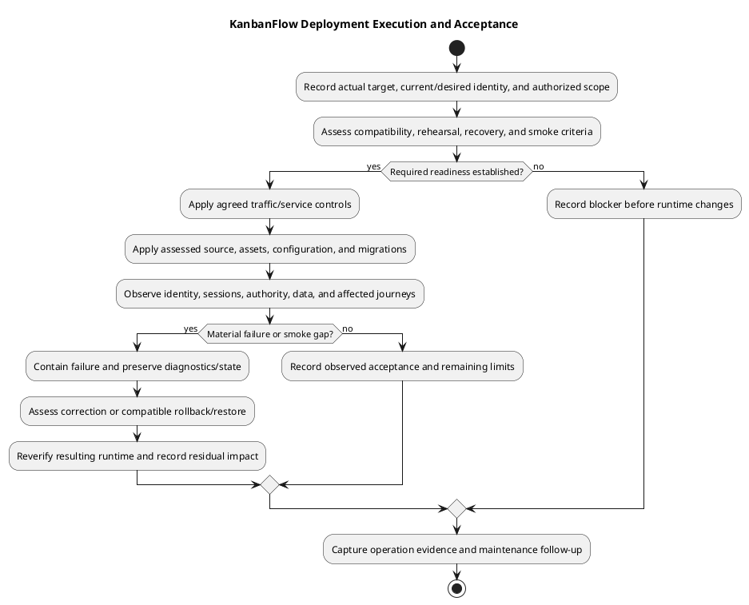

# KanbanFlow Deployment Guide

## Scope and entry conditions

Identify the actual target, current running commit/assets, desired candidate, operator, authorized scope, and maintenance/traffic plan. Review the exact diff and release notes, runtime/dependency requirements, database compatibility, host/session configuration, and recovery evidence before changing the runtime.

The repository's CI runs tests and frontend lint/build; it does not automatically deploy the application. No hosting provider, production domain, service manager, or rollout topology is established by this guide.

## Pre-deployment checklist

- Confirm candidate SHA/tag and affected acceptance evidence; retain known issues and unverified boundaries.
- Match backend dependencies and frontend assets to the candidate's lockfiles and runtime requirements.
- Identify assessed migrations and old/new schema compatibility; do not assume migration reversal is safe.
- Preserve existing environment secrets and application key through a secure procedure.
- Verify backup availability and restore evidence appropriate to the operation's data risk.
- Establish traffic, service, worker, and cache procedures for the actual target.

## Execution controls

Use an isolated staging target to exercise the planned procedure first when appropriate. Apply only the reviewed source, assets, configuration, and migrations. Avoid destructive database reset commands and routine application-key regeneration on existing installations. Record each operational result and stop on a material failure rather than proceeding blindly.

Expose only the backend public entry point through the actual server configuration; keep environment files, private storage, and repository internals outside public access. Configure SPA route fallback for frontend navigation without turning API errors into HTML responses. Provider-specific commands must be selected and verified for the target rather than invented here.

## Operation record before rollout

| Field | Actual value required |
| --- | --- |
| Target and scope | Intended installation, affected services/data, operator, and authorization. |
| Current/desired identity | Full source SHA/tag, frontend artifact identity, dependency baseline, database/schema state. |
| Configuration | Non-secret host/origin/session/runtime assumptions and protected key/secret references. |
| Change effects | API/UI contracts, dependencies, migrations, existing-record compatibility, and known issues. |
| Controls | Traffic/maintenance approach, service/cache actions, failure criteria, and relevant side effects. |
| Recovery | Protected recovery point, compatible prior runtime/data combination, and actual restore evidence. |
| Verification | Agreed smoke/acceptance cases, environment, fixtures, and evidence capture. |

Use [deployment architecture](deployment-architecture.md) and [environment review](environment-and-configuration.md). Do not infer the target from a local path or an open browser, or invent production domain, operators, approvals, and maintenance windows.

## Rehearsal and compatibility

Exercise the planned procedure on an isolated representative target where appropriate. Assess PHP/extensions, lockfile installations, build-time API configuration, actual database engine/schema, sessions/CSRF/origins, writable storage, and relevant services. Keep outbound messages and queued work controlled during rehearsal.

Confirm existing records remain usable and the intended assets/API are compatible throughout the assessed rollout. If old/new source must overlap, examine changed contracts and schema assumptions explicitly; no zero-downtime or multi-instance rollout is established by this guide.

SQLite test success is not MySQL contention evidence, and a frontend build is not real browser acceptance. Link observed candidate-specific results using [verification layers](../06-testing/verification-layers.md).

## Execution checkpoints

1. Reconfirm target, authorization, current/desired identity, readiness evidence, and recovery access immediately before the operation.
2. Apply the agreed traffic/service controls and preserve relevant starting-state evidence.
3. Prepare the assessed source/dependency/assets combination using the actual target procedure.
4. Apply only reviewed configuration and migrations with their compatibility consequences understood.
5. Refresh affected configuration caches and reload/restart relevant services through established target controls.
6. Verify runtime identity, database-backed behavior, browser sessions, authority, and changed journeys.
7. Record acceptance or contain failure; reopen/resume through the assessed operational decision.

Record each material step/result. No provider command, automatic worker restart, scheduler, asset cache invalidation, or migration strategy is assumed for an unspecified target. Source publication is a separate action from these runtime steps.

## Post-deployment smoke matrix

| ID | Check | Required observation |
| --- | --- | --- |
| DEP-001 | Running identity and routing | Intended backend source/frontend assets, API responses, deep links, and actual service paths. |
| DEP-002 | Database-dependent readiness | Existing permitted records read successfully; health response alone is insufficient. |
| DEP-003 | SPA session | Real sign-in/sign-out/protected requests with actual cookies/CSRF/origins and relevant existing-session behavior. |
| DEP-004 | Authority/privacy | Allowed and denied actors, current membership, private content, ancestry, and affected related views. |
| DEP-005 | Data mutation | Accepted changes persist after refresh; rejected/invalid operations leave intended state unchanged. |
| DEP-006 | Workflow integrity | Affected movement/ordering/WIP and stale/failure paths; engine-specific checks when warranted. |
| DEP-007 | UI/collaboration | Affected navigation/themes/focus, comments, notifications, activity, and relevant analytics. |
| DEP-008 | Operational signals | Actual logs/services/storage/queued work where used, without unintended replay or private-data exposure. |

Select affected scenarios through [manual acceptance](../06-testing/manual-acceptance-checklist.md) and [security matrix](../06-testing/security-regression-matrix.md). Record Pass, Fail, Blocked, Not run, or justified Not applicable; the matrix itself contains no completed results.

## Failure containment and recovery decision

Stop when a material apply step fails, required evidence disappears, or smoke results reveal confidentiality/integrity problems. Preserve safe diagnostics and current state. Avoid repeated writes, destructive resets, key regeneration, or unassessed migration reversal as recovery shortcuts.

Choose scoped forward correction or compatible rollback/restore from the actual cause, data/schema state, runtime/configuration, and security consequences. Older source can reintroduce known defects. Code rollback does not recover deleted data; restore may discard writes after the selected point.

Use [backup runbook](backup-and-recovery-runbook.md) and [upgrade and rollback](../../Releases/upgrade-and-rollback.md). Reverify the corrected/recovered runtime and record residual impact before acceptance; a completed command is not a successful recovery.

## Closeout and follow-up

Capture actual target/source/assets, operator/timestamps, steps, smoke evidence, failures, recovery choices, residual issues/data loss, and acceptance or pending state. Keep publication, tag, runtime rollout, and recovery identities separate. Do not report unobserved CI, performance, security/accessibility certification, or zero data loss.

DEC-003 remains an open application policy/enforcement issue; deploying documentation does not resolve it. Link outstanding work to [maintenance](../08-maintenance/README.md) and retain candidate-specific evidence in the [release verification record](../../Releases/verification-template.md). This guide performs no runtime deployment, migration, or restoration.

## Completion evidence

Verify running identity, API reachability, database-dependent behavior, real sign-in/sign-out, relevant permissions/private resources, existing data, accepted/rejected task movements, and affected UI journeys. Observe relevant logs and configured background services. The health endpoint's successful response alone does not prove database readiness or the whole application.

Record exact target/candidate, timestamps, observed checks, failures, and residual issues in a [verification record](../../Releases/verification-template.md). If checks fail, use the assessed recovery procedure; a code rollback is not a data restore. Follow [release and upgrade runbook](release-and-upgrade-runbook.md).

## PlantUML diagram

[Editable PlantUML source](diagrams/deployment.puml)

