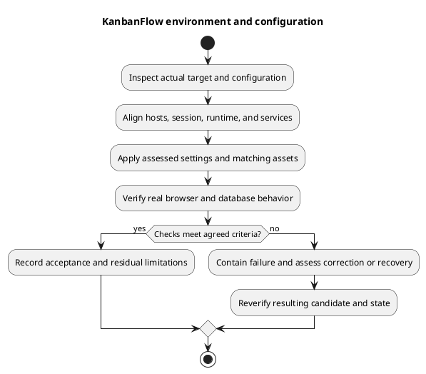

# KanbanFlow Environment and Configuration

## Evidence and handling

Use [backend environment example](../../../backend/.env.example), [CORS configuration](../../../backend/config/cors.php), the intended dependency lockfiles, and the actual target settings. Example defaults describe local development, not production readiness. Keep secrets out of commits, screenshots, logs, and verification records.

## Configuration review matrix

| Area | Review before deployment |
| --- | --- |
| Identity | `APP_NAME`, `APP_ENV`, `APP_DEBUG`, actual source/assets. Use KanbanFlow naming; disable inappropriate debug exposure on a public target. |
| URLs | `APP_URL`, `FRONTEND_URL`, and build-time `VITE_API_URL`; align hosts, schemes, ports, and routing. |
| SPA session | `SANCTUM_STATEFUL_DOMAINS`, CORS allowed origins/credentials, actual session domain/path/security settings. Test real browser cookies. |
| Database | Connection, runtime driver/extensions, version, access privileges, migrations and existing data compatibility. |
| Secret/key | Preserve the established application key securely; key rotation requires a separate compatibility/recovery assessment. |
| Sessions/cache/queues | Actual selected drivers, required tables/services, writable paths and service controls. |
| Filesystems | Actual disk/root, private access, permissions, any external credentials and recovery coverage. |
| Logs/mail | Destination, access/retention, safe error reporting, and actual configured delivery behavior. |

## Local baseline versus target

The local example uses API `http://localhost:8000`, frontend `http://localhost:5173`, MySQL database `kanbanflow`, and stateful domains including both local ports. Do not copy its blank database password or debug settings into a public environment. Avoid mixing `localhost` and `127.0.0.1` unintentionally when checking cookies and origins.

The current CORS configuration reads a frontend origin and supports credentials. Review the actual deployment's origin requirements rather than assuming arbitrary origins work or widening the allowlist to fix a session symptom.

## Apply and verify

Change only assessed settings, rebuild frontend assets when build-time configuration changes, and refresh Laravel configuration caches through the target's established procedure. Restart/reload relevant services when necessary. A cache-clear command does not substitute for browser and API verification.

Record non-secret configuration assumptions and actual smoke outcomes. Diagnose transport, cookie, CSRF, and API failures separately from invalid credentials. See [authentication design](../04-design/authentication-and-authorization.md) and [release runbook](release-and-upgrade-runbook.md).

## PlantUML diagram

[Editable PlantUML source](diagrams/environment-and-configuration.puml)

