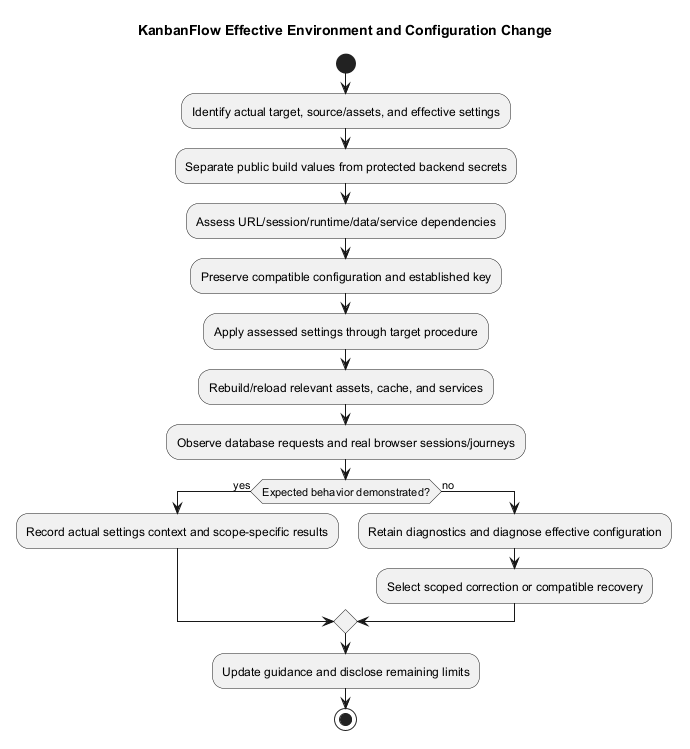
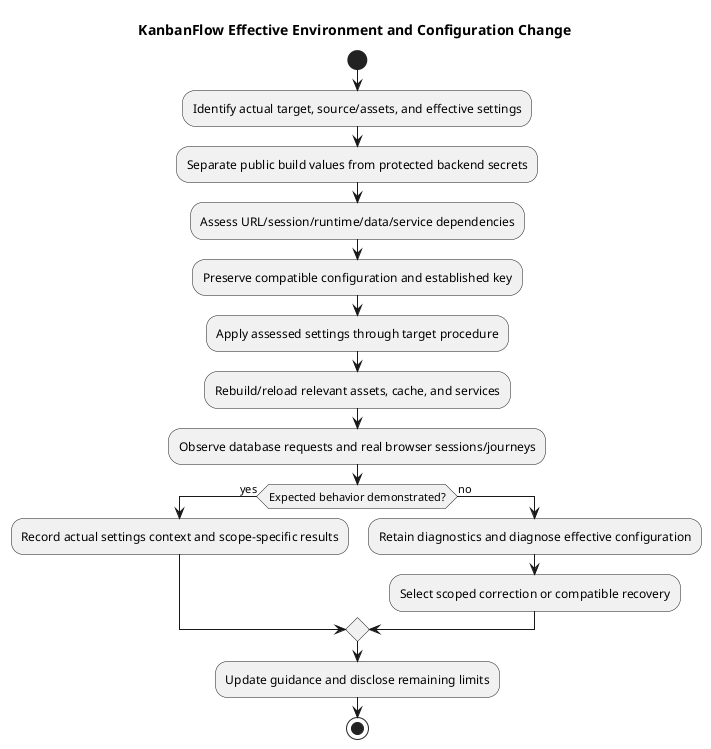

# KanbanFlow Environment and Configuration

## Evidence and handling

Use [backend environment example](../../../backend/.env.example), [CORS configuration](../../../backend/config/cors.php), the intended dependency lockfiles, and the actual target settings. Example defaults describe local development, not production readiness. Keep secrets out of commits, screenshots, logs, and verification records.

## Configuration review matrix

| Area | Review before deployment |
| --- | --- |
| Identity | `APP_NAME`, `APP_ENV`, `APP_DEBUG`, actual source/assets. Use KanbanFlow naming; disable inappropriate debug exposure on a public target. |
| URLs | `APP_URL`, `FRONTEND_URL`, and build-time `VITE_API_URL`; align hosts, schemes, ports, and routing. |
| SPA session | `SANCTUM_STATEFUL_DOMAINS`, CORS allowed origins/credentials, actual session domain/path/security settings. Test real browser cookies. |
| Database | Connection, runtime driver/extensions, version, access privileges, migrations and existing data compatibility. |
| Secret/key | Preserve the established application key securely; key rotation requires a separate compatibility/recovery assessment. |
| Sessions/cache/queues | Actual selected drivers, required tables/services, writable paths and service controls. |
| Filesystems | Actual disk/root, private access, permissions, any external credentials and recovery coverage. |
| Logs/mail | Destination, access/retention, safe error reporting, and actual configured delivery behavior. |

## Local baseline versus target

The local example uses API `http://localhost:8000`, frontend `http://localhost:5173`, MySQL database `kanbanflow`, and stateful domains including both local ports. Do not copy its blank database password or debug settings into a public environment. Avoid mixing `localhost` and `127.0.0.1` unintentionally when checking cookies and origins.

The current CORS configuration reads a frontend origin and supports credentials. Review the actual deployment's origin requirements rather than assuming arbitrary origins work or widening the allowlist to fix a session symptom.

## Effective configuration and ownership

Identify the actual target, running source/assets, environment file or secret provider, cached configuration, runtime executables, database, and service controls. Record the authorized change scope and operator when known. Example files and edited values are not proof that the running process uses those values.

Keep public build configuration separate from backend secrets. Vite client configuration can be included in browser-delivered assets; never place database passwords, application keys, private API credentials, or session secrets in frontend environment variables. Protect backend environment files and backup references outside public routes and source publication.

## Configuration dependencies

| Change | Dependent review and verification |
| --- | --- |
| Frontend/API host or port | Build-time API URL, actual routing, CORS origin/credentials, stateful domains, cookies/CSRF, and real sessions. |
| Transport or reverse proxy | Target scheme/proxy assumptions and cookie security; verify browser-visible URLs and session behavior. |
| Database driver/credentials/schema | Runtime extensions, access, required tables, migrations, existing records, and database-backed acceptance. |
| Session/cache/queue driver | Required database tables or external services, effective settings, service behavior, and recovery implications. |
| Filesystem location/driver | Actual paths/permissions, private access, external credentials if used, and protected recovery scope. |
| Application key | Compatibility with protected data/sessions and recovery; do not regenerate during ordinary upgrades. |
| Logging/mail configuration | Actual destination/delivery, restricted diagnostics, retention, and rehearsal side-effect controls. |

Framework options are not active services by themselves. S3 settings do not prove a deployed bucket or attachment feature, and a database queue option does not mean every notification is asynchronously delivered.

## Runtime and package compatibility

Check actual PHP/Node versions, extensions, installed locked dependencies, and target database version. CI configures PHP 8.4 and Node.js 24; that is not proof of the target's runtime. Use [dependency baseline](../05-implementation/dependency-baseline.md) and inspect effective platform/engine requirements rather than assuming XAMPP's bundled executables are sufficient.

Backend PHPUnit overrides use SQLite and test-specific services, while the local example uses MySQL and database-backed sessions/cache/queues. Keep those environments distinct when reporting results or diagnosing a working test suite alongside a failing application.

## Change procedure

1. Record baseline source/assets and relevant non-secret effective settings; securely preserve required secrets/key.
2. Assess the configuration change's affected contracts, services, data, and recovery implications.
3. Apply only intended values through the target's established configuration/secret procedure.
4. Rebuild frontend assets for changed build-time settings; manage relevant backend cache/service reload through actual controls.
5. Verify running identity, effective behavior, database-backed requests, and real browser sessions/affected journeys.
6. Retain failure evidence and choose a scoped correction or compatible recovery if checks fail.

Changing `.env` without refreshing the appropriate running/cached state may not change behavior. Avoid printing complete environment/configuration dumps to shared logs as a diagnostic shortcut. Do not clear or reset unrelated services/data merely to hide a symptom.

## Troubleshooting matrix

| Symptom | Evidence to inspect |
| --- | --- |
| Client cannot reach API | Actual build API URL, process/port/host, routing, transport response, and CORS behavior. |
| Login or protected request fails | Response status/body, CSRF cookie/header, browser cookie acceptance, trusted origin, session driver/database, and credential validation. |
| Settings appear ignored | Running checkout/assets, cached backend configuration, frontend rebuild, and relevant process identity. |
| Database-dependent action fails | Actual connection/extensions/privileges, schema/tables, migration state, and safe error diagnostics. |
| Storage or service failure | Actual selected driver/root, writable permissions, service connectivity, and relevant runtime logs. |
| Mail/notification expectation differs | Accepted mutation, stored records, actual delivery/queue configuration, and active services where required. |

Record observations before naming a cause. A healthy endpoint does not prove database/session readiness. Do not widen origins, weaken authority, reset passwords, or regenerate keys without evidence that those are the required correction.

## Verification and record

Capture target/candidate/assets, relevant settings without secrets, actual tool/service context, changed fields, cache/rebuild/service actions, smoke results, and unresolved issues. Use [release verification](../../Releases/verification-template.md) and [deployment guide](deployment.md) to link the operation.

Verify permitted and denied paths, existing data, real login/logout, affected UI state, and relevant side effects after changes. Builds alone do not demonstrate those journeys; SQLite tests do not demonstrate MySQL contention. Use [verification layers](../06-testing/verification-layers.md).

## Recovery and maintenance

Retain compatible prior settings/source/assets and required protected key/configuration recovery. Assess schema/data and security consequences before restoring previous values; configuration rollback alone does not recover data or reverse migrations. Follow [upgrade and rollback](../../Releases/upgrade-and-rollback.md).

Update examples and source-linked guidance when accepted configuration contracts change, while preserving historical release observations. This document performs no secret rotation, service setup, environment change, deployment, or configuration audit on an actual target.

## Apply and verify

Change only assessed settings, rebuild frontend assets when build-time configuration changes, and refresh Laravel configuration caches through the target's established procedure. Restart/reload relevant services when necessary. A cache-clear command does not substitute for browser and API verification.

Record non-secret configuration assumptions and actual smoke outcomes. Diagnose transport, cookie, CSRF, and API failures separately from invalid credentials. See [authentication design](../04-design/authentication-and-authorization.md) and [release runbook](release-and-upgrade-runbook.md).

## PlantUML diagram

[Editable PlantUML source](diagrams/environment-and-configuration.puml)

