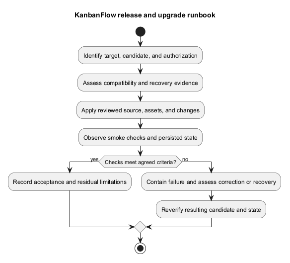
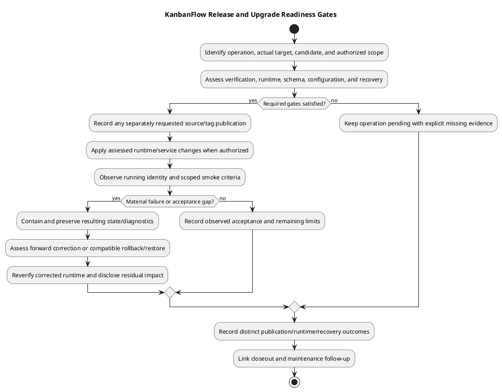

# KanbanFlow Release and Upgrade Runbook

> **Policy amendment (2026-10-10):** Membership mutations are now owner-only; DEC-003/PB-001's bypass is fixed. Earlier open-policy text and diagrams below describe the preceding state. See [QA corrections](../06-testing/qa-corrections-2026-10-10.md) for the selected rule and regression evidence.

## Runbook status

This is a preparation and execution framework. Fill in the actual target, operators, commands/service controls, timings, and evidence before use. No production operation, deployment authorization, or recovery success is inferred from this document.

## Prepare the operation

1. Record current running SHA/tag/assets and intended candidate; review exact release notes/diff.
2. Identify authorized target and change scope, maintenance/traffic approach, and failure decision criteria.
3. Review runtime/lockfiles, request contracts, migration/data compatibility, and configuration.
4. Verify recoverable data/configuration and a compatible known-good source/assets combination.
5. Rehearse the candidate and affected smoke checks in an isolated representative environment.

Use [release checklist](../../Releases/release-checklist.md), [versioning strategy](../../Project-Management/versioning-strategy.md), and [dependency baseline](../05-implementation/dependency-baseline.md). A documentation push alone neither creates a release tag nor updates the runtime.

## Apply the assessed candidate

Publish source/assets through the target's controlled procedure, install intended locked dependencies as needed, apply only reviewed configuration/migrations, and manage relevant services/caches. Preserve application key and local secrets. Do not use destructive reset commands or assume every migration has a safe reverse operation.

Record results at each step. If a material step fails, contain the operation and assess the current state before retrying. Match frontend assets and API source; a successful build in a different checkout is insufficient identity evidence.

## Verify and decide

Observe services, actual database-backed requests, sign-in/sign-out/session behavior, denied/private paths, existing records, relevant task ordering/WIP, and affected UI/collaboration behavior. Capture logs without secrets. Use the [manual checklist](../06-testing/manual-acceptance-checklist.md) for scoped journeys.

If checks meet the operation criteria, record acceptance and residual issues. Otherwise choose a scoped forward correction or compatible rollback using current source/schema/data/security evidence. Older permission behavior can reintroduce known defects; older is not automatically safer.

## Recovery and closeout

Use [upgrade and rollback](../../Releases/upgrade-and-rollback.md) and [backup runbook](backup-and-recovery-runbook.md). Source rollback does not restore data, and database restore can discard writes since the recovery point. Reverify the recovered runtime before accepting it.

Record candidate/target identity, actual steps/results, backup references, recovery decisions, and follow-up in a [verification record](../../Releases/verification-template.md). Keep publication, runtime deployment, and recovery evidence distinct.

## Operation identity and event boundaries

Record whether the requested operation is source publication, release/tag publication, runtime upgrade, or recovery. Each has its own result: a remote commit is not a deployed application, a tag is not post-rollout acceptance, and a code rollback is not a data restore.

| Field | Record before an actual operation |
| --- | --- |
| Scope/target | Actual installation, authorized actions, operators, and affected data/services. |
| Current/target identity | Full SHA/tag, matching frontend artifacts, lockfiles/runtime, and schema/configuration. |
| Release content | Exact included changes, known issues, verification, compatibility, and upgrade/recovery implications. |
| Procedure | Actual service/traffic/cache/migration controls and target-specific commands. |
| Recovery | Usable recovery point, protected key/configuration, compatible prior runtime, and restore evidence. |
| Acceptance | Planned smoke criteria, isolated fixtures, evidence capture, and failure decisions. |

Keep secrets and dumps outside shared records. Do not invent an approver, maintenance window, host, published version, or successful rehearsal.

## Readiness gates

| Gate | Required assessment | If unresolved |
| --- | --- | --- |
| Candidate | Exact diff/release scope and candidate-specific verification. | Keep readiness pending; historical results do not transfer automatically. |
| Runtime/dependencies | Actual PHP/extensions/Node and locked installation/build compatibility. | Diagnose mismatch; do not bypass platform requirements. |
| Data/schema | Existing-record compatibility, reviewed migrations, and old/new runtime assumptions. | Resolve before applying data-affecting changes. |
| Configuration/assets | Hosts/origins/session settings, key preservation, build-time API URL, and matching artifacts. | Correct assessed configuration and reverify relevant journeys. |
| Recovery | Protected consistent backup/configuration and viable rollback/restore evidence. | Record missing evidence before risking the affected state. |
| Authorization/control | Actual target/scope, traffic/services, and operator actions. | Do not infer runtime authorization from documentation/source publication. |

Use [environment guide](environment-and-configuration.md), [deployment architecture](deployment-architecture.md), and [testing layers](../06-testing/verification-layers.md). CI configures tests/lint/build but does not deploy; an actual candidate run must be inspected before claiming CI success.

## Publication and versioning

When release publication is requested, select the version using the accepted change and [versioning strategy](../../Project-Management/versioning-strategy.md), prepare accurate release notes, and verify the intended tag/source identity. Do not create a patch tag for every documentation expansion or rewrite historical release claims to describe later main commits.

Follow [change delivery](../05-implementation/change-delivery.md) for review, staged scope, commit, push, and fetched remote identity checks. Record publication separately from a later runtime operation; package metadata alone does not identify what a target runs.

## Upgrade checkpoint sequence

1. Reconfirm actual target, current/desired identities, authorized scope, readiness evidence, and recovery access.
2. Apply agreed traffic/service controls and preserve relevant starting-state diagnostics.
3. Prepare the intended source, locked dependencies, frontend build, and assessed configuration.
4. Apply only reviewed migrations/changes with compatibility and failure handling understood.
5. Refresh affected cache/service state through actual target controls; reconcile relevant background work.
6. Observe runtime identity and scoped smoke criteria with actual responses and persisted state.
7. Record acceptance or contain failure and choose the assessed corrective/recovery path.

No provider-specific rollout, zero-downtime topology, automatic migration reversal, or worker restart is assumed. Do not regenerate the established application key or run destructive reset/setup scripts as an upgrade shortcut.

## Smoke and acceptance record

Use the identified DEP scenarios in [deployment guide](deployment.md) and relevant [manual cases](../06-testing/manual-acceptance-checklist.md). Inspect real browser sessions, allowed/denied/private paths, existing data, accepted/rejected mutations, task ordering/WIP, changed UI, and relevant collaboration/services.

Record criterion-specific Pass, Fail, Blocked, Not run, or justified Not applicable. A healthy endpoint does not prove database readiness, and SQLite tests do not prove deployed MySQL contention. Keep DEC-003 and other known defects visible; source or infrastructure publication does not resolve an application policy issue.

## Failure decision table

| Observation | Required handling |
| --- | --- |
| Apply step fails | Contain, preserve diagnostics, identify resulting source/schema/service state, and assess before retry. |
| Smoke exposes data/authority defect | Retain impact/state evidence and select scoped correction or compatible recovery. |
| Assets/API/configuration mismatch | Identify actual running units and correct the assessed combination; do not report build success as runtime acceptance. |
| Older code incompatible with current schema/data | Do not blindly roll back source; assess a safe forward correction or explicit restore procedure. |
| Restore would discard newer writes | Record loss/reconciliation implications and required operational decision before overwrite. |
| Required evidence unavailable | Keep operation/readiness pending and state the blocker. |

Use [backup and recovery](backup-and-recovery-runbook.md) and [upgrade/rollback guidance](../../Releases/upgrade-and-rollback.md). Preserve the original failed operation and distinguish corrected/recovered candidate observations. Reverify resulting runtime before accepting it.

## Copyable closeout record

````markdown
# Release / upgrade outcome — <actual candidate and target>

- Operation type, authorized scope, operator, timestamps/timezone: <actual>
- Starting and intended source/assets/schema/configuration: <identities without secrets>
- Published commit/tag/release references: <actual or not performed>
- Runtime steps, service controls, and outcomes: <actual or not performed>
- Backup/recovery point and compatibility evidence: <protected references>
- Smoke results and evidence by criterion: <actual states>
- Failures, corrective/recovery identity, and rechecks: <actual or none observed>
- Residual issues/loss and acceptance decision: <actual or pending>
- Follow-up and recorded responsibility: <known actions/owners only>
````

Link [release verification](../../Releases/verification-template.md) for detailed checks and [maintenance](../08-maintenance/README.md) for follow-up. This runbook performs no tag creation, release publication, deployment, migration, rollback, or restoration by its existence.

## PlantUML diagram



[Editable PlantUML source](diagrams/release-and-upgrade-runbook.puml)


