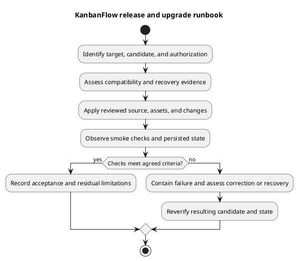

# KanbanFlow Release and Upgrade Runbook

## Runbook status

This is a preparation and execution framework. Fill in the actual target, operators, commands/service controls, timings, and evidence before use. No production operation, deployment authorization, or recovery success is inferred from this document.

## Prepare the operation

1. Record current running SHA/tag/assets and intended candidate; review exact release notes/diff.
2. Identify authorized target and change scope, maintenance/traffic approach, and failure decision criteria.
3. Review runtime/lockfiles, request contracts, migration/data compatibility, and configuration.
4. Verify recoverable data/configuration and a compatible known-good source/assets combination.
5. Rehearse the candidate and affected smoke checks in an isolated representative environment.

Use [release checklist](../../Releases/release-checklist.md), [versioning strategy](../../Project-Management/versioning-strategy.md), and [dependency baseline](../05-implementation/dependency-baseline.md). A documentation push alone neither creates a release tag nor updates the runtime.

## Apply the assessed candidate

Publish source/assets through the target's controlled procedure, install intended locked dependencies as needed, apply only reviewed configuration/migrations, and manage relevant services/caches. Preserve application key and local secrets. Do not use destructive reset commands or assume every migration has a safe reverse operation.

Record results at each step. If a material step fails, contain the operation and assess the current state before retrying. Match frontend assets and API source; a successful build in a different checkout is insufficient identity evidence.

## Verify and decide

Observe services, actual database-backed requests, sign-in/sign-out/session behavior, denied/private paths, existing records, relevant task ordering/WIP, and affected UI/collaboration behavior. Capture logs without secrets. Use the [manual checklist](../06-testing/manual-acceptance-checklist.md) for scoped journeys.

If checks meet the operation criteria, record acceptance and residual issues. Otherwise choose a scoped forward correction or compatible rollback using current source/schema/data/security evidence. Older permission behavior can reintroduce known defects; older is not automatically safer.

## Recovery and closeout

Use [upgrade and rollback](../../Releases/upgrade-and-rollback.md) and [backup runbook](backup-and-recovery-runbook.md). Source rollback does not restore data, and database restore can discard writes since the recovery point. Reverify the recovered runtime before accepting it.

Record candidate/target identity, actual steps/results, backup references, recovery decisions, and follow-up in a [verification record](../../Releases/verification-template.md). Keep publication, runtime deployment, and recovery evidence distinct.

## PlantUML diagram

[Editable PlantUML source](diagrams/release-and-upgrade-runbook.puml)

