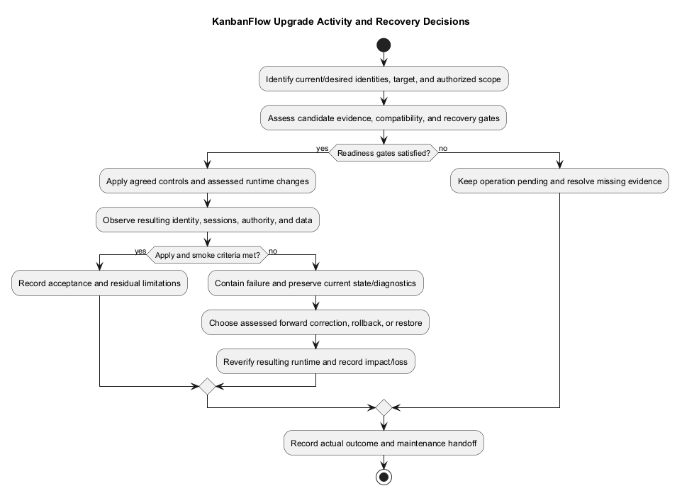
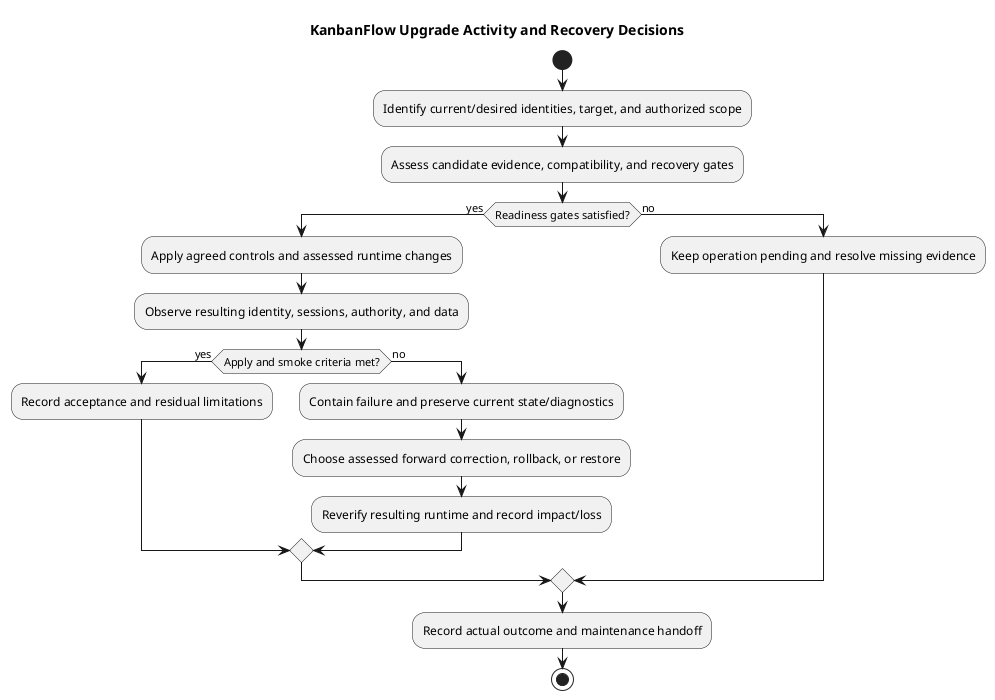

# KanbanFlow Upgrade Activity

## Purpose

The activity below describes an upgrade decision process. It is not a record of an upgrade performed. Use the [release and upgrade runbook](release-and-upgrade-runbook.md) to supply target-specific controls and commands.

## Decision checkpoints

| Checkpoint | Required observation or decision |
| --- | --- |
| Candidate | Exact current/target identities and assessed diff/release effects. |
| Compatibility | Source/assets/runtime/schema and configuration agree; migration consequences understood. |
| Recovery | Appropriate backups, restore evidence, and known-good compatible combination identified. |
| Authorization | Actual target and operational scope authorized. Documentation/source publication does not supply this. |
| Application | Results of assessed changes and service/cache actions captured. |
| Smoke | Actual authentication, authority, existing data, and changed journeys verified. |
| Outcome | Accept with stated limits, correct forward, or use a compatible recovery path. |

## Failure behavior

Pause the rollout on a material failure, preserve useful diagnostics and current state, and assess side effects before repeating mutations. Do not automatically reverse migrations or discard data to restore a green health response. Recovered or corrected candidates require new scoped verification.

## Evidence

Record timestamps, operator, target, source/assets identity, non-secret environment assumptions, step outcomes, and unresolved issues. Link [release verification](../../Releases/verification-template.md) and [upgrade/rollback guidance](../../Releases/upgrade-and-rollback.md); the diagram alone does not prove readiness.

## Activity inputs and boundaries

Identify the current running source/assets, intended candidate, actual target, authorized scope, assessed release effects, and candidate-specific verification. Record effective runtime/schema/configuration, relevant service/traffic controls, protected recovery point, and agreed smoke criteria. Do not infer runtime identity from package version metadata or source synchronization.

Source publication, tag/release publication, runtime upgrade, and recovery are separate events. This activity describes runtime decision checkpoints; optional publication steps need their own actual identities and outcomes. No production host, operator, maintenance window, approval, or performed upgrade is invented here.

## Gate behavior

| Gate | Pass basis | Unresolved/failure path |
| --- | --- | --- |
| Scope and identity | Actual target, current/desired SHA/assets, operator and authorized changes. | Resolve ambiguity before modifying runtime or data. |
| Candidate evidence | Required acceptance results and disclosed known issues for the intended candidate. | Keep readiness pending and obtain missing verification. |
| Compatibility | Runtime/lockfiles, source/assets/API, existing records, migrations and configuration assessed together. | Diagnose mismatch or change the plan; do not bypass requirements. |
| Recovery readiness | Protected usable backup/key/configuration, compatible recovery combination, and appropriate restore evidence. | Resolve recovery gap before the affected operation. |
| Apply steps | Actual assessed source/configuration/migration/service results. | Contain and inspect the resulting state before retry. |
| Smoke acceptance | Actual sessions, authority, existing data, changed journeys, and relevant services verified. | Preserve failure and choose scoped correction or compatible recovery. |

The gates are evidence checkpoints rather than automatically assigned approvals. Use [environment guidance](environment-and-configuration.md) and [backup runbook](backup-and-recovery-runbook.md) for the actual target details.

## Execution stages

1. Reconfirm readiness and recovery access immediately before applying the operation.
2. Establish agreed traffic/service controls and preserve relevant starting-state diagnostics.
3. Prepare the assessed source, locked dependencies, and matching frontend artifacts.
4. Apply only reviewed configuration/migrations and target-specific cache/service actions.
5. Observe running identity, database-backed behavior, real browser sessions, denied/private paths, and affected persistence/UI.
6. Record acceptance or follow the contained failure path; reverify any corrected/recovered runtime.
7. Close out the actual outcome, residual issues/loss, and maintenance follow-up.

No universal migration reversal, zero-downtime topology, worker restart command, or deployment provider is assumed. Avoid destructive resets and routine regeneration of the established application key.

## Verification and observed state

Use DEP scenario IDs in [deployment guide](deployment.md) and affected [manual acceptance cases](../06-testing/manual-acceptance-checklist.md). Check the response, visible behavior, and authoritative persisted state; a successful build or health response does not establish complete readiness.

Record database/browser/runtime context and criterion-specific Pass, Fail, Blocked, Not run, or justified Not applicable. SQLite regression results do not prove MySQL contention. CI configuration is not an observed passing run and does not deploy the application. DEC-003 remains open rather than being repaired by an infrastructure upgrade.

## Correction and recovery choices

| Option | Assessment required |
| --- | --- |
| Scoped forward correction | Actual cause, affected contracts/data, corrected candidate, and meaningful recheck. |
| Source/assets rollback | Compatible dependencies/configuration/current schema and security consequences. |
| Data restoration | Selected recovery point, overwrite authorization, lost writes, compatible source/schema/key/files, and restore verification. |
| Further investigation | Preserved diagnostics/state and explicit unresolved evidence before more mutations. |

Older source can reintroduce known defects. Code rollback does not restore deleted data or reverse migrations automatically, and restoring data can discard newer writes. Follow [upgrade and rollback](../../Releases/upgrade-and-rollback.md) and [recovery activity](backup-recovery-activity.md).

Keep original failure and corrected/recovered observations separate. Do not repeatedly reapply a failed operation without inspecting current state or report recovery success from a completed command alone.

## Closeout evidence

| Field | Record |
| --- | --- |
| Identity/scope | Actual target, starting/intended/resulting source/assets, operator, authorization and timestamps/timezone. |
| Readiness | Compatibility, candidate checks, recovery evidence, and remaining pre-operation gaps. |
| Execution | Material step results, traffic/services/configuration/migrations, and any failed apply state. |
| Acceptance | Actual smoke observations, persisted effects, limitations, and acceptance or pending decision. |
| Recovery | Selected option, resulting identity, actual restore/rollback/recheck outcome, and residual loss. |
| Follow-up | Linked defects, next action, and recorded responsibility when known. |

Link [release verification](../../Releases/verification-template.md) and [maintenance](../08-maintenance/README.md). Keep secrets and private data outside shared evidence. This document performs no upgrade, release/tag creation, migration, service change, or restoration.

## PlantUML diagram

[Editable PlantUML source](diagrams/upgrade-activity.puml)

