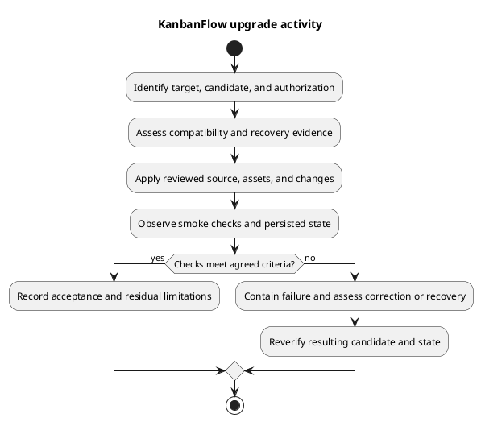

# KanbanFlow Upgrade Activity

## Purpose

The activity below describes an upgrade decision process. It is not a record of an upgrade performed. Use the [release and upgrade runbook](release-and-upgrade-runbook.md) to supply target-specific controls and commands.

## Decision checkpoints

| Checkpoint | Required observation or decision |
| --- | --- |
| Candidate | Exact current/target identities and assessed diff/release effects. |
| Compatibility | Source/assets/runtime/schema and configuration agree; migration consequences understood. |
| Recovery | Appropriate backups, restore evidence, and known-good compatible combination identified. |
| Authorization | Actual target and operational scope authorized. Documentation/source publication does not supply this. |
| Application | Results of assessed changes and service/cache actions captured. |
| Smoke | Actual authentication, authority, existing data, and changed journeys verified. |
| Outcome | Accept with stated limits, correct forward, or use a compatible recovery path. |

## Failure behavior

Pause the rollout on a material failure, preserve useful diagnostics and current state, and assess side effects before repeating mutations. Do not automatically reverse migrations or discard data to restore a green health response. Recovered or corrected candidates require new scoped verification.

## Evidence

Record timestamps, operator, target, source/assets identity, non-secret environment assumptions, step outcomes, and unresolved issues. Link [release verification](../../Releases/verification-template.md) and [upgrade/rollback guidance](../../Releases/upgrade-and-rollback.md); the diagram alone does not prove readiness.

## PlantUML diagram

[Editable PlantUML source](diagrams/upgrade-activity.puml)

