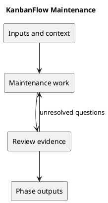

# Maintenance

## Purpose and activities

Collect reproducible defects and user feedback, prioritize risks, and maintain dependencies and documentation. Verify changes before release. Track the manager remove/re-add loophole until the policy is decided and enforcement is tested.

## Completion evidence

A maintained backlog, current known issues, scoped fixes, and release evidence. Historical release claims stay separate from current verification.

## Related guidance

- [Supporting documentation](../../Releases/README.md)
- [SDLC index](../README.md)

## PlantUML workflow

[Editable source](diagrams/workflow.puml)

