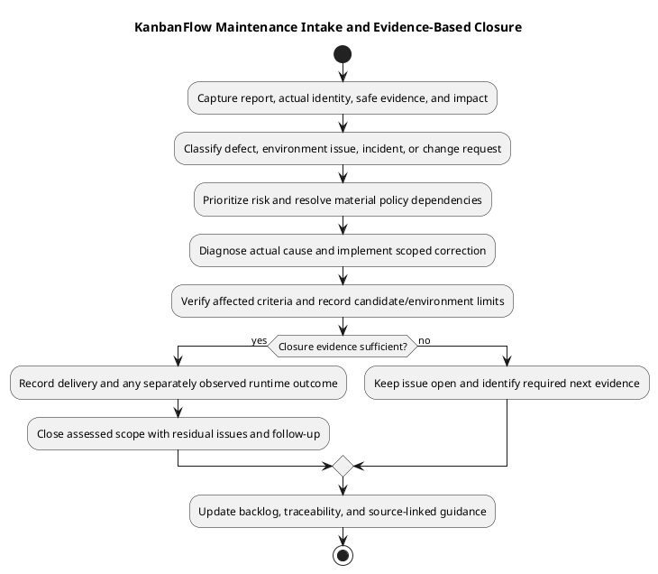

# KanbanFlow Maintenance

## Purpose and status

Maintenance converts observed defects, user feedback, operational signals, and dependency changes into scoped, verified improvements. This catalog defines working procedures; it does not establish an active monitoring service, on-call rota, incident response agreement, or completed production operation.

## Document catalog

| Document | Responsibility |
| --- | --- |
| [Maintenance](maintenance.md) | Intake, prioritization, verification, and closure. |
| [Dependency and change management](dependency-and-change-management.md) | Controlled upgrades, compatibility, and delivery evidence. |
| [Incident triage](incident-triage.md) | Evidence collection, impact assessment, containment, and diagnosis. |
| [Monitoring and incident response](monitoring-and-incident-response.md) | Signals, response workflow, recovery, and follow-up. |

Every document includes PlantUML source and a rendered diagram. Apply the guidance to an identified candidate or operational target, with actual evidence and responsibilities recorded.

## How to use this section

Use [maintenance guidance](maintenance.md) for reproducible reports, prioritization, scoped fixes, and closure. Use [dependency and change management](dependency-and-change-management.md) for package/runtime/schema/configuration changes. Route suspected operational incidents through [triage](incident-triage.md), and use [monitoring and response](monitoring-and-incident-response.md) to define actual signals and follow-up.

The guides describe responsibilities and procedures, not an installed monitoring system or assigned support team. No scheduler, alert channel, response-time objective, maintenance window, or approved production action is created by this catalog.

## Intake and classification

| Report type | Initial evidence and path |
| --- | --- |
| Product defect | Actor, trigger, expected/actual behavior, source/assets, fixture, reproduction, and impact; route to a scoped implementation task. |
| Configuration/runtime problem | Actual target/tools/settings and safe diagnostics; distinguish environment mismatch from product behavior. |
| Confidentiality/integrity incident | Affected access/data, ongoing effects, containment needs, and restricted evidence; use incident triage. |
| Availability/degradation | Affected services/journeys, scope/duration, actual resource/service signals, and recent changes. |
| Dependency/advisory change | Exact lockfile/runtime, dated reason/advisory evidence, compatibility, and affected verification. |
| Documentation/request | Source contract or user need, concrete outcome, affected links/diagrams, and verification scope. |

Collect enough context to diagnose without exposing passwords, session cookies, tokens, environment files, dumps, or private user content. Record hypotheses separately from confirmed observations.

## Priorities and known issues

Prioritize observed confidentiality/integrity failures, ongoing harmful mutations, widespread disruption, and blocked core journeys before cosmetic defects. Record uncertainty, workaround limits, acceptance cases, and dependencies. Use [quality and risk plan](../../Project-Management/quality-and-risk-plan.md) rather than inventing numerical severity, response deadlines, or a service agreement.

DEC-003/PB-001 remains open for manager removal/re-addition role escalation. Direct-role restrictions and documentation completion do not close that path. Agree the policy, implement direct and indirect enforcement, and capture relevant regression acceptance before updating its state. Proposed file/PDF/sharing/password-change designs remain separate from implemented capabilities.

## Responsibilities

| Responsibility | Contribution to record |
| --- | --- |
| Intake/scope | Reproducible report, actual environment, expected result, impact, and exclusions. |
| Policy/priority | Material decisions, agreed acceptance criteria, and unresolved dependencies. |
| Diagnosis/implementation | Confirmed cause, scoped correction, contracts/data effects, and regression coverage. |
| Verification/review | Actual candidate/environment observations, failures, limits, and final-diff assessment. |
| Operations/recovery | Identified target, authorized actions, compatible procedure, and observed outcome. |
| Closeout | Evidence-backed status, residual issues, follow-up, and updated documentation. |

These are responsibilities, not an assigned roster. Record actual owners/operators/reviewers only when known; avoid reconstructed approval dates or commitments.

## Maintenance change cycle

1. Capture and classify the report with safe evidence and current identity.
2. Assess impact/urgency, isolate reproduction, and resolve material policy questions.
3. Trace actual client/API/authority/persistence or operational boundaries and identify cause.
4. Implement a focused correction through [implementation guidance](../05-implementation/implementation.md).
5. Verify affected criteria and shared consumers through [test strategy](../06-testing/test-strategy.md).
6. Review and publish the intended candidate through [change delivery](../05-implementation/change-delivery.md).
7. Perform separately assessed runtime actions only for the authorized target and scope.
8. Record outcome, remaining risks, and follow-up; update backlog/status and source-linked guidance.

Preserve unrelated work and original failure evidence. Substantive corrections, conflict resolutions, dependencies, or configuration changes require relevant checks on the resulting candidate. More unchanged passing runs do not fill a missing browser, database, or operational layer.

## Verification and closure gates

| Gate | Evidence required |
| --- | --- |
| Cause/scope | Reproduction or operational observations support the diagnosis and accepted correction. |
| Behavior/integrity | Affected normal, denied, invalid, stale, or failure cases demonstrate expected outcomes and persisted state. |
| Environment | Relevant browser/MySQL/runtime/service checks supplement narrower static/SQLite evidence. |
| Delivery | Actual commit/publication identity; runtime rollout or recovery outcome only when performed. |
| Closure | Acceptance evidence, residual risks, and required follow-up recorded; unresolved items remain visible. |

CI configuration and historical releases are not fresh passing results. Frontend lint/build do not prove browser usability, SQLite does not prove MySQL contention, and a source push does not prove users run a fix. Use [verification records](../06-testing/verification-record-template.md).

## Operational handoff and recovery

For runtime/configuration/schema changes follow [deployment guidance](../07-deployment/README.md), [release/upgrade runbook](../07-deployment/release-and-upgrade-runbook.md), and [backup/recovery](../07-deployment/backup-and-recovery-runbook.md). Preserve diagnostics and assess current state before repeated actions. Code rollback does not recover data or automatically reverse migrations.

Record actual target/source/assets, authorized operation, step results, smoke evidence, residual impact/loss, and acceptance or further action. A cleared error log or successful health response alone does not close an incident.

## Continuous improvement and evidence limits

Track recurring defects, missed regression cases, unclear guidance, and recovery lessons as explicit backlog actions. Reassess dependency/platform changes, monitoring signals, and runbooks when actual behavior/environment changes. Use agreed schedules when established; this documentation introduces none.

Preserve historical records and link new candidate-specific evidence through [traceability](../../Project-Management/traceability.md). No new application suite, security/accessibility audit, runtime incident response, measured availability, or backup restoration is claimed by this index.

## Inputs and outcomes

Inputs include reproducible reports, actual target/candidate identity, safe diagnostics, known issues, and agreed acceptance criteria. Outcomes include a maintained backlog, scoped fixes with verification, documented operational decisions, updated guidance, and visible residual risks.

Keep the manager remove/re-add issue open until policy is decided and enforcement is verified. Source publication alone does not close an operational incident or prove deployment.

See [quality and risk plan](../../Project-Management/quality-and-risk-plan.md), [testing](../06-testing/README.md), [deployment](../07-deployment/README.md), [releases](../../Releases/README.md), and [SDLC index](../README.md).

## PlantUML diagram

[Editable PlantUML source](diagrams/workflow.puml)

