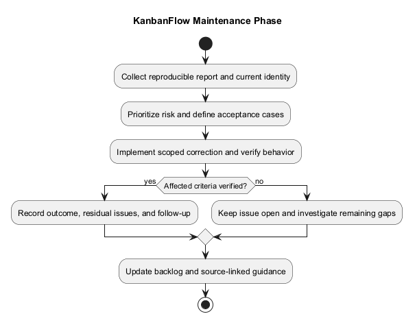
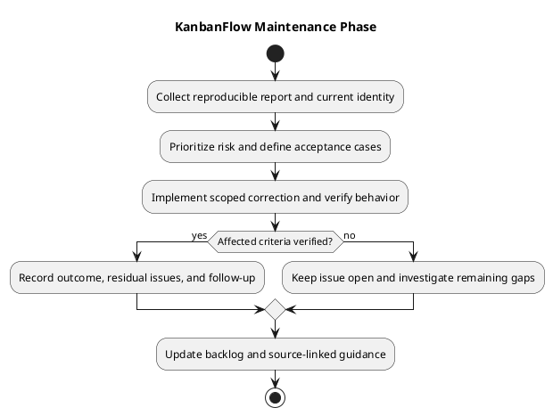

# KanbanFlow Maintenance

## Purpose and status

Maintenance converts observed defects, user feedback, operational signals, and dependency changes into scoped, verified improvements. This catalog defines working procedures; it does not establish an active monitoring service, on-call rota, incident response agreement, or completed production operation.

## Document catalog

| Document | Responsibility |
| --- | --- |
| [Maintenance](maintenance.md) | Intake, prioritization, verification, and closure. |
| [Dependency and change management](dependency-and-change-management.md) | Controlled upgrades, compatibility, and delivery evidence. |
| [Incident triage](incident-triage.md) | Evidence collection, impact assessment, containment, and diagnosis. |
| [Monitoring and incident response](monitoring-and-incident-response.md) | Signals, response workflow, recovery, and follow-up. |

The screenshot abbreviates two filenames; this catalog uses their full descriptive names. Every document includes PlantUML source and a rendered diagram.

## Inputs and outcomes

Inputs include reproducible reports, actual target/candidate identity, safe diagnostics, known issues, and agreed acceptance criteria. Outcomes include a maintained backlog, scoped fixes with verification, documented operational decisions, updated guidance, and visible residual risks.

Keep the manager remove/re-add issue open until policy is decided and enforcement is verified. Source publication alone does not close an operational incident or prove deployment.

See [quality and risk plan](../../Project-Management/quality-and-risk-plan.md), [testing](../06-testing/README.md), [deployment](../07-deployment/README.md), [releases](../../Releases/README.md), and [SDLC index](../README.md).

## PlantUML diagram

[Editable PlantUML source](diagrams/workflow.puml)

