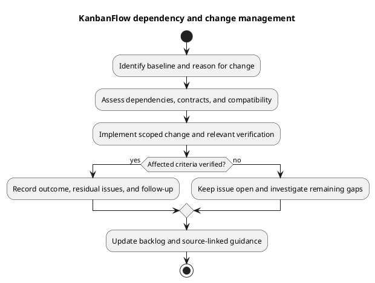

# KanbanFlow Dependency and Change Management

## Baseline and scope

Use committed manifests and lockfiles as the dependency baseline. [Dependency guidance](../05-implementation/dependency-baseline.md) records declared tooling; it does not certify latest releases or vulnerability status. Dependency, configuration, schema, and behavior changes need an explicit reason and affected-scope assessment.

## Change record

| Field | Record |
| --- | --- |
| Motivation | Observed defect, compatibility requirement, feature need, or dated advisory. |
| Candidate | Baseline and intended source/lockfile identities. |
| Impact | Direct/transitive packages, runtime/extensions, API contracts, UI consumers, data/schema. |
| Verification | Installation, relevant suites/static/build checks, browser or database-specific cases. |
| Recovery | Compatible prior source/assets/dependencies and actual data/configuration recovery needs. |
| Delivery | Actual commit/release/deployment evidence and unresolved issues. |

## Dependency updates

Distinguish reproducible install (`composer install`, `npm ci`) from deliberate version resolution changes. Review both manifests and lockfiles, runtime requirements, lifecycle scripts/plugins, and migration or API effects. Keep upgrades scoped rather than bundling unrelated packages solely to reach newer version numbers.

For an advisory assessment record date, exact affected versions, exploitability/context, remedy, and verified corrected candidate. A build pass is not a security audit. Do not claim all dependencies are current or safe without actual evidence.

## Application and schema changes

Assess compatibility with existing records, consumers, deployment configuration, and the known-good recovery combination. Avoid automatic migration reversal or application-key regeneration as maintenance shortcuts. Review permission changes against both direct and indirect paths, including DEC-003.

## Verification and delivery

Run proportional checks and retain failures and environmental limits. CI configuration is not a passing run; inspect candidate-specific results before reporting them. Use [verification records](../06-testing/verification-record-template.md), [release pipeline](../../Project-Management/release-pipeline.md), and [versioning strategy](../../Project-Management/versioning-strategy.md).

Source rollback does not restore lost data, and historical release checks do not validate a new upgrade. Use [upgrade and rollback](../../Releases/upgrade-and-rollback.md) for an actual assessed runtime operation.

## PlantUML diagram

[Editable PlantUML source](diagrams/dependency-and-change-management.puml)

