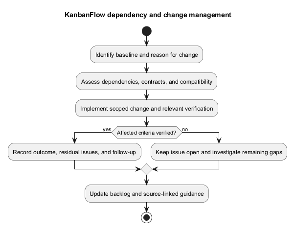
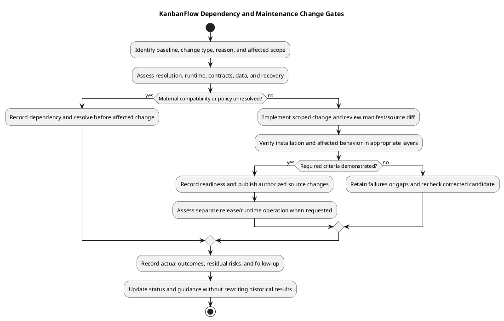

# KanbanFlow Dependency and Change Management

> **Policy amendment (2026-10-10):** Membership mutations are now owner-only; DEC-003/PB-001's bypass is fixed. Current guidance below reflects this rule; historical records retain their original scope. See [QA corrections](../06-testing/qa-corrections-2026-10-10.md) for the selected rule and regression evidence.

## Baseline and scope

Use committed manifests and lockfiles as the dependency baseline. [Dependency guidance](../05-implementation/dependency-baseline.md) records declared tooling; it does not certify latest releases or vulnerability status. Dependency, configuration, schema, and behavior changes need an explicit reason and affected-scope assessment.

## Change record

| Field | Record |
| --- | --- |
| Motivation | Observed defect, compatibility requirement, feature need, or dated advisory. |
| Candidate | Baseline and intended source/lockfile identities. |
| Impact | Direct/transitive packages, runtime/extensions, API contracts, UI consumers, data/schema. |
| Verification | Installation, relevant suites/static/build checks, browser or database-specific cases. |
| Recovery | Compatible prior source/assets/dependencies and actual data/configuration recovery needs. |
| Delivery | Actual commit/release/deployment evidence and unresolved issues. |

## Dependency updates

Distinguish reproducible install (`composer install`, `npm ci`) from deliberate version resolution changes. Review both manifests and lockfiles, runtime requirements, lifecycle scripts/plugins, and migration or API effects. Keep upgrades scoped rather than bundling unrelated packages solely to reach newer version numbers.

For an advisory assessment record date, exact affected versions, exploitability/context, remedy, and verified corrected candidate. A build pass is not a security audit. Do not claim all dependencies are current or safe without actual evidence.

## Application and schema changes

Assess compatibility with existing records, consumers, deployment configuration, and the known-good recovery combination. Avoid automatic migration reversal or application-key regeneration as maintenance shortcuts. Review permission changes against both direct and indirect paths, including DEC-003.

## Verification and delivery

Run proportional checks and retain failures and environmental limits. CI configuration is not a passing run; inspect candidate-specific results before reporting them. Use [verification records](../06-testing/verification-record-template.md), [release pipeline](../../Project-Management/release-pipeline.md), and [versioning strategy](../../Project-Management/versioning-strategy.md).

Source rollback does not restore lost data, and historical release checks do not validate a new upgrade. Use [upgrade and rollback](../../Releases/upgrade-and-rollback.md) for an actual assessed runtime operation.

## Intake and classification

Identify the actual baseline, requested outcome, affected candidate/target, and reason for change. Distinguish a package update, runtime compatibility fix, security advisory response, application behavior change, schema migration, configuration change, and documentation correction. Several may be linked, but their effects and evidence remain explicit.

| Change type | Assessment focus |
| --- | --- |
| Package/runtime | Direct/transitive resolution, actual platform/engines, lifecycle scripts/plugins, API changes. |
| Application contract | Actor/trigger, invoked authority, ancestry, validation, consumers, and failure behavior. |
| Schema/data | Existing records, constraints, rollout sequence, old/new code compatibility, and recovery. |
| Configuration/service | Effective settings, host/session dependencies, secret handling, actual service controls. |
| Documentation | Source accuracy, links/diagrams, historical evidence, and no fabricated execution results. |

Link [product backlog](../../Project-Management/product-backlog.md) and [decision register](../../Project-Management/decision-register.md). Resolve material policy questions rather than letting an incidental dependency/refactor change decide them.

## Upgrade assessment and reproducibility

Read the intended manifests/lockfiles and actual installed/runtime context. A declared range, resolved version, and installed package state are distinct. Use [dependency baseline](../05-implementation/dependency-baseline.md) for source records; re-read candidate requirements when versions change.

Review the full direct/transitive diff, package sources/integrity metadata, scripts/plugins, runtime/extensions, and changed APIs. Do not delete lockfiles, manually alter integrity records, or bypass platform requirements to hide mismatch. Keep cache, dependency directories, environment values, and generated local artifacts outside the intended commit scope.

Separate deliberate version resolution from reproducible installation. Backend framework tooling and the application frontend have different package contexts. Setup scripts that generate keys or run migrations are assessed operations, not harmless existing-installation verification.

## Advisory and urgent change handling

For an advisory record dated source/tool evidence, exact affected versions, actual exposure/context, proposed remedy or mitigation, and residual risk. An unavailable advisory source leaves the assessment unverified. Do not claim a dependency is safe or latest from a build pass or version number alone.

For an urgent fix keep scope, cause, acceptance cases, evidence, and recovery explicit. Urgency does not make destructive resets, broad authority changes, undocumented runtime edits, or skipped required evidence into verified success. Record any remaining gaps and actual operational authorization rather than inventing an emergency approval process.

## Compatibility and recovery matrix

| Boundary | Before-change question |
| --- | --- |
| Runtime/dependencies | Can the actual target install and execute the intended locked combination? |
| API/client | Do request/response changes preserve or deliberately update affected consumers and failure recovery? |
| Authority/privacy | Do direct/indirect paths and downstream visibility remain correct? Preserve DEC-003 owner-only enforcement and direct/indirect regression evidence. |
| Data/schema | Can existing records and any overlapping runtime safely use the assessed schema? |
| Configuration/assets | Do effective URLs, sessions, key, services, and frontend build match the candidate? |
| Recovery | Is the prior source/assets/runtime compatible with resulting schema/data, or does recovery need an assessed restore? |

Source rollback does not restore data or automatically reverse migrations. Restore may discard newer writes; older code can reintroduce security defects. Use [backup runbook](../07-deployment/backup-and-recovery-runbook.md) for actual recovery evidence.

## Verification gates

1. Define affected criteria and inspect source/contract/assertion coverage.
2. Verify intended installation and actual platform/engine requirements in an appropriate environment.
3. Run relevant backend suites or frontend lint/build and retain original failures.
4. Observe affected browser, authority, persistence, or isolated MySQL contention cases as warranted.
5. Review final diff, lockfile churn, secrets, documentation, and diagram consistency.
6. Record scope-specific readiness and residual issues for the exact candidate.

SQLite checks do not establish MySQL scheduling, lint/build do not establish browser acceptance, and configured CI is not a fresh run. Use [test strategy](../06-testing/test-strategy.md) and [verification layers](../06-testing/verification-layers.md). Substantive corrections or conflict resolutions require affected rechecks on the new candidate.

## Delivery and operational boundaries

Publish the intended commit through [change delivery](../05-implementation/change-delivery.md) and confirm fetched remote identity separately from working-tree cleanliness. Select a release version/tag only when a release is requested and its scope is assessed. Documentation commits do not automatically need patch tags.

Runtime changes follow [release/upgrade runbook](../07-deployment/release-and-upgrade-runbook.md) with actual target, authorization, compatibility, recovery, and smoke evidence. Do not report deployment success from source publication or claim recovery from a completed command alone.

## Copyable maintenance change record

````markdown
# Maintenance change — <actual scope>

- Reason/type and requirement/advisory references: <dated evidence>
- Baseline/candidate and affected packages/source/configuration: <actual identities>
- Runtime, contracts, data/schema, and side-effect assessment: <scope>
- Verification commands/scenarios and results: <candidate/environment/evidence>
- Failures, corrected candidate, and remaining gaps: <actual>
- Recovery combination and protected data/key needs: <assessed evidence>
- Published commit/release/runtime outcome: <separate actual results or not performed>
- Residual risks, closure decision, and follow-up: <actual or pending>
````

Protect sensitive evidence and record owners/approvals only when actually known. Update the [implementation status](../05-implementation/implementation-status.md), backlog, and source-linked guidance when accepted behavior changes. Preserve historical release results for their original candidates.

## Limits of this guidance

This document performs no package upgrade, advisory lookup, configuration change, migration, deployment, or recovery operation. It establishes neither a recurring update schedule nor a monitoring/approval service. Actual assessments and execution remain candidate/target-specific.

## PlantUML diagram



[Editable PlantUML source](diagrams/dependency-and-change-management.puml)


