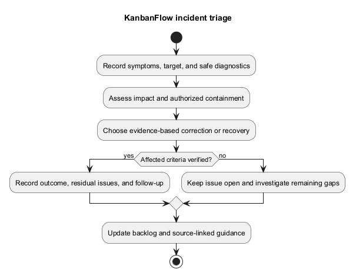
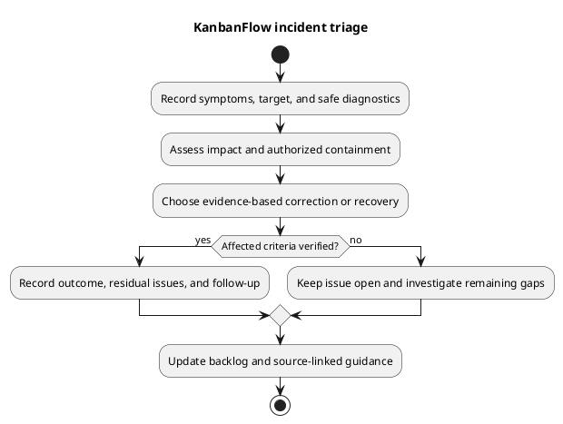

# KanbanFlow Incident Triage

## Purpose and prerequisites

Triage determines observed impact, immediate containment needs, and the next evidence-based action. No active incident, on-call owner, response-time commitment, or notification channel is established here. Select those responsibilities for the actual environment.

## Safe initial record

Capture detection time/timezone, reporter/operator when known, target and running source/assets, affected journeys/users, symptoms, recent changes, and available diagnostics. Distinguish confirmed observations from hypotheses. Restrict sensitive evidence and sanitize shared excerpts without destroying required incident context.

## Impact and containment

Assess confidentiality, data integrity, availability, scope, ongoing writes, and recovery risk. For suspected exposure or corrupt mutations prioritize restricting the affected operation through an authorized environment-specific control. Avoid repeated retries, destructive resets, or broad configuration changes that obscure evidence or worsen data loss.

## Diagnosis matrix

| Symptom | Evidence to collect |
| --- | --- |
| Login/protected access failure | Actual API status, browser origin/cookies/CSRF behavior, session configuration, backend reachability. |
| Missing/private resource | Current membership, role/visibility, nested ancestry, actual endpoint authority, soft-delete state. |
| Failed ordering/WIP | Source/destination IDs, stale state/conflict response, persisted ordering, concurrent operations. |
| Missing signals | Relevant accepted mutation, activity/notification records, actual queue configuration and services where applicable. |
| UI inconsistency | Running asset identity, response/cache behavior, browser/version, theme, pending/error recovery. |
| Runtime degradation | Actual server/database/storage/service diagnostics, resource pressure, and recent changes. |

The health endpoint response alone does not establish database readiness. Laravel logs and domain activity have different purposes; activity records are not a complete operational or tamper-proof audit log.

## Decision and verification

Choose a scoped correction, compatible rollback, data recovery, or further investigation using actual cause/state evidence. Record authorization for operational actions. Follow [upgrade guidance](../07-deployment/release-and-upgrade-runbook.md) and [backup/recovery](../07-deployment/backup-and-recovery-runbook.md) where relevant.

Verify affected journeys, data, denied paths, and relevant services after intervention. Record residual issues and follow-up regression cases. Close only when the agreed scope is verified; source publication or a cleared error log is insufficient.

## PlantUML diagram

[Editable PlantUML source](diagrams/incident-triage.puml)

