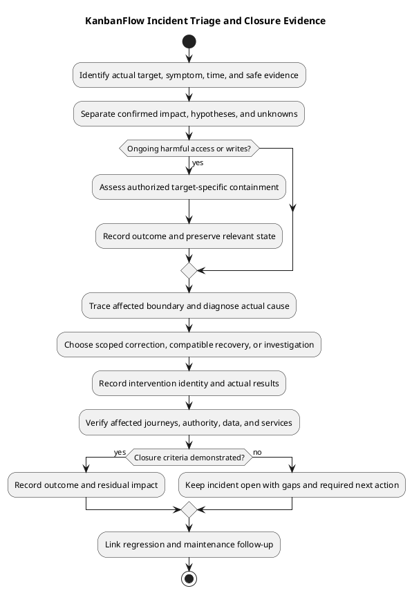

# KanbanFlow Incident Triage

> **Policy amendment (2026-10-10):** Membership mutations are now owner-only; DEC-003/PB-001's bypass is fixed. Current guidance below reflects this rule; historical records retain their original scope. See [QA corrections](../06-testing/qa-corrections-2026-10-10.md) for the selected rule and regression evidence.

## Purpose and prerequisites

Triage determines observed impact, immediate containment needs, and the next evidence-based action. No active incident, on-call owner, response-time commitment, or notification channel is established here. Select those responsibilities for the actual environment.

## Safe initial record

Capture detection time/timezone, reporter/operator when known, target and running source/assets, affected journeys/users, symptoms, recent changes, and available diagnostics. Distinguish confirmed observations from hypotheses. Restrict sensitive evidence and sanitize shared excerpts without destroying required incident context.

## Impact and containment

Assess confidentiality, data integrity, availability, scope, ongoing writes, and recovery risk. For suspected exposure or corrupt mutations prioritize restricting the affected operation through an authorized environment-specific control. Avoid repeated retries, destructive resets, or broad configuration changes that obscure evidence or worsen data loss.

## Diagnosis matrix

| Symptom | Evidence to collect |
| --- | --- |
| Login/protected access failure | Actual API status, browser origin/cookies/CSRF behavior, session configuration, backend reachability. |
| Missing/private resource | Current membership, role/visibility, nested ancestry, actual endpoint authority, soft-delete state. |
| Failed ordering/WIP | Source/destination IDs, stale state/conflict response, persisted ordering, concurrent operations. |
| Missing signals | Relevant accepted mutation, activity/notification records, actual queue configuration and services where applicable. |
| UI inconsistency | Running asset identity, response/cache behavior, browser/version, theme, pending/error recovery. |
| Runtime degradation | Actual server/database/storage/service diagnostics, resource pressure, and recent changes. |

The health endpoint response alone does not establish database readiness. Laravel logs and domain activity have different purposes; activity records are not a complete operational or tamper-proof audit log.

## Decision and verification

Choose a scoped correction, compatible rollback, data recovery, or further investigation using actual cause/state evidence. Record authorization for operational actions. Follow [upgrade guidance](../07-deployment/release-and-upgrade-runbook.md) and [backup/recovery](../07-deployment/backup-and-recovery-runbook.md) where relevant.

Verify affected journeys, data, denied paths, and relevant services after intervention. Record residual issues and follow-up regression cases. Close only when the agreed scope is verified; source publication or a cleared error log is insufficient.

## Intake fields and uncertainty

| Field | Capture without secrets |
| --- | --- |
| Incident identity/time | Actual record reference, detection/observation times and timezone. |
| Target and source | Actual installation, running backend/frontend assets, runtime/database/service context. |
| Symptom and reproduction | Actor/role, resource ancestry, trigger, expected/actual response and visible state. |
| Impact | Confirmed affected journeys/data/users, duration, ongoing writes/exposure, and scope uncertainty. |
| Change context | Actual recent source/configuration/schema/service changes, not inferred deployment history. |
| Evidence | Safe logs/request/state observations and restricted references for sensitive material. |
| Decisions | Authorized containment/intervention scope, actual operators, actions and outcomes. |

Keep confirmed facts, plausible causes, and unknowns separate. A single report does not establish affected-user count, compromise, or data loss. Record missing evidence rather than assigning invented severity scores, deadlines, or approvals.

## Initial triage sequence

1. Confirm the target and observed symptom using safe, non-destructive checks.
2. Assess confidentiality, integrity, availability, ongoing effects, and immediate containment needs.
3. Preserve relevant diagnostics/state and identify the actual operator/authorized scope.
4. Trace the affected browser/API/authority/data/service boundary and compare recent changes.
5. Select a scoped intervention or further investigation based on evidence.
6. Verify resulting behavior/state and document residual impact and follow-up.

Avoid reproducing harmful writes or exposure against real users to prove a hypothesis. Prefer isolated fixtures for additional reproduction. Do not reset databases, regenerate keys, weaken permissions, or repeatedly retry destructive operations without an assessed cause and scope.

## Impact-driven decisions

| Observation | Triage attention |
| --- | --- |
| Unauthorized data exposure | Affected content/routes/actors, current visibility/membership, possible ongoing access, and restricted evidence. |
| Unauthorized or corrupt mutation | Persisted changes/side effects, ongoing writes, containment, and recovery-point implications. |
| Login or service outage | Actual response/origin/session/service/database behavior and affected scope; do not assume credentials are wrong. |
| Intermittent stale/movement issue | Competing operations, source/destination, conflicts, final ordering/WIP, and engine-specific behavior. |
| Client-only inconsistency | Running assets/API, response/cache state, failure recovery, browser context, and persistence after refresh. |
| Known policy issue | Link the relevant decision; DEC-003 records the corrected owner-only rule and regression evidence, not a current open defect. |

Prioritize confirmed confidentiality/integrity risk and ongoing harm. If impact remains uncertain, keep the uncertainty visible while gathering bounded evidence; unrelated successful checks do not disprove the reported problem.

## Evidence collection by boundary

Correlate available timestamps, actor/fixture, request method/path/status, source identity, relevant server diagnostics, and pre/post persisted state. Do not assert correlation IDs or audit guarantees that are not implemented. Domain activity records may describe accepted actions but are not a complete tamper-proof security log.

For SPA access failures inspect actual API responses, cookie/CSRF/origin behavior, effective session configuration, and database reachability. For authorization inspect current membership, nested IDs, private visibility, and invoked controller checks. For side effects inspect actual accepted mutations and configured service behavior; do not assume every notification is queued.

Use [security matrix](../06-testing/security-regression-matrix.md), [manual acceptance](../06-testing/manual-acceptance-checklist.md), and [environment guidance](../07-deployment/environment-and-configuration.md) for controlled observations. Source/build/SQLite evidence cannot substitute for every browser or MySQL question.

## Containment and intervention record

Describe the selected target-specific action, purpose, authorized scope, operator, expected effect, and reversibility/data implications. Record actual outcome rather than assuming restriction or restart succeeded. Preserve useful starting-state evidence where appropriate and assess consequences for sessions, writes, services, and queued work.

Choose among scoped correction, compatible source/assets/configuration rollback, assessed data restore, or further investigation. Older source may reintroduce defects; source rollback does not restore data, and restore can discard newer writes. Use [recovery activity](../07-deployment/backup-recovery-activity.md) and [upgrade/rollback guidance](../../Releases/upgrade-and-rollback.md).

External communication needs actual authorized recipients/channels and scope. This guide sends no messages, creates no alerting, and establishes no escalation rota.

## Verification and closure gates

| Gate | Required observation |
| --- | --- |
| Intervention identity | Actual resulting source/assets/configuration/data/service state. |
| Affected behavior | Expected response and user journey, plus authoritative persistence/side effects where relevant. |
| Authority/privacy | Relevant allowed/denied actors, current membership, and affected private/downstream views. |
| Operational state | Actual service/log behavior and recovery outcome within the assessed target. |
| Residual impact | Remaining loss, uncertainty, defects, and required follow-up made explicit. |

Record Pass, Fail, Blocked, Not run, or justified Not applicable for scoped criteria using [verification records](../06-testing/verification-record-template.md). Retain original failure and corrected/recovered rechecks separately. A cleared log, health response, or pushed commit alone does not close an operational incident.

## Copyable incident record

````markdown
# Incident triage — <actual reference>

- Detection/observation times and timezone: <actual>
- Target, running identity, operator and authorized scope: <actual or unknown>
- Confirmed symptoms/impact and reproduction: <safe evidence>
- Hypotheses and unknowns: <explicit>
- Relevant recent changes and diagnostics: <references>
- Containment/intervention decisions and results: <actual or pending>
- Resulting candidate/runtime/data state and verification: <criterion-specific evidence>
- Residual loss/issues, closure state, and follow-up: <actual>
````

Store sensitive evidence through restricted procedures; sanitize shared records without fabricating or hiding required incident facts. Capture assigned owners/approvals only when known. Add meaningful regression cases and runbook improvements through [maintenance](maintenance.md), preserving historical outcomes for their actual candidates.

This document performs no incident investigation, containment, recovery, security audit, or external notification on a live target.

## PlantUML diagram


[Editable PlantUML source](diagrams/incident-triage.puml)


