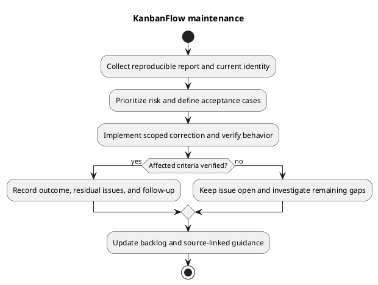

# KanbanFlow Maintenance Guide

## Intake and classification

Record the reported behavior, expected outcome, affected actor/journey, candidate/runtime identity, environment, reproduction steps, and impact. Separate feature requests, defects, environment problems, documentation errors, and incidents using evidence. A login failure may reflect origin/session/API configuration rather than invalid credentials.

Protect private data when collecting screenshots or logs. Do not publish credentials, cookies, tokens, environment files, database dumps, or real-user content in issue records.

## Prioritization and backlog

Prioritize confidentiality/integrity failures, widespread service disruption, and blocked core journeys by observed impact. Record uncertainty, workarounds, acceptance cases, and dependencies. Link [product backlog](../../Project-Management/product-backlog.md) and [decision register](../../Project-Management/decision-register.md) rather than inventing approval dates, owners, or numerical service targets.

DEC-003 covers the manager removal/re-addition role bypass. Documentation and direct-role tests do not resolve it. Agree the intended policy, cover indirect operations, implement server enforcement, and verify before closing the issue.

## Fix and verify

Reproduce the defect, inspect the actual request/controller/policy/data path, and implement a scoped correction. Preserve unrelated work and public contracts unless a reviewed change explicitly alters them. Add meaningful regression coverage for changed behavior; shared UI fixes need representative consumer and keyboard/theme checks.

Use [test strategy](../06-testing/test-strategy.md) and [verification layers](../06-testing/verification-layers.md). SQLite backend tests do not demonstrate MySQL contention, and frontend lint/build do not establish browser acceptance. Record failures and unverified boundaries against the exact candidate.

## Delivery and closure

Review and publish the intended change through [change delivery](../05-implementation/change-delivery.md). For runtime changes follow [deployment guidance](../07-deployment/README.md) and confirm actual target behavior after rollout. Close a report only when its acceptance evidence and remaining limitations are recorded; a pushed commit alone is not proof that users run the fix.

## Continuing maintenance

Review dependencies and compatibility when relevant, update source-linked documentation/diagrams when contracts change, and retain historical release evidence without treating it as fresh results. Track recurring defects and recovery lessons as explicit follow-up actions. No recurring scheduler or monitoring installation is created by this guide.

## PlantUML diagram

[Editable PlantUML source](diagrams/maintenance.puml)

