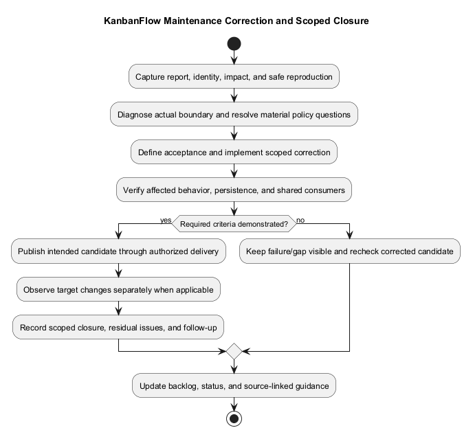
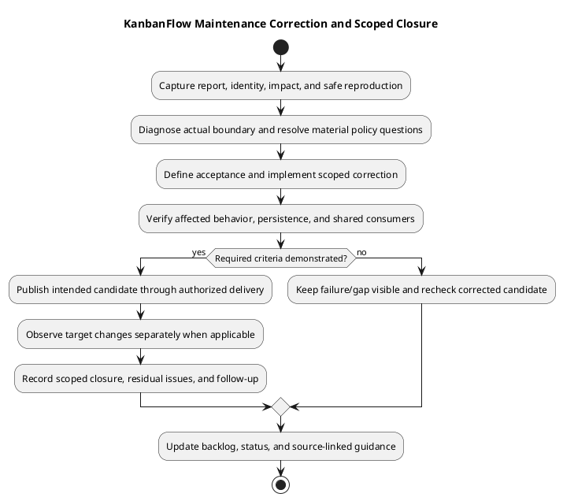

# KanbanFlow Maintenance Guide

> **Policy amendment (2026-10-10):** Membership mutations are now owner-only; DEC-003/PB-001's bypass is fixed. Earlier open-policy text and diagrams below describe the preceding state. See [QA corrections](../06-testing/qa-corrections-2026-10-10.md) for the selected rule and regression evidence.

## Intake and classification

Record the reported behavior, expected outcome, affected actor/journey, candidate/runtime identity, environment, reproduction steps, and impact. Separate feature requests, defects, environment problems, documentation errors, and incidents using evidence. A login failure may reflect origin/session/API configuration rather than invalid credentials.

Protect private data when collecting screenshots or logs. Do not publish credentials, cookies, tokens, environment files, database dumps, or real-user content in issue records.

## Prioritization and backlog

Prioritize confidentiality/integrity failures, widespread service disruption, and blocked core journeys by observed impact. Record uncertainty, workarounds, acceptance cases, and dependencies. Link [product backlog](../../Project-Management/product-backlog.md) and [decision register](../../Project-Management/decision-register.md) rather than inventing approval dates, owners, or numerical service targets.

DEC-003 covers the manager removal/re-addition role bypass. Documentation and direct-role tests do not resolve it. Agree the intended policy, cover indirect operations, implement server enforcement, and verify before closing the issue.

## Fix and verify

Reproduce the defect, inspect the actual request/controller/policy/data path, and implement a scoped correction. Preserve unrelated work and public contracts unless a reviewed change explicitly alters them. Add meaningful regression coverage for changed behavior; shared UI fixes need representative consumer and keyboard/theme checks.

Use [test strategy](../06-testing/test-strategy.md) and [verification layers](../06-testing/verification-layers.md). SQLite backend tests do not demonstrate MySQL contention, and frontend lint/build do not establish browser acceptance. Record failures and unverified boundaries against the exact candidate.

## Delivery and closure

Review and publish the intended change through [change delivery](../05-implementation/change-delivery.md). For runtime changes follow [deployment guidance](../07-deployment/README.md) and confirm actual target behavior after rollout. Close a report only when its acceptance evidence and remaining limitations are recorded; a pushed commit alone is not proof that users run the fix.

## Continuing maintenance

Review dependencies and compatibility when relevant, update source-linked documentation/diagrams when contracts change, and retain historical release evidence without treating it as fresh results. Track recurring defects and recovery lessons as explicit follow-up actions. No recurring scheduler or monitoring installation is created by this guide.

## Minimum report and task scope

| Field | Record |
| --- | --- |
| Trigger/result | Observable steps, expected versus actual behavior, and relevant response/persisted state. |
| Actor/data | Role/current membership, visibility, resource ancestry, and isolated reproduction fixture. |
| Identity/environment | Actual source/assets, target, tool/database/browser context, and recent changes when known. |
| Impact | Confirmed affected journeys/data, ongoing harm, uncertainty, and workaround limits. |
| Acceptance | Concrete corrected outcome, denial/failure cases, exclusions, and policy dependencies. |
| Evidence/follow-up | Safe diagnostic references, actual assigned responsibility when known, and required next action. |

Do not require a reporter to know the cause before intake. Separate observed facts from hypotheses and unknowns. Use [incident triage](incident-triage.md) for harmful access/writes or operational disruption, and [dependency management](dependency-and-change-management.md) for package/runtime/schema/configuration changes.

## Maintenance task lifecycle

| State | Basis for advancement |
| --- | --- |
| Reported | Symptom and impact captured; reproduction may still be incomplete. |
| Diagnosed/scoped | Evidence supports cause/scope and accepted behavior; unresolved policy remains explicit. |
| Implemented pending verification | Scoped correction exists with relevant source and meaningful regression cases. |
| Verified for candidate/environment | Actual affected checks demonstrate criteria within recorded limits. |
| Published | Actual remote commit/release identity confirmed; runtime status is separate. |
| Observed on target when applicable | Actual rollout identity and affected post-change checks recorded. |
| Closed with stated scope | Acceptance evidence, remaining issues, and follow-up recorded. |

A task can be blocked or reopened at any stage. Do not treat a document update, test-file presence, or source push as universal closure. Record the scope in which the fix was verified and whether the affected runtime actually uses it.

## Diagnosis and scoped correction

Reproduce safely in an isolated environment and trace actual client requests, nested ancestry, invoked authority, validation, persistence, and side effects. For configuration symptoms inspect effective running values and assets rather than editing example files blindly. For concurrency symptoms retain competing-operation and persisted-state evidence.

Avoid broad refactors, permission widening, password resets, key regeneration, or destructive database operations as unsupported fixes. Preserve unrelated work and the original failure reproduction. Resolve material policy questions through the decision register; DEC-003 requires direct and indirect membership-path acceptance.

Use [implementation guidance](../05-implementation/implementation.md) and [development workflow](../05-implementation/development-workflow.md). Changes to shared controls need representative consumers; API changes need affected client and downstream visibility checks, not only the edited endpoint.

## Verification selection

| Affected scope | Relevant observations |
| --- | --- |
| Authority/privacy | Allowed/denied actors, wrong ancestry, membership/visibility transitions, related lists/analytics/activity. |
| Data/workflow | Accepted and rejected persistence, positions/WIP, stale state, side effects, and relevant MySQL contention. |
| Client/shared UI | Lint/build plus browser pending/error recovery, refresh, themes, keyboard/focus, and narrow/zoom layout. |
| Dependencies/schema/configuration | Locked install/platform compatibility, existing data, actual services/settings, and recovery implications. |
| Documentation | Source accuracy, local links, diagram source consistency/readability, and intended patch formatting. |

Record candidate/environment, expected/actual result, evidence, and Pass/Fail/Blocked/Not run/justified Not applicable using [verification records](../06-testing/verification-record-template.md). Retain failing and corrected candidates separately. Repeat checks when substantive edits, conflicts, failures, or affected consumers justify it; unchanged passing runs cannot replace a missing layer.

## Delivery and operational decision

Inspect the final diff, stage intended files, preserve unrelated staged work, and publish through the repository's authorized workflow. Confirm fetched remote identity and working-tree state separately. Tag/release decisions use [versioning strategy](../../Project-Management/versioning-strategy.md); documentation maintenance does not automatically require a patch tag.

For runtime work identify target, authorized scope, compatibility, traffic/service controls, protected recovery point, and smoke evidence. Use [release/upgrade runbook](../07-deployment/release-and-upgrade-runbook.md). Source rollback does not restore data, and older source may reintroduce defects. A runtime failure remains open until its assessed behavior/state is reverified.

## Closure checklist

- The accepted trigger/result and relevant denial/failure behavior have candidate-specific evidence.
- Confirmed cause and correction are documented; remaining uncertainty is explicit.
- Data/side effects, shared consumers, and environment-specific limits are assessed where affected.
- Actual publication and any runtime/recovery outcomes are recorded separately.
- Known issues, residual impact, and required follow-up remain linked and visible.
- Relevant backlog/status and source-linked documentation/diagrams reflect accepted behavior without rewriting historical results.

If a criterion is unexecuted or blocked, record the next evidence needed rather than marking it passed. A complete maintenance record can still contain open follow-up or scoped exclusions.

## Copyable maintenance outcome

````markdown
# Maintenance outcome — <actual task/reference>

- Report, actor/trigger, expected/actual behavior and impact: <safe evidence>
- Baseline, cause/scope, policy dependencies and correction candidate: <actual>
- Verification criteria, environment, results and limitations: <references>
- Original failures and corrected-candidate rechecks: <actual>
- Publication and separately observed runtime/recovery outcome: <actual or not performed>
- Closure state, residual issues and next action: <actual or pending>
- Recorded responsibility/date: <only when known>
````

## Continuing review and limits

Use recurring defect patterns, missing coverage, unclear runbooks, and operational recovery lessons to create explicit improvement tasks. Apply real agreed schedules/owners when established; this guide invents none and installs no scheduler, monitoring, alerting, or support service.

No new application run, incident action, dependency upgrade, advisory audit, deployment, or recovery is performed by expanding this guide. Keep historical records tied to their original candidates and link later evidence through [traceability](../../Project-Management/traceability.md).

## PlantUML diagram



[Editable PlantUML source](diagrams/maintenance.puml)


