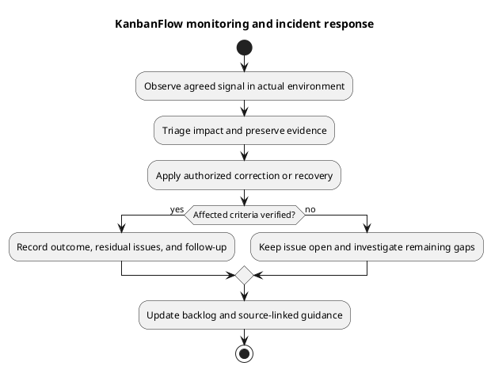

# KanbanFlow Monitoring and Incident Response

## Current evidence and limits

[Laravel logging configuration](../../../backend/config/logging.php) defines selectable channels; the example environment uses a stack with a single-file log. This is configuration, not proof of deployed collection, alert routing, retention, or operator response. CI is development verification, not production monitoring. No observability service or scheduled monitoring job is installed by this document.

## Signals to assess for an actual environment

| Signal | Interpretation and limit |
| --- | --- |
| HTTP/API availability and errors | Record affected routes/statuses and transport failures; health success alone does not prove database readiness. |
| Authentication/authorization failures | Distinguish expected denials, origin/session problems, and suspicious access patterns with safe evidence. |
| Database integrity/latency | Observe real engine/service behavior and affected mutations; avoid inferring contention safety from SQLite tests. |
| Storage/resources | Monitor actual writable paths, capacity, access failures, and recovery dependencies. |
| Background services | Observe relevant workers/jobs only when configured and used; do not assume every notification is queued. |
| User journeys | Check agreed critical scenarios using isolated accounts/data with controlled side effects. |
| Backup/recovery | Record actual backup age/integrity and restore rehearsal outcomes against agreed objectives. |

## Monitoring design decisions

Define owner, scope, collection location, access, retention, thresholds, escalation channels, and expected response for each chosen signal. Set thresholds from measured environment behavior and agreed objectives; no uptime target or alert interval is invented here. Ensure sensitive tokens, passwords, cookies, and private content are excluded or handled with appropriate restricted controls.

Domain activity records help explain accepted application changes but are not a complete security/operational audit trail. Correlate available timestamps, request context, source identity, and infrastructure evidence without asserting correlation IDs that have not been implemented.

## Response workflow

Detect and record the signal, assess impact through [incident triage](incident-triage.md), contain through authorized controls, and preserve diagnostics. Select correction or recovery based on data/schema/security compatibility. Verify the resulting runtime and record residual impact before acceptance.

External notifications require an agreed recipient/channel and authorized action; this guide sends no messages or creates escalation tooling. Track communication decisions in the actual incident record.

## Follow-up and improvement

Record the timeline, confirmed cause, contributing conditions, intervention, observed recovery, and remaining uncertainty. Add scoped regression cases and backlog actions, improve relevant runbooks, and verify completed fixes. Keep measured recovery time/data loss separate from proposed objectives. Use [maintenance guidance](maintenance.md) and [verification template](../06-testing/verification-record-template.md).

## PlantUML diagram

[Editable PlantUML source](diagrams/monitoring-and-incident-response.puml)

