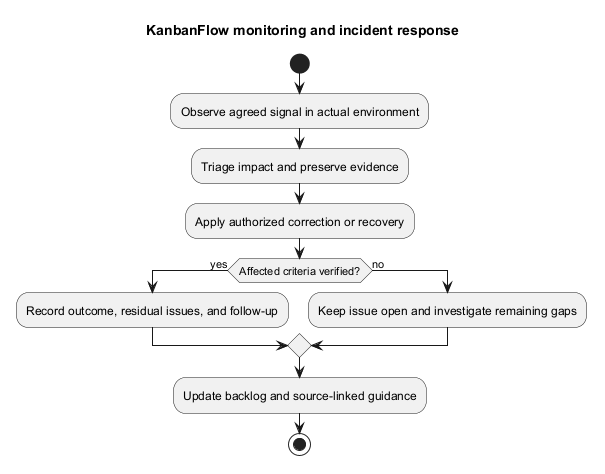
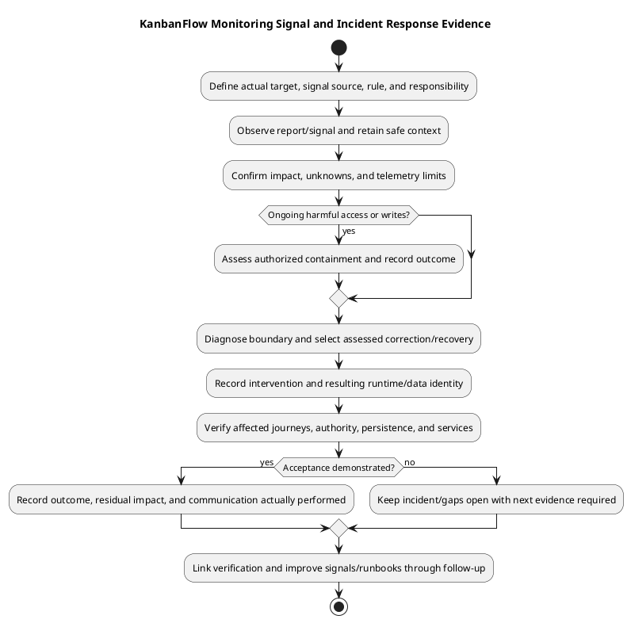

# KanbanFlow Monitoring and Incident Response

> **Policy amendment (2026-10-10):** Membership mutations are now owner-only; DEC-003/PB-001's bypass is fixed. Current guidance below reflects this rule; historical records retain their original scope. See [QA corrections](../06-testing/qa-corrections-2026-10-10.md) for the selected rule and regression evidence.

## Current evidence and limits

[Laravel logging configuration](../../../backend/config/logging.php) defines selectable channels; the example environment uses a stack with a single-file log. This is configuration, not proof of deployed collection, alert routing, retention, or operator response. CI is development verification, not production monitoring. No observability service or scheduled monitoring job is installed by this document.

## Signals to assess for an actual environment

| Signal | Interpretation and limit |
| --- | --- |
| HTTP/API availability and errors | Record affected routes/statuses and transport failures; health success alone does not prove database readiness. |
| Authentication/authorization failures | Distinguish expected denials, origin/session problems, and suspicious access patterns with safe evidence. |
| Database integrity/latency | Observe real engine/service behavior and affected mutations; avoid inferring contention safety from SQLite tests. |
| Storage/resources | Monitor actual writable paths, capacity, access failures, and recovery dependencies. |
| Background services | Observe relevant workers/jobs only when configured and used; do not assume every notification is queued. |
| User journeys | Check agreed critical scenarios using isolated accounts/data with controlled side effects. |
| Backup/recovery | Record actual backup age/integrity and restore rehearsal outcomes against agreed objectives. |

## Monitoring design decisions

Define owner, scope, collection location, access, retention, thresholds, escalation channels, and expected response for each chosen signal. Set thresholds from measured environment behavior and agreed objectives; no uptime target or alert interval is invented here. Ensure sensitive tokens, passwords, cookies, and private content are excluded or handled with appropriate restricted controls.

Domain activity records help explain accepted application changes but are not a complete security/operational audit trail. Correlate available timestamps, request context, source identity, and infrastructure evidence without asserting correlation IDs that have not been implemented.

## Response workflow

Detect and record the signal, assess impact through [incident triage](incident-triage.md), contain through authorized controls, and preserve diagnostics. Select correction or recovery based on data/schema/security compatibility. Verify the resulting runtime and record residual impact before acceptance.

External notifications require an agreed recipient/channel and authorized action; this guide sends no messages or creates escalation tooling. Track communication decisions in the actual incident record.

## Follow-up and improvement

Record the timeline, confirmed cause, contributing conditions, intervention, observed recovery, and remaining uncertainty. Add scoped regression cases and backlog actions, improve relevant runbooks, and verify completed fixes. Keep measured recovery time/data loss separate from proposed objectives. Use [maintenance guidance](maintenance.md) and [verification template](../06-testing/verification-record-template.md).

## Signal definition record

Define each selected signal against the actual target before relying on it. Configuration examples do not establish an active collector or alert, and a lack of alerts does not prove service health.

| Field | Required actual decision/evidence |
| --- | --- |
| Scope | Target/service/journey, source/assets identity, and property being assessed. |
| Collection | Actual source/tool, sampling or check method, location, and successful collection observation. |
| Interpretation | Expected baseline, measured context, threshold/rule and reason when agreed. |
| Responsibility | Actual owner/operator, authorized recipients/channel, and response responsibility when established. |
| Protection | Access, sanitization, retention, and exclusion of secrets/private content. |
| Failure behavior | Missing/stale data, collector failure, false positives, and required follow-up. |
| Verification | Controlled signal/response exercise and actual observed outcomes. |

No universal thresholds, polling intervals, response deadlines, or uptime objectives are prescribed. Choose them from observed behavior and actual operational requirements, then document limitations.

## Source and signal boundaries

| Source | Useful evidence | Limit |
| --- | --- | --- |
| HTTP/API observations | Reachability, statuses, affected routes, and response behavior. | A health response alone does not prove database/session readiness. |
| Laravel/service logs | Actual diagnostics and timestamps from the configured runtime. | Channel definitions do not prove deployed collection/retention or completeness. |
| Domain activity | Recorded accepted domain actions and relevant metadata. | Not a complete tamper-proof security or operational audit trail. |
| Database/storage/service signals | Actual latency, failures, capacity, jobs or connections when collected. | Framework driver options do not prove active services or their measured behavior. |
| Controlled journey checks | Actual session and permitted/denied/data behavior under safe fixtures. | Limited to tested target, actors, scenarios, and browser/configuration. |
| CI | Candidate-specific tests/lint/build when inspected. | Not production monitoring, runtime deployment, or recovery evidence. |

Correlate available timestamps, candidate/target, actor/fixture, request/status, and state without claiming unimplemented correlation IDs. Record unknowns rather than treating missing telemetry as a normal result.

## Response stages and evidence

1. Detect a signal/report and record actual observation time/timezone, source, target, and symptom.
2. Confirm scope and impact with bounded, safe evidence through [incident triage](incident-triage.md).
3. Assess ongoing exposure/harm and authorized target-specific containment; record effects and preserve diagnostics.
4. Diagnose the affected client/API/authority/data/service boundary and choose a scoped intervention.
5. Apply only assessed correction or compatible recovery within actual authorization.
6. Verify resulting identity, affected journeys, permissions, persistence, and relevant service state.
7. Record acceptance or ongoing failure, residual impact/loss, and concrete follow-up.

Avoid repeated harmful mutations, broad permission changes, database resets, or key regeneration as unsupported response shortcuts. Distinguish real SPA origin/session failures from invalid credentials, and ordinary denied actions from suspected unauthorized access using actual request/context evidence.

## Response gates

| Gate | Required basis |
| --- | --- |
| Incident scope | Confirmed symptoms/impact and explicit uncertainty; actual target identity. |
| Intervention | Cause/state evidence, authorized scope, compatible procedure, and side-effect assessment. |
| Recovery | Selected protected point, key/schema/source compatibility, lost-write implications, and restore evidence where relevant. |
| Acceptance | Actual affected behavior/data/service checks and disclosed remaining limits. |
| Closeout | Timeline, decisions/results, residual issues, and linked verification/follow-up. |

Use [release/upgrade runbook](../07-deployment/release-and-upgrade-runbook.md) and [backup/recovery](../07-deployment/backup-and-recovery-runbook.md). Code rollback does not restore data; older source can reintroduce defects, and restored queued work can duplicate side effects. Reverify corrected/recovered state before acceptance.

## Communication and sensitive evidence

Record actual authorized recipients/channels and the scope of information to share. Keep known facts, hypotheses, residual impact, and next action distinct. Do not invent escalation owners or send external messages based solely on this guidance. Store sensitive diagnostics through restricted procedures and share sanitized references without credentials, cookies, tokens, dumps, or private content.

Record operator/reviewer identities and decisions only when actually known. Notification delivery or alert acknowledgment is not equivalent to incident containment or verified resolution.

## Copyable monitoring/response record

````markdown
# Monitoring / response observation — <actual reference>

- Signal/report, source, target, and timestamps/timezone: <actual>
- Running source/assets and relevant environment: <actual or unknown>
- Confirmed impact, hypotheses, and missing telemetry: <explicit>
- Signal rule/owner/channel: <actual established values or not established>
- Containment/intervention authorization and results: <actual or pending>
- Corrected/recovered runtime/data and verification: <candidate-specific evidence>
- Communication performed: <actual authorized scope or not performed>
- Residual impact/loss, closure state, and follow-up: <actual>
````

Link [verification records](../06-testing/verification-record-template.md) and [maintenance](maintenance.md). Keep failed observations and subsequent corrected results separate; source publication, monitoring collection, and runtime recovery establish different outcomes.

## Improvement and evidence limits

Review recurring signals, missing telemetry, false positives, diagnosis gaps, and recovery lessons as explicit backlog actions. Verify completed changes, update signal definitions/runbooks when actual dependencies/environment change, and exercise response through an agreed controlled procedure when established. No rehearsal schedule or monitoring service is created here.

SQLite results do not prove MySQL contention, frontend builds do not prove browser acceptance, and documentation alone does not verify deployed DEC-003 enforcement. This guide performs no live monitoring installation, alert delivery, incident response, advisory/security audit, deployment, or restore and claims no measured availability or recovery objective.

## PlantUML diagram



[Editable PlantUML source](diagrams/monitoring-and-incident-response.puml)


