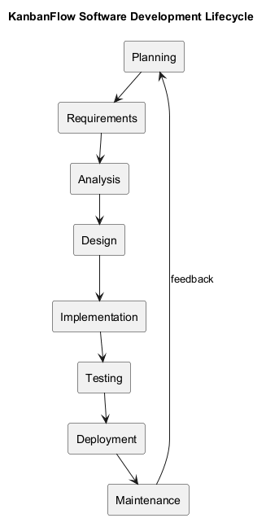
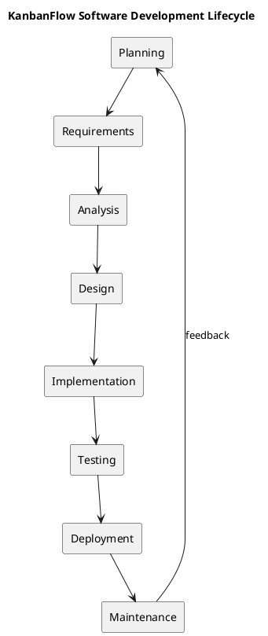

# KanbanFlow SDLC

This section organizes software lifecycle guidance into the eight requested phases. It describes a working process, not evidence that every phase has been completed or that production deployment has occurred. Phases may iterate as requirements and evidence change.

## Phases

- [Planning](01-planning/README.md)
- [Requirements](02-requirements/README.md)
- [Analysis](03-analysis/README.md)
- [Design](04-design/README.md)
- [Implementation](05-implementation/README.md)
- [Testing](06-testing/README.md)
- [Deployment](07-deployment/README.md)
- [Maintenance](08-maintenance/README.md)

## Traceability and completion

Connect user needs, decisions, implementation, checks, and release records. Record exact commits and environments for verification. Open policy questions and failed checks remain visible. Use [project management](../Project-Management/README.md) for planning and [release guidance](../Releases/README.md) for publication and upgrade preparation.

Each phase has a PlantUML source and a rendered PNG preview. Regenerate previews when source changes.

## PlantUML lifecycle

[Editable source](diagrams/lifecycle.puml)

