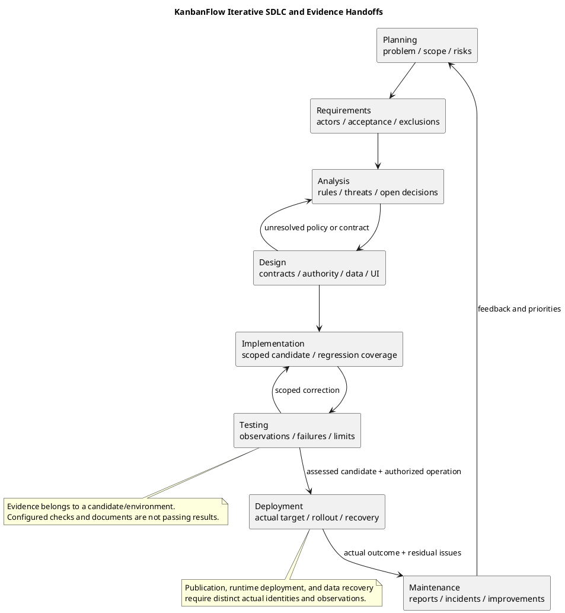

# KanbanFlow SDLC

> **Policy amendment (2026-10-10):** Membership mutations are now owner-only; DEC-003/PB-001's bypass is fixed. Earlier open-policy text and diagrams below describe the preceding state. See [QA corrections](06-testing/qa-corrections-2026-10-10.md) for the selected rule and regression evidence.

This section organizes software lifecycle guidance into the eight requested phases. It describes a working process, not evidence that every phase has been completed or that production deployment has occurred. Phases may iterate as requirements and evidence change.

## Phases

- [Planning](01-planning/README.md)
- [Requirements](02-requirements/README.md)
- [Analysis](03-analysis/README.md)
- [Design](04-design/README.md)
- [Implementation](05-implementation/README.md)
- [Testing](06-testing/README.md)
- [Deployment](07-deployment/README.md)
- [Maintenance](08-maintenance/README.md)

## How to use the lifecycle

Start from the problem and actual source state, then read the affected phase guides rather than assuming every change needs a full new project plan. A focused defect may return through analysis, implementation, and testing; a runtime change also needs deployment/recovery assessment. Feedback and failed checks can return work to an earlier phase.

Use [project definition](../Project-Definition/README.md) for context and scope, [project management](../Project-Management/README.md) for backlog/decisions, and [sprints](../Sprints/README.md) for iteration records. These organize work; they do not establish completed execution by their existence.

## Phase responsibilities and outputs

| Phase | Key question | Expected output and handoff |
| --- | --- | --- |
| Planning | What problem, outcome, scope, constraints, and risks guide the work? | Scoped plan and priorities tied to project context. |
| Requirements | What observable behavior is expected for each actor and boundary? | Traceable acceptance criteria, functional/non-functional requirements, and explicit exclusions. |
| Analysis | What domain rules, data flows, threats, and decisions need resolution? | Source-backed rules/models, known risks, and visible open questions. |
| Design | How will client, API, authority, data, and errors satisfy the agreed behavior? | Contracts, diagrams, decisions/tradeoffs, and proposed versus implemented boundaries. |
| Implementation | What scoped source change realizes the accepted outcome? | Reviewable candidate, meaningful regression coverage, and updated guidance. |
| Testing | Which properties are demonstrated for this candidate/environment? | Actual results, failures, gaps, and scope-specific readiness assessment. |
| Deployment | Is the candidate ready for an identified authorized target and recoverable rollout? | Actual operation identity, smoke results, residual impact, and recovery evidence when performed. |
| Maintenance | What reports, incidents, and changes require follow-up? | Prioritized corrections, verified outcomes, and updated backlog/runbooks. |

## Evidence and status vocabulary

| State/event | Required basis |
| --- | --- |
| Proposed | Accepted need or design scope with unresolved decisions visible. |
| Implemented pending verification | Actual source/contracts identified; execution still needs evidence. |
| Verified for candidate/environment | Observed checks tied to exact source, scenario, tools/data, and environment. |
| Published source/release | Actual remote commit or tag/release identity and outcome. |
| Deployed and observed | Actual running target/source/assets plus post-rollout verification. |
| Recovered | Actual selected point, compatible runtime/data/key, restore/rollback checks, and residual loss/issues. |

A document, test file, configured CI job, or package version is not a fresh passing result. Keep historical evidence tied to its original candidate. Code rollback does not recover data, and documentation completion does not certify product security, accessibility, performance, or every lifecycle phase.

## Traceability chain

Connect user need or backlog item to acceptance criteria, domain/policy decision, design contract, changed source, verification observation, defect/correction, and actual delivery identity. Record missing links and unresolved expectations instead of inventing approvals, testers, dates, or measurements.

Use [traceability](../Project-Management/traceability.md), [documentation traceability](../Project-Management/documentation-traceability.md), and [decision register](../Project-Management/decision-register.md). DEC-003/PB-001 remains open for manager remove/re-add role escalation until policy, enforcement, and direct/indirect acceptance evidence justify closure.

## Applying the lifecycle to common work

| Work | Relevant phase path and evidence |
| --- | --- |
| Product feature | Scope/criteria, domain decisions, design, scoped implementation, meaningful checks, and separately assessed release/runtime work. |
| Authorization defect | Actor/ancestry/visibility rules, actual invoked authority, direct/indirect regression cases, persisted state and downstream data exposure. |
| UI improvement | Accepted journey, shared consumers, implementation, lint/build plus browser themes/focus/error recovery. |
| Dependency/schema/configuration | Baseline/compatibility, affected implementation, appropriate environments, rollout/recovery consequences. |
| Documentation | Source accuracy, links, embedded/editable diagrams, rendered previews, formatting, and scoped publication. |
| Incident/recovery | Actual target/impact, authorized containment, diagnosis, compatible intervention, observed recovery, and maintenance follow-up. |

Not every documentation change requires application tests or a new version tag. Select verification from the affected behavior using [verification layers](06-testing/verification-layers.md) and [test strategy](06-testing/test-strategy.md).

## Review gates and feedback

- Unclear requirements or policy return to scope/analysis before implementation encodes an accidental choice.
- Contract or compatibility problems return to design and affected consumers.
- Failed acceptance retains its candidate evidence and returns a scoped correction for recheck.
- Missing runtime/recovery evidence keeps an operation pending for the identified target.
- Recurring incidents, coverage gaps, and unclear guidance become explicit maintenance/backlog work.

Entry and exit assessments are scope-specific, not a universal completion percentage. Backend SQLite tests do not establish MySQL contention, client lint/build do not establish browser acceptance, and CI does not automatically deploy or restore the application.

## Records, responsibilities, and diagram maintenance

Capture actual scope/policy, implementation, review, verification, and operational responsibilities without inventing a staffing roster. Use [testing records](06-testing/verification-record-template.md) and [release records](../Releases/verification-template.md) for candidate/target observations. Keep secrets and private data out of shared source and evidence.

Update affected documents and PlantUML sources together, regenerate previews, validate local links/source identity, and inspect readability. Use [diagram guide](../diagram-guide.md). Preserve historical review/release records and label later amendments explicitly.

## Current limits

The lifecycle documents describe a source-backed process and proposed operational requirements. They establish no production provider, monitoring installation, assigned on-call service, backup schedule, measured recovery target, or completed live operation. Proposed attachments, PDF/export, public-sharing, and password-change designs are distinct from implemented endpoints. Use actual candidate/target evidence before advancing their status.

## Traceability and completion

Connect user needs, decisions, implementation, checks, and release records. Record exact commits and environments for verification. Open policy questions and failed checks remain visible. Use [project management](../Project-Management/README.md) for planning and [release guidance](../Releases/README.md) for publication and upgrade preparation.

Each phase has a PlantUML source and a rendered PNG preview. Regenerate previews when source changes.

## PlantUML lifecycle

[Editable source](diagrams/lifecycle.puml)

