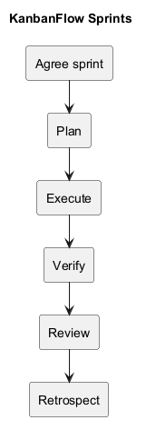
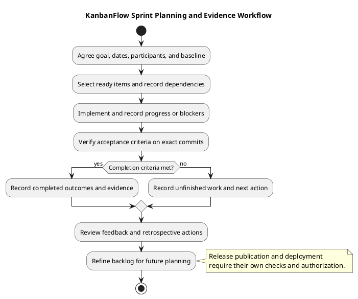

# KanbanFlow Sprints

> **Policy amendment (2026-10-10):** Membership mutations are now owner-only; DEC-003/PB-001's bypass is fixed. Earlier open-policy text and diagrams below describe the preceding state. See [QA corrections](../SDLC/06-testing/qa-corrections-2026-10-10.md) for the selected rule and regression evidence.

This section provides guides and templates for planning, executing, and reviewing agreed sprints. It does not establish dated sprint history, staffing, velocity, or completion from repository commits. Historical delivery milestones are recorded in the [milestones index](../Project-Management/milestones.md).

Use a sprint to pursue a clear user or operational outcome within agreed dates and available capacity. The guidance here complements KanbanFlow's backlog and ongoing workflow; it does not impose a fixed sprint length or invent commitments for the project.

## Find a guide

| Guide | Use it to | Expected record |
| --- | --- | --- |
| [Sprint planning](sprint-planning.md) | Agree the goal, capacity, scope, and dependencies | Selected items and explicit exclusions |
| [Sprint backlog](sprint-backlog.md) | Track selected work and acceptance criteria | Owner, state, blockers, and evidence per item |
| [Sprint record](sprint-record-template.md) | Capture sprint identity and closure | Dates, participants, baseline, changes, and outcome |
| [Daily progress](daily-progress.md) | Keep progress and blockers visible | Actual observations and next actions |
| [Definition of Ready](definition-of-ready.md) | Assess whether an item can be selected | Clear scope and feasible verification |
| [Definition of Done](definition-of-done.md) | Assess whether agreed work is complete | Demonstrated outcomes and relevant review/checks |
| [Sprint review](sprint-review.md) | Compare outcomes with acceptance criteria | Demonstrated results, gaps, and feedback |
| [Sprint retrospective](sprint-retrospective.md) | Improve the working process | Specific actions, owners, and follow-up |
| [Sprint metrics](sprint-metrics.md) | Interpret measured progress | Defined measures, sample limits, and evidence |

## Before starting

Agree a sprint identifier, start/end dates, participants, one coherent goal, and the source baseline. Identify the actual available capacity rather than assuming a team size or deriving effort from commit counts.

Select items from the [product backlog](../Project-Management/product-backlog.md) after [refinement](../Project-Management/backlog-refinement.md). Each selected item needs an observable outcome, acceptance criteria, an accountable owner, dependencies, and a verification approach. Apply the Definition of Ready before committing to implementation.

Items that require unresolved policy remain blocked for enforcement work. The membership remove/re-add role loophole is tracked in PB-001 and DEC-003; sprint selection does not resolve that decision. Separate policy investigation from implementation that depends on its outcome.

## Create an actual sprint record

Copy the relevant templates into a dedicated folder only after a sprint is agreed. This example is a suggested layout, not an existing sprint or scheduled commitment:

```text
docs/Sprints/sprint-001/
  README.md
  backlog.md
  progress.md
  review.md
  retrospective.md
```

Use the sprint record template for `README.md` and adapt the other templates to their purpose. Replace placeholders with actual dates, owners, scope, and evidence. Update copied relative links so they resolve from the new folder. If copying diagram references, adjust their paths or provide the relevant source and preview; do not leave broken references.

Link the actual sprint record from this index when it exists. Preserve completed records as historical evidence and label later corrections. No actual dated sprint is asserted by the example above.

## Work through the sprint

| Step | Record | Decision |
| --- | --- | --- |
| Plan | Goal, selected items, capacity, exclusions, baseline | Is scope feasible and sufficiently ready? |
| Execute | Implementation references, progress, blockers | What is needed to continue toward the goal? |
| Adapt | Reason for scope changes and effect on the goal | Should an item be split, deferred, or replaced? |
| Verify | Exact commit, environment, checks, results, and gaps | Are the acceptance criteria demonstrated? |
| Review | Completed and unfinished outcomes plus feedback | What is accepted and what returns to the backlog? |
| Retrospect | Process observations and owned actions | What should change in the next cycle? |

Use the backlog states consistently: Proposed, Ready, In progress, Blocked, In review, Verified, and Done. A blocked item includes its reason and next action. Verified identifies the tested revision and result; Done requires the agreed completion criteria. Reopen or recheck affected work when later changes invalidate the evidence.

Progress records should describe actual developments rather than repeat a plan as if it happened. Record material decisions in the [decision register](../Project-Management/decision-register.md) and link them from the sprint so the same policy is not described differently in two places.

## Verification and completion

Use the [verification template](../Releases/verification-template.md) for detailed check evidence. Record pass, fail, blocked, not run, and justified not-applicable states separately. Choose checks according to affected behavior and the [quality and risk plan](../Project-Management/quality-and-risk-plan.md).

- Identify the implemented commit and the acceptance criteria it addresses.
- Record relevant automated checks and scoped review results.
- Verify affected browser journeys when interaction or visible state changes.
- Check relevant database contention boundaries with isolated data when locking behavior changes.
- Update affected documentation and preserve remaining defects and skipped checks.

Build success does not demonstrate usability. SQLite regressions do not establish MySQL contention behavior. Historical release test totals cannot be carried forward as new sprint evidence.

An item that fails completion criteria remains unfinished. At sprint closure, record its current state and next action, then refine or reselect it for future work. Do not mark it Done merely because the sprint's end date arrived.

## Review, retrospective, and metrics

The review compares demonstrated outcomes with the agreed goal and criteria. Identify what was accepted, what remains incomplete, and what feedback changes future priorities. Do not invent attendance, sign-off, or user feedback.

The retrospective concerns the working process. Choose actionable improvements with owners and a follow-up point; link unresolved actions when the next sprint is planned.

Use metrics only when their definitions and underlying observations are available. Distinguish scope changes from delivery, and keep blocked time or unfinished work visible. Do not infer velocity, dates, person-hours, or team performance from commits, test counts, or unfilled templates.

## Release and deployment boundary

Sprint completion, source merge, version publication, and deployment are separate events. A sprint review does not automatically authorize a tag, GitHub release, production update, or data operation. Link any separately completed release record to the sprint and use the [release checklist](../Releases/release-checklist.md) and [upgrade guidance](../Releases/upgrade-and-rollback.md).

Document outcomes at the tested revision even if `main` later advances. Keep open risks visible when planning a release; a successful sprint does not imply production readiness or successful recovery testing.

## Related guidance and maintenance

- [Documentation index](../README.md)
- [Management sprint workflow](../Project-Management/sprint-workflow.md)
- [Product backlog](../Project-Management/product-backlog.md)
- [Traceability](../Project-Management/traceability.md)
- [Milestones](../Project-Management/milestones.md)
- [Release index](../Releases/README.md)
- [Diagram guide](../diagram-guide.md)

Keep this index and copied record links current when adding or moving sprint documents. Maintain the diagram source, embedded block, and preview together. Changes to these guides are process documentation; they do not prove that a sprint has been run.

## Sprint workflow diagram



[PlantUML source](diagrams/README.puml)


