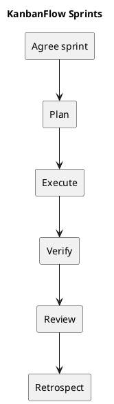

# KanbanFlow Sprints

This section provides a complete working kit for planning and reviewing sprints. No dated sprint history, velocity, staffing, or completion record is inferred from repository commits. Historical milestones are tracked separately.

## Guides and templates

- [Sprint Planning](sprint-planning.md)
- [Sprint Backlog Template](sprint-backlog.md)
- [Sprint Record Template](sprint-record-template.md)
- [Daily Progress and Blockers](daily-progress.md)
- [Definition of Ready](definition-of-ready.md)
- [Definition of Done](definition-of-done.md)
- [Sprint Review Template](sprint-review.md)
- [Sprint Retrospective Template](sprint-retrospective.md)
- [Sprint Metrics and Evidence](sprint-metrics.md)

## Use the kit

Copy the templates into a new folder such as sprint-001 only when a sprint is agreed. Replace placeholders with actual goals, dates, owners, and evidence. Record pending work honestly. A sprint review does not automatically authorize a release or deployment.

See [milestones](../Project-Management/milestones.md), [product backlog](../Project-Management/product-backlog.md), and [release guidance](../Releases/README.md).

## Related guidance

- [Sprint index](README.md)
- [Management sprint workflow](../Project-Management/sprint-workflow.md)

## PlantUML diagram

[Editable source](diagrams/README.puml)

