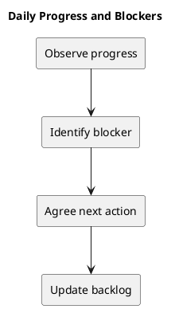

# Daily Progress and Blockers

Use a short progress record when helpful; no mandatory daily meeting cadence is established here.

## Record format

| Date | Progress toward goal | Next action | Blocker | Owner |
| --- | --- | --- | --- | --- |
| Actual date | Observed result | Concrete next step | Reason or none | Actual owner |

## Blocker handling

Describe the missing decision, dependency, or failed check. Assign a next action where agreed and update the backlog state. Avoid substituting an unapproved workaround for an unresolved requirement.

Track outcomes rather than hours or activity alone.

## Related guidance

- [Sprint index](README.md)
- [Management sprint workflow](../Project-Management/sprint-workflow.md)

## PlantUML diagram

[Editable source](diagrams/daily-progress.puml)

