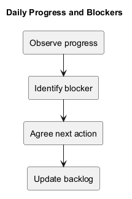
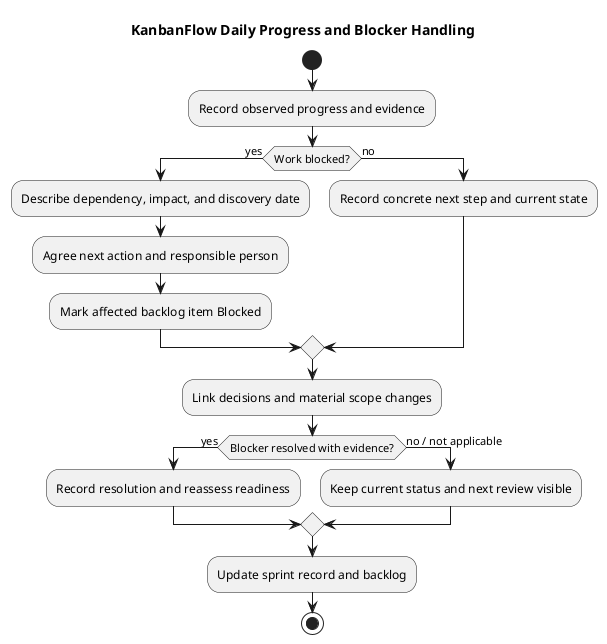

# KanbanFlow Daily Progress and Blockers

> **Policy amendment (2026-10-10):** Membership mutations are now owner-only; DEC-003/PB-001's bypass is fixed. Current guidance below reflects this rule; historical records retain their original scope. See [QA corrections](../SDLC/06-testing/qa-corrections-2026-10-10.md) for the selected rule and regression evidence.

Use a short progress record to show what changed toward an agreed sprint goal, what should happen next, and what prevents progress. Update it when useful progress or a material blocker occurs. This guide does not establish a mandatory daily meeting, reporting schedule, or historical sprint activity.

The record supports coordination and review. Describe observed outcomes rather than hours, commit counts, or activity alone. An implementation step and a verified user outcome are different states.

## Where to keep the record

For an agreed sprint, create a progress document in its actual record folder as described in the [sprint index](README.md). Link it to the [sprint backlog](sprint-backlog.md) and [sprint record](sprint-record-template.md). Do not overwrite this reusable guide with an invented sprint log.

Use the actual observation date and identify the author or responsible person where needed. If recording an earlier observation later, distinguish the observation date from the entry date. Include the timezone for time-sensitive events; do not reconstruct missing times from assumptions.

## Copyable progress record

Replace the placeholders below with actual observations. Add one row per useful item update; the rows are a template, not performed work.

| Observation date | Sprint/item reference | Progress toward goal | Evidence and revision | Current state | Next action | Responsible person | Blocker reference |
| --- | --- | --- | --- | --- | --- | --- | --- |
| Actual date | Link to actual sprint and item | Observable result or explicit no change | Commit/check/document link, or pending | Agreed backlog state | Concrete next step | Agreed person, or unassigned | Link to blocker, or none observed |

For a short narrative entry, use these fields:

```text
Observation date and entry date if different:
Sprint goal and affected item:
Observed progress:
Evidence and exact revision:
Current state:
Blocker and impact, if any:
Next action and responsible person:
Next review point, if agreed:
Scope change or decision reference:
```

Keep entries concise but specific. “Task movement implemented; browser persistence check pending” is more useful than “Worked on dragging.” Do not record a pending check as passed or a proposed action as completed.

## State and evidence rules

Use the backlog's states: Proposed, Ready, In progress, Blocked, In review, Verified, and Done. State changes should explain the underlying event rather than merely repeat the label.

| Observation | Appropriate interpretation |
| --- | --- |
| Code written, checks pending | Implementation progress; completion remains unverified. |
| Relevant check passed on an identified revision | Evidence for that check and revision, within its stated scope. |
| Required check failed or cannot run | Record failure or verification gap and its effect on acceptance. |
| Dependency prevents the next required step | Mark the affected item Blocked and record its next action. |
| Completion criteria demonstrated and reviewed | Assess Done using the agreed Definition of Done. |

Link exact commits for source-related evidence and identify the environment for runtime checks. Use the [verification template](../Releases/verification-template.md) for detailed results; the progress record can link to it instead of duplicating logs. Build success does not prove browser usability, and SQLite regression results do not prove MySQL contention behavior.

Do not include credentials, private user data, or complete sensitive logs. Summarize the relevant result and link an appropriate evidence location. Record unavailable evidence as pending, blocked, or not run rather than inventing artifacts.

## Blocker register

Track blockers with enough information to support a next step. Assign an identifier within the actual sprint record; example identifiers are placeholders, not repository issues.

| Blocker ID | Affected items | Discovered on | Cause or missing dependency | Impact on goal | Next action | Responsible person | Review point | State | Resolution evidence |
| --- | --- | --- | --- | --- | --- | --- | --- | --- | --- |
| To be assigned | Actual item links | Observed date | Specific unmet need | Work prevented or delayed | Agreed action | Agreed person or unassigned | Agreed date/event or pending | Open | Pending |

Use Open, In progress, and Resolved for blocker handling. These describe the blocker, not the backlog item's completion state. A resolved blocker may permit implementation to resume; it does not automatically make the affected item Verified or Done.

Do not assign another person responsibility without agreement. If ownership is missing, record it as unassigned and make agreeing ownership the next action.

## Handle a blocker

1. Identify the specific missing decision, dependency, access, or failed check and the affected item.
2. Record the observed impact and mark work Blocked when it prevents the required next step.
3. Agree a feasible next action, responsible person, and review point; leave unavailable details pending.
4. Continue independent work that does not rely on the missing condition, if it still supports the sprint goal.
5. Link material policy decisions in the [decision register](../Project-Management/decision-register.md) and record any agreed scope change.
6. On resolution, capture evidence, reassess readiness, and update affected item states.

Avoid substituting an unapproved workaround for an unresolved requirement. DEC-003/PB-001 records the owner-only membership correction; a daily note alone cannot authorize future permission changes or establish their verification.

When a blocker threatens the goal or an agreed delivery decision, bring the recorded impact and options to the people responsible for that decision. This guide specifies no automatic escalation deadline or notification channel. Record the actual decision instead of assuming approval from elapsed time.

## Scope changes and corrections

Record additions, removals, splits, or substitutions with their reason and effect on the goal. Link the corresponding backlog or decision update. A daily progress entry should not silently turn new work into an agreed commitment.

Preserve important earlier observations. Add a dated correction when later evidence changes a result, identifying which claim changed and why. Do not rewrite a historical failed check as if it originally passed.

## Review and closure

Before a [sprint review](sprint-review.md), reconcile progress entries with the backlog and verification records. Highlight completed outcomes, unfinished items, unresolved blockers, and gaps. At closure, record next actions for unfinished work without automatically marking it Done or scheduling it into a future sprint.

Use actual blocker observations for [sprint metrics](sprint-metrics.md). If discovery or resolution timestamps are unavailable, elapsed duration is unknown. Avoid inferring effort, velocity, or individual performance from the log.

Bring recurring causes to the [retrospective](sprint-retrospective.md), where process improvements receive agreed owners and follow-up. Sprint review and blocker resolution do not authorize release publication or deployment.

## Entry quality checklist

- The observation date, affected goal/item, and current state are clear.
- Progress is an observed outcome; pending checks remain explicit.
- Evidence identifies the relevant revision and scope where applicable.
- A blocker states its impact, next action, and agreed owner or missing ownership.
- Material scope changes and decisions are linked.
- Resolutions include evidence and do not imply unrelated work is complete.
- Sensitive data is excluded, and relative links work from the record's location.

## Related guidance

- [Sprint index](README.md)
- [Sprint backlog](sprint-backlog.md)
- [Definition of Ready](definition-of-ready.md)
- [Definition of Done](definition-of-done.md)
- [Management sprint workflow](../Project-Management/sprint-workflow.md)
- [Quality and risk plan](../Project-Management/quality-and-risk-plan.md)
- [Diagram guide](../diagram-guide.md)

## Progress and blocker diagram



[PlantUML source](diagrams/daily-progress.puml)


