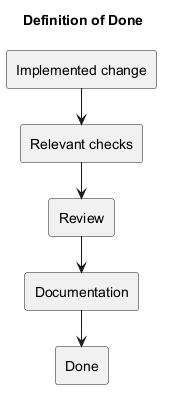
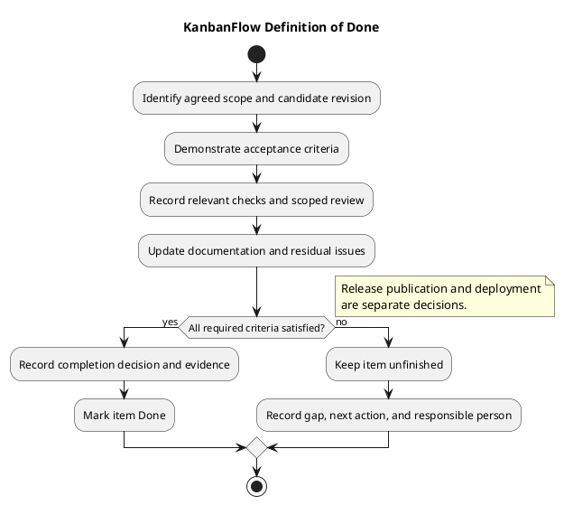

# KanbanFlow Definition of Done

> **Policy amendment (2026-10-10):** Membership mutations are now owner-only; DEC-003/PB-001's bypass is fixed. Earlier open-policy text and diagrams below describe the preceding state. See [QA corrections](../SDLC/06-testing/qa-corrections-2026-10-10.md) for the selected rule and regression evidence.

An item is Done when its agreed outcome is demonstrated, relevant checks pass, scoped review is complete, and affected documentation is updated. Completion is assessed against the item's acceptance criteria and an identified source revision, not against elapsed time or the amount of activity performed.

This guide defines a completion gate for sprint work. It does not assert that existing backlog items already satisfy the gate or that a completed item has been released or deployed. Agree material item-specific requirements during [planning](sprint-planning.md) and [readiness assessment](definition-of-ready.md).

## Completion criteria

| Criterion | Required evidence | Completion boundary |
| --- | --- | --- |
| Outcome | Observable acceptance criteria linked to the item | Implementation activity alone is insufficient. |
| Scope | Final change matches agreed scope and exclusions | Material changes require a recorded decision. |
| Source identity | Exact implemented and tested commit; disclose uncommitted changes if present | Evidence must identify what was checked. |
| Correctness | Relevant checks and affected failure paths | Historical test counts cannot substitute for candidate evidence. |
| Review | Actual scoped review result and unresolved findings | Do not invent reviewers or approval. |
| Documentation | Changed behavior, configuration, or process explained in its owning document | A documentation update must match the final implementation. |
| Residual issues | Remaining defects and verification gaps linked with impact and next action | Required unresolved criteria prevent Done. |
| Change hygiene | Intended files reviewed; secrets and unrelated changes excluded | Completion must be assessable from the change and record. |

Use proportionate checks. A document-only change normally needs content, link, and diagram verification, rather than an application test run. A change to authorization or movement needs evidence for those behaviors. Select checks through the [quality and risk plan](../Project-Management/quality-and-risk-plan.md).

## Verification by change type

| Change affects | Relevant checks to consider |
| --- | --- |
| Backend behavior | Focused regression tests and applicable suite checks, validation, errors, and persistence |
| Permissions or private data | Direct requests, current/removed membership, relevant roles, and aggregate/list responses |
| Frontend behavior | Lint, TypeScript/build checks, affected browser journeys, loading and failure feedback |
| UI or accessibility | Keyboard operation, focus, readable light/dark states, responsive layout, and accessible feedback |
| Task movement or ordering | Persistence after reload, rejection/rollback, ordering, and relevant WIP behavior |
| Locking or contention | Authorized isolated database experiments for affected concurrency boundaries |
| Configuration or upgrade | Actual environment values without secrets, compatibility implications, and scoped recovery guidance |
| Documentation | Factual accuracy, resolved links, synchronized PlantUML sources, and readable previews |

These are check-selection prompts, not a requirement to execute every check for every item. Record why a check is relevant or not applicable. If required verification cannot run, record the limitation and keep the affected completion criterion unresolved.

Backend tests using in-memory SQLite do not establish MySQL contention behavior. Build success does not demonstrate browser usability. A passing scenario supports that scenario at the checked revision; it does not establish a complete browser matrix or production capacity.

## Evidence states and decision

Use Pass, Fail, Blocked, Not run, and justified Not applicable for individual checks, as described in the [verification template](../Releases/verification-template.md). Link detailed evidence rather than copying results into multiple inconsistent records.

- Pass records the demonstrated criterion, revision, environment, and result.
- Fail records the observed mismatch and next action.
- Blocked identifies the missing dependency or condition needed for the check.
- Not run states that execution has not occurred.
- Not applicable explains why the check does not apply to the agreed scope.

A required failed, blocked, or unexecuted check prevents completion. An unrelated known issue can remain open if it does not prevent the agreed outcome, but its impact and tracking reference must remain visible. Do not quietly lower the criteria after a failed check; record and obtain the appropriate agreement for a legitimate scope change.

The membership remove/re-add role loophole remains tracked by PB-001 and DEC-003 in the [backlog](../Project-Management/product-backlog.md) and [decision register](../Project-Management/decision-register.md). It prevents declaring that enforcement item complete while unresolved; it does not automatically prevent completion of every unrelated documentation item.

## Copyable completion record

Replace placeholders with actual evidence. This is a reusable record, not completed verification.

```text
Item and agreed outcome:
Acceptance criteria reference:
Final scope and exclusions:
Implemented revision:
Tested revision and working-tree differences, if any:
Environment and relevant checks:
Results and evidence links:
Scoped review result and actual reviewer, if applicable:
Documentation updated:
Remaining issues and effect on acceptance:
Completion decision, date, and responsible person:
Next action if unfinished:
```

For multiple criteria, add an acceptance table:

| Criterion | Check and evidence | Revision | Result | Remaining gap |
| --- | --- | --- | --- | --- |
| Actual criterion | Actual observation or pending evidence | Exact commit or documented candidate | Actual result state | Explicit gap or none observed |

Do not copy a historical suite total into this record as a fresh result. If source changes after verification, reassess which evidence remains applicable and rerun affected checks before relying on it.

## State transitions and unfinished work

Use the [sprint backlog](sprint-backlog.md) states consistently. In review indicates review is underway. Verified indicates identified checks demonstrated their stated scope. Done additionally requires the agreed completion criteria and documentation/review obligations to be satisfied.

If criteria are unmet, keep the item in its actual state and record the gap, next action, and responsible person in [daily progress](daily-progress.md). A sprint end date, merge, or successful build does not automatically move an item to Done.

At closure, [review](sprint-review.md) the goal and item outcomes. Return unfinished work to refinement or future selection with its actual state; do not assume automatic carryover or a future delivery date. If later evidence invalidates completion, record the correction and reopen or create linked follow-up work according to its scope.

## Completion, release, and deployment

Done is an item-level decision. Sprint completion evaluates the agreed goal and selected outcomes. Merge incorporates source. A tag or GitHub release identifies a published version. Deployment updates an environment. Record these separately.

Publishing and deployment need their own applicable checks and authorization. Use the [release checklist](../Releases/release-checklist.md), [release pipeline](../Project-Management/release-pipeline.md), and [upgrade and rollback guidance](../Releases/upgrade-and-rollback.md). Item completion does not establish production readiness, backup restoration, or an operational service guarantee.

## Maintain the criteria

Review this guide when a new risk or recurring verification gap changes the working process. Record material decisions and communicate changed criteria before using them to assess work. Preserve historical completion evidence and explain later corrections instead of rewriting past outcomes.

Keep the source, embedded PlantUML, and image preview aligned using the [diagram guide](../diagram-guide.md). Return to the [sprint index](README.md) and [management sprint workflow](../Project-Management/sprint-workflow.md) for the wider process.

## Completion decision diagram



[PlantUML source](diagrams/definition-of-done.puml)


