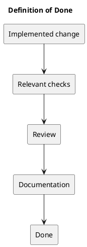

# Definition of Done

An item is done when its agreed outcome is demonstrated, relevant checks pass, scoped review is completed, and affected documentation is updated.

## Evidence checklist

- Identify the implemented commit and affected requirements.
- Record relevant backend tests and frontend lint/type/build results.
- Verify affected browser journeys or concurrency boundaries when applicable.
- Keep open defects and skipped checks explicit.
- Confirm no unrelated changes or secrets enter the change.

Backend SQLite tests do not establish MySQL contention behavior. Build success does not prove usability. Publishing and deploying remain separate authorized actions.

## Related guidance

- [Sprint index](README.md)
- [Management sprint workflow](../Project-Management/sprint-workflow.md)

## PlantUML diagram

[Editable source](diagrams/definition-of-done.puml)

