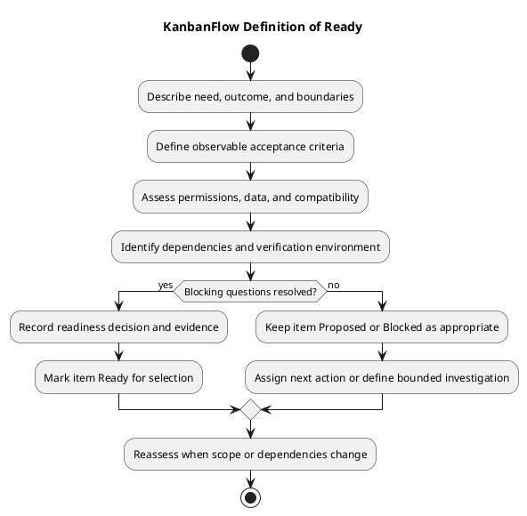

# KanbanFlow Definition of Ready

> **Policy amendment (2026-10-10):** Membership mutations are now owner-only; DEC-003/PB-001's bypass is fixed. Earlier open-policy text and diagrams below describe the preceding state. See [QA corrections](../SDLC/06-testing/qa-corrections-2026-10-10.md) for the selected rule and regression evidence.

An item is Ready for sprint selection when its user problem, intended outcome, scope, acceptance criteria, dependencies, and verification approach are sufficiently clear to begin the agreed work. Readiness reduces avoidable uncertainty; it does not require every implementation detail to be designed in advance.

This is a planning gate, not a claim that current backlog candidates already meet it. Ready does not mean selected, implemented, verified, released, or deployed. Use the [Definition of Done](definition-of-done.md) to assess completion after work occurs.

## Readiness criteria

| Criterion | What to establish | Record |
| --- | --- | --- |
| User need | Who is affected and what problem should change | Problem and intended outcome |
| Scope | Included behavior and explicit exclusions | Bounded item description |
| Acceptance | Observable success and relevant rejection/failure behavior | Criteria that can be checked |
| Permissions | Relevant roles, access boundaries, and policy decisions | Rules or linked unresolved decisions |
| Data | Persistence, integrity, sensitive data, and migration effects | Applicable constraints and risks |
| Compatibility | Affected clients, configuration, dependencies, or upgrades | Known impact and assumptions |
| Dependencies | Required decisions, access, services, and preceding work | Owner, condition, and status |
| Verification | Feasible checks in an authorized environment | Scenarios, evidence plan, and limitations |
| Capacity | Work can reasonably fit the agreed planning context | Estimate or sizing rationale if used |

Apply the criteria proportionately. For a documentation item, identify the owning document, factual sources, link checks, and any diagram update. For an authorization change, identify roles, direct requests, and data visibility boundaries. Do not invent estimates, staffing, or available environments to make an item appear ready.

## Write observable acceptance criteria

State a trigger, relevant conditions, and expected result. Include failure behavior when it affects correctness or user trust. Separate the requested outcome from a suggested implementation.

For example, a proposed task-movement item could require that a rejected move restores the visible source/destination lists and that reload confirms the original persisted state. This is an example criterion, not a new scheduled item or fresh evidence of current behavior.

Avoid vague criteria such as “works well” or “improve security.” Specify what a reviewer can observe, which roles or states apply, and what remains outside scope. Link related requirements through [traceability](../Project-Management/traceability.md).

## Dependencies and unresolved questions

| Condition | Readiness treatment |
| --- | --- |
| A required policy decision is missing | Keep dependent enforcement work Blocked until the rule is agreed. |
| Required test access or environment is unavailable | Record the limitation and next action; do not assume verification can occur. |
| Implementation detail can be resolved within bounded work | Record the assumption or investigation step and its effect on acceptance. |
| Scope is too large or mixes independent outcomes | Split during refinement and retain dependency links. |
| Required preceding work has a clear completion condition | Record the dependency and assess whether it prevents starting the selected scope. |

The manager remove/re-add role issue depends on the membership-policy decision tracked by DEC-003 and PB-001 in the [decision register](../Project-Management/decision-register.md) and [product backlog](../Project-Management/product-backlog.md). Dependent enforcement implementation remains blocked while that policy is undecided.

A bounded investigation can be ready even when the implementation it informs is not. Define its question, scope, expected decision/evidence output, and stopping point. Completing investigation does not automatically resolve policy or implement the resulting feature.

Assign dependency follow-up to an agreed person. If responsibility is unknown, record it as unassigned and make ownership agreement a next action. Elapsed time or a planning entry does not constitute approval.

## Verification feasibility

Choose checks according to the [quality and risk plan](../Project-Management/quality-and-risk-plan.md) and the affected behavior. Identify whether evidence needs automated tests, browser observations, database experiments, or documentation review.

- Backend checks should identify relevant validation, authorization, and persistence behavior.
- Frontend checks should include affected interaction and failure feedback where applicable.
- Locking changes may require isolated MySQL contention checks; SQLite results do not establish that behavior.
- Documentation checks should include source accuracy, relative links, and readable diagram previews.
- Configuration or upgrade work should identify actual environment assumptions without including secrets.

Record what the environment can and cannot demonstrate. Use the [verification template](../Releases/verification-template.md) for eventual results, while keeping this readiness assessment a plan. Existing historical release test counts do not verify a proposed candidate.

## Copyable readiness record

Replace placeholders with agreed facts; this template is not evidence of an actual readiness decision.

```text
Item and user problem:
Intended outcome:
Scope and exclusions:
Acceptance criteria:
Relevant permissions and policy references:
Data and compatibility implications:
Dependencies, conditions, and agreed owners:
Assumptions and unresolved questions:
Verification scenarios and authorized environment:
Capacity or sizing rationale, if used:
Readiness decision, date, and responsible person:
Next action if not ready:
```

For a detailed review, record criterion states:

| Criterion | Assessment | Evidence or decision reference | Gap and next action |
| --- | --- | --- | --- |
| Actual criterion | Satisfied / unresolved / justified not applicable | Actual source or pending | Explicit action or none identified |

Use an actual decision date. Do not infer sign-off from repository commits or fill missing fields with invented reviewers or outcomes.

## Selection and state transitions

Refine Proposed items using the [backlog refinement guide](../Project-Management/backlog-refinement.md). Mark an item Ready when its applicable readiness criteria are met. Use Blocked when an identified dependency prevents required progress, and record it through [daily progress and blockers](daily-progress.md).

Selection during [sprint planning](sprint-planning.md) also considers the goal, priorities, and actual capacity. Readiness does not guarantee selection or a delivery date. Record selected work in the [sprint backlog](sprint-backlog.md) and preserve exclusions and dependencies.

If scope, policy, or dependencies change, reassess readiness rather than relying on the original label. Keep material decisions and their impact visible. Avoid adding unrelated work silently to a selected item.

## Readiness review checklist

- The outcome and user problem are concrete.
- Scope is bounded and exclusions are explicit.
- Acceptance criteria are observable, including relevant failures.
- Permission, data, and compatibility implications are assessed.
- Blocking decisions and dependencies are resolved or clearly prevent selection.
- Verification is feasible and authorized; limitations are recorded.
- The proposed work fits the agreed planning context without invented capacity.
- The decision and next action are recorded with real ownership where agreed.

Readiness does not authorize release publication, deployment, or data operations. Those require their own decisions and checks, described in the [release index](../Releases/README.md).

## Maintenance and related guidance

Review criteria when recurring ambiguity or verification gaps reveal a planning weakness. Record material changes in the decision register and apply them openly to future assessments. Preserve historical readiness records and label later corrections.

See the [sprint index](README.md), [management sprint workflow](../Project-Management/sprint-workflow.md), and [Definition of Done](definition-of-done.md). Maintain diagram source, embedded block, and preview together using the [diagram guide](../diagram-guide.md).

## Readiness decision diagram


[PlantUML source](diagrams/definition-of-ready.puml)


