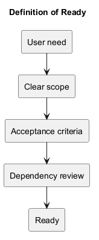
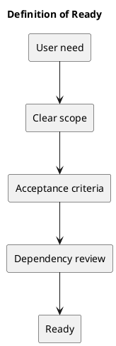

# Definition of Ready

An item is ready for selection when:

- The user problem and intended outcome are explicit.
- Scope and exclusions are understood.
- Acceptance criteria are observable.
- Permission, data, and compatibility implications are assessed.
- Dependencies and unresolved questions are visible.
- Verification is feasible in an authorized environment.

Readiness is a proposed planning gate, not a claim that current backlog candidates already satisfy it. Items requiring an undecided membership policy remain blocked for enforcement implementation.

## Related guidance

- [Sprint index](README.md)
- [Management sprint workflow](../Project-Management/sprint-workflow.md)

## PlantUML diagram

[Editable source](diagrams/definition-of-ready.puml)

