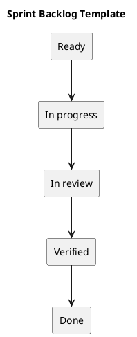

# Sprint Backlog Template

Copy this table for an actual sprint; the example IDs below are placeholders, not scheduled commitments.

| Item | User outcome | Acceptance criteria | Owner | Dependency | State | Evidence |
| --- | --- | --- | --- | --- | --- | --- |
| ITEM-001 | To be agreed | Observable result | To be assigned | To be identified | Proposed | Pending |

## State conventions

Use Proposed, Ready, In progress, Blocked, In review, Verified, and Done. Blocked items include a reason and next action. Verified items identify the tested commit and result. Done means the agreed completion criteria are met.

Do not treat a started task or a successful build as complete user behavior.

## Related guidance

- [Sprint index](README.md)
- [Management sprint workflow](../Project-Management/sprint-workflow.md)

## PlantUML diagram

[Editable source](diagrams/sprint-backlog.puml)

