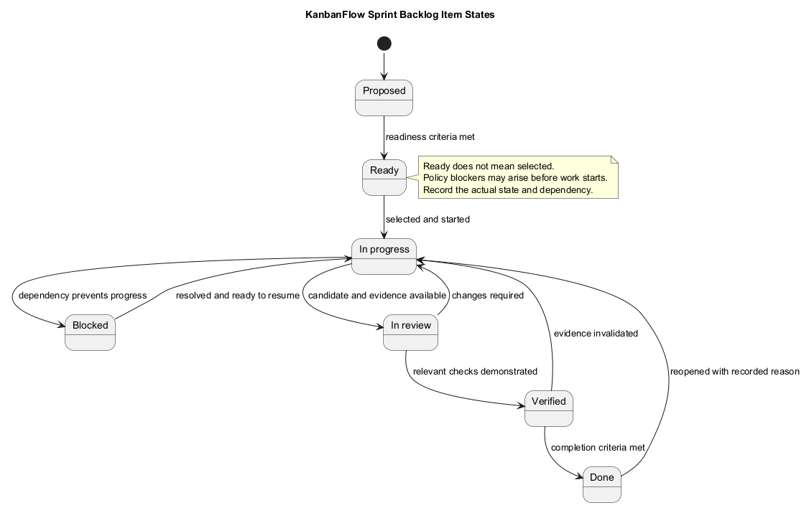
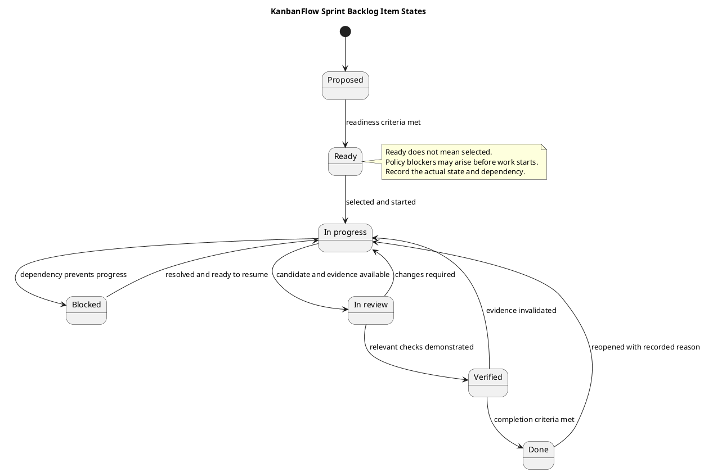

# KanbanFlow Sprint Backlog Template

Use a sprint backlog to record the work selected for an agreed sprint, its intended outcomes, current states, dependencies, and evidence. It is a working record linked to the sprint goal, not a promise that every proposed item will be completed.

This document is a reusable guide and template. Placeholder items, dates, and owners below are not scheduled commitments or actual sprint history. Create a record using the [sprint index](README.md) only after the sprint is agreed.

## Product backlog and sprint backlog

The [product backlog](../Project-Management/product-backlog.md) holds broader candidate work and priorities. The sprint backlog records the selected scope and its execution details. Link selected items to their product backlog references; preserve traceability without maintaining conflicting copies of requirements.

An item being Ready does not automatically select it. [Sprint planning](sprint-planning.md) considers the goal, priorities, dependencies, and available capacity. Record exclusions and deferred candidates explicitly when they matter to the goal.

## Sprint identity and scope

Start an actual backlog record with these fields:

```text
Sprint identifier and record link:
Agreed dates and participants:
Sprint goal:
Baseline commit:
Selected scope:
Explicit exclusions:
Capacity or sizing assumptions, if used:
Dependencies and unresolved questions:
```

Use actual dates and agreed ownership. Do not infer capacity, effort, or selection from commit counts. Link the [sprint record](sprint-record-template.md) for the overall identity and closure information.

## Copyable backlog table

Replace the example row with actual selected work. Large acceptance criteria or evidence records can be linked instead of making this table unreadable.

| Item | Product reference | Intended outcome | Acceptance criteria | Agreed owner | Dependency/blocker | State | Evidence and revision | Next action |
| --- | --- | --- | --- | --- | --- | --- | --- | --- |
| Placeholder ID | Actual link or pending | Outcome to be agreed | Observable criteria or link | To be agreed | Actual dependency or none identified | Proposed | Pending | Concrete next step |

Use stable identifiers within the actual sprint record. These identifiers are not automatically GitHub issue numbers. Where ownership is unassigned, state that and record agreeing an owner as a next action.

## Item detail template

Use this when an item needs more explanation than a row allows:

```text
Item identifier and product backlog reference:
User problem and intended outcome:
Scope and exclusions:
Acceptance criteria:
Permission, data, and compatibility implications:
Dependencies and linked decisions:
Agreed owner:
Current state and observation date:
Implemented/tested revisions:
Check results and evidence links:
Remaining gaps or blockers:
Next action:
Completion decision, when actually made:
```

Keep acceptance criteria aligned with the [Definition of Ready](definition-of-ready.md). Describe relevant success and failure behavior so a reviewer can assess the outcome. A technical subtask should link to the user outcome it supports rather than quietly replacing that outcome.

## State conventions

| State | Meaning | Record before changing state |
| --- | --- | --- |
| Proposed | Candidate scope is being clarified | Problem, intended outcome, and open questions |
| Ready | Applicable readiness criteria are met | Readiness assessment and dependencies |
| In progress | Agreed implementation or investigation has started | Current work, owner, and next action |
| Blocked | A condition prevents a required next step | Cause, impact, next action, and agreed owner |
| In review | Candidate work and evidence are being assessed | Revision, criteria, and review/check status |
| Verified | Relevant checks demonstrate their stated scope | Tested revision, environment, results, and limits |
| Done | All agreed completion criteria are satisfied | Actual completion decision and evidence |

States describe work; they are not a rigid application-enforced workflow. Blockers can occur during refinement, implementation, or review. After resolving one, reassess the item and return it to the appropriate state rather than assuming it is Done.

Use the [Definition of Done](definition-of-done.md) for completion. A started task, merge, elapsed sprint date, or successful build alone does not demonstrate complete user behavior. Reopen affected work or create linked follow-up when later evidence invalidates a completion claim, recording the reason.

## Dependencies and blockers

Link blockers in [daily progress](daily-progress.md). Describe the missing condition, the affected criterion or next step, and what would resolve it. Continue independent work only when it does not depend on the missing condition and still supports the goal.

The membership-policy decision in DEC-003 and related PB-001 work remain tracked in the [decision register](../Project-Management/decision-register.md) and product backlog. Do not mark dependent role-enforcement implementation Ready or Done while its required policy is unresolved. A bounded investigation may be separately defined with its own question and evidence output.

## Scope changes

Track material additions, removals, splits, and substitutions. Preserve the original selected scope or a baseline reference so changes remain understandable.

| Observation date | Item/change | Reason | Effect on goal/capacity | Decision reference | Next action |
| --- | --- | --- | --- | --- | --- |
| Actual date | Actual change | Observed cause | Explicit impact | Actual agreement or pending | Concrete action |

Do not silently convert new requests into committed scope. Record the agreed decision and update linked acceptance criteria and records. If an item is split, link the resulting items and retain the unfinished part's actual state.

## Evidence and verification

Use the [verification template](../Releases/verification-template.md) for detailed checks. Record Pass, Fail, Blocked, Not run, and justified Not applicable separately. Identify exact revisions and disclose relevant working-tree changes so the checked candidate can be understood.

Select checks through the [quality and risk plan](../Project-Management/quality-and-risk-plan.md). Frontend build success does not establish usability; SQLite tests do not establish MySQL contention behavior. Historical release totals are not fresh sprint results.

Keep failed checks and required gaps visible. If the source changes after verification, assess which checks need rerunning before relying on the earlier result. Avoid duplicating detailed logs across the backlog and progress record; link a maintained evidence record instead.

## Review and closure

At [sprint review](sprint-review.md), compare demonstrated outcomes with the goal and criteria. Reconcile table states, progress entries, and verification results. Record accepted outcomes, unfinished work, unresolved blockers, and feedback.

At closure, record the next action for unfinished work. Return it to refinement or future selection without implying automatic scheduling or completion. Use the [retrospective](sprint-retrospective.md) for recurring process issues and [metrics guide](sprint-metrics.md) for measures supported by actual observations.

Done, source merge, release publication, and deployment remain separate events. Link any actual release record without treating sprint completion as authorization for publication or environment changes.

## Record quality and maintenance

- Each item links to the goal and observable criteria.
- States reflect actual observations, with blockers and next actions visible.
- Owners and decisions are agreed or explicitly pending.
- Material scope changes preserve their reason and impact.
- Verification identifies revisions, results, and limitations.
- Unfinished work remains visible at closure.
- Copied templates use correct relative links and exclude sensitive data.

Maintain diagram source, embedded block, and preview together using the [diagram guide](../diagram-guide.md). See the [management sprint workflow](../Project-Management/sprint-workflow.md) and [traceability guide](../Project-Management/traceability.md) for related process rules.

## Backlog state diagram



[PlantUML source](diagrams/sprint-backlog.puml)


