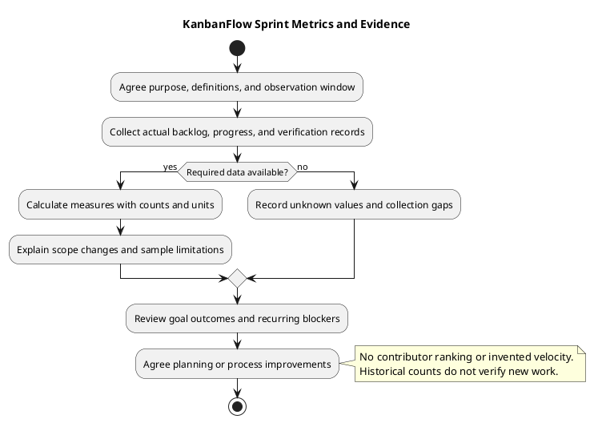

# KanbanFlow Sprint Metrics and Evidence

Use sprint metrics to understand goal outcomes, unfinished work, blockers, and verification gaps, then improve planning. No dated sprint history, velocity, or capacity baseline is established by the repository. Begin collecting measures only when their purpose, definitions, and source records are agreed.

Metrics summarize observations; they do not replace acceptance criteria or the [Definition of Done](definition-of-done.md). Use them to improve the process, not to rank individual contributors. Commit counts, hours of activity, and historical test totals do not establish sprint delivery or productivity.

## Define the measurement context

Record the actual sprint, observation window, collection date, source records, units, and exclusions before calculating a value. Identify which work was selected initially and which was added, removed, or split later.

Use the [sprint backlog](sprint-backlog.md), [daily progress](daily-progress.md), [sprint record](sprint-record-template.md), and verification records as evidence. Unknown values remain unknown; do not substitute zero for unavailable data.

## Recommended measures

| Measure | Definition | Source and interpretation |
| --- | --- | --- |
| Goal outcome | Whether agreed goal criteria are demonstrated, partly demonstrated, or unmet | Review evidence and explain unmet criteria; do not infer from task totals. |
| Completed items | Unique items meeting the agreed Definition of Done within the observation window | Identify item IDs and completion evidence; item sizes may differ. |
| Unfinished selected items | Items still selected at closure that do not meet Done | Record states, reasons, and next actions; not automatically scheduled into another sprint. |
| Scope changes | Recorded additions, removals, splits, and substitutions after initial selection | Explain impact on the goal and denominator. |
| Blockers | Recorded blocking conditions and affected items | Count distinct blocker records separately from affected items. |
| Blocked duration | Time within the observation window during which required progress was blocked | Requires actual timestamps and a declared time basis. |
| Verification gaps | Required checks or criteria not demonstrated | Link failed, blocked, or not-run evidence; avoid treating irrelevant checks as gaps. |
| Process actions | Agreed retrospective actions and their actual follow-up states | Track owned actions; count alone does not demonstrate improvement. |

Choose only measures that answer a useful question. Keep raw counts and source references alongside percentages so readers can assess small samples and changing scope.

## Counts, rates, and denominators

For a simple closure snapshot, define the final selected set after agreed scope changes. Count each item once. If `F` is its item count and `D` is the number of those items meeting Done at closure, an item completion rate is `D / F × 100`, provided `F > 0`.

This rate treats items as equal counting units, not equal effort or value. State that limitation. If the final selected set is empty, record the rate as not applicable rather than dividing by zero.

Report unfinished items as the final selected items not Done at closure. Removed items are reported under scope changes, not silently counted as completed. If reporting initial-scope completion separately, use the initial set and name that denominator explicitly. For split items, record the lineage and counting convention so splitting does not create apparent delivery without explaining the scope change.

Example calculation only: if a hypothetical final selected set has five items and three are Done, its item completion rate is 60%, with two unfinished items. This is not a KanbanFlow sprint result, estimate, or target.

## Time measures and blockers

If collecting time measures, agree their start/end events and time basis before use:

| Measure | Possible agreed definition | Limit |
| --- | --- | --- |
| Cycle time | Elapsed time from first In progress event to meeting Done | Define treatment of rework/reopening and include blocked time unless explicitly reporting another measure. |
| Lead time | Elapsed time from an agreed request/selection event to Done | Request and selection are different start events; choose and label one. |
| Blocked time | Union of blocked intervals for an item, clipped to the observation window | Overlapping blockers must not double-count item blocked time. |

Record timezone and whether values use calendar time or an agreed working-time calendar. If a blocker remains open, report elapsed blocked time through the observation cutoff and label it unresolved. If discovery or resolution timestamps are missing, duration is unknown.

Multiple items affected by one blocker can have separate item durations. Summing those durations gives item-time, not a single project delay. Likewise, summing overlapping blocker intervals overstates elapsed time unless overlap is handled explicitly.

Report the number of observations with any average or median. Completed-item cycle times exclude unfinished work; show unfinished item age separately if reliable start timestamps exist. Small or incomplete samples do not support confident forecasts.

## Velocity and capacity

Do not publish velocity without actual completed sprint records and a stable, agreed estimation scale. Story points, if adopted, are local planning units, not hours or a universal productivity measure.

Capacity depends on agreed availability and work context. Do not infer it from commits, tests, or the number of named contributors. Avoid comparing teams or people using different estimation scales or item sizes. No numerical velocity target or delivery forecast is established here.

## Verification evidence

Use the [verification template](../Releases/verification-template.md) to distinguish Pass, Fail, Blocked, Not run, and justified Not applicable. Record the checked revision and environment. Count gaps only against applicable required criteria, with their impact on acceptance.

A passing build does not prove usability, and SQLite regressions do not prove MySQL contention behavior. Historical release suite totals are historical evidence, not current sprint results. A high completion percentage does not override a failed essential goal criterion or unresolved authorization risk.

## Copyable measurement record

Replace these placeholders with actual observations. This is a reusable template, not a performed sprint measurement.

```text
Sprint identifier and goal:
Observation window and timezone:
Collection date and responsible person:
Source records and checked revisions:
Initial scope and final selected set:
Scope changes and counting conventions:
Chosen measures and definitions:
Raw counts, units, and denominators:
Calculated values, or unknown/not applicable with reason:
Missing data and sample limitations:
Goal outcome and verification gaps:
Interpretation:
Agreed improvement and follow-up:
```

| Measure | Definition/window | Value and unit | Source | Limitation | Planning implication |
| --- | --- | --- | --- | --- | --- |
| Actual measure | Agreed definition | Actual value or unknown | Actual record link | Explicit gap | Evidence-supported action or further observation |

Keep the source records accessible and exclude credentials or personal details that are unnecessary for the planning question. Do not manufacture individual performance assessments from aggregate data.

## Review and improvement

Discuss goal outcomes and unfinished work at the [sprint review](sprint-review.md). Use the [retrospective](sprint-retrospective.md) to investigate recurring blockers or verification gaps and agree specific actions with owners and follow-up.

Describe possible causes as hypotheses when the records do not establish causation. For example, a larger final scope and more carryover may justify reviewing selection practices, but do not prove that one contributor caused the result. Compare trends only when definitions, scope, and collection practices remain comparable.

Metrics do not authorize release publication or deployment. Use the [release checklist](../Releases/release-checklist.md) for an actual candidate's readiness decision.

## Maintenance and quality checks

- Definitions, dates, units, and source records are explicit.
- Counts distinguish initial scope, final selection, and scope changes.
- Missing data is unknown rather than zero.
- Durations use actual timestamps and declared overlap/calendar rules.
- Samples and unfinished work are visible when interpreting time measures.
- Evidence gaps and unmet goal criteria remain visible alongside delivery counts.
- Conclusions support process improvement without invented targets or contributor rankings.

Preserve historical records and label corrected calculations with their reason. If definitions change, explain the break in comparability rather than rewriting earlier measures silently. See the [sprint index](README.md), [management sprint workflow](../Project-Management/sprint-workflow.md), and [diagram guide](../diagram-guide.md).

## Measurement workflow diagram


[PlantUML source](diagrams/sprint-metrics.puml)


