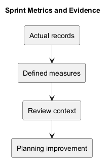
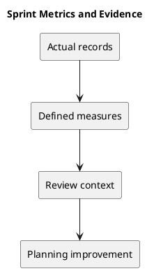

# Sprint Metrics and Evidence

No sprint velocity or capacity baseline is available in the repository. Begin collecting metrics only when the team agrees their purpose and definitions.

## Suggested measures

| Measure | Definition | Caution |
| --- | --- | --- |
| Goal outcome | Agreed goal demonstrated or unmet | More meaningful than raw task counts. |
| Completed items | Items satisfying the definition of done | Do not compare different-sized items blindly. |
| Carryover | Selected items unfinished at closure | Record reasons and dependencies. |
| Blockers | Cause and elapsed time using actual records | Avoid invented timestamps. |
| Verification gaps | Required checks not demonstrated | Keep limitations visible. |

Use metrics to improve planning, not to rank individual contributors. Record source evidence and collection dates.

## Related guidance

- [Sprint index](README.md)
- [Management sprint workflow](../Project-Management/sprint-workflow.md)

## PlantUML diagram

[Editable source](diagrams/sprint-metrics.puml)

