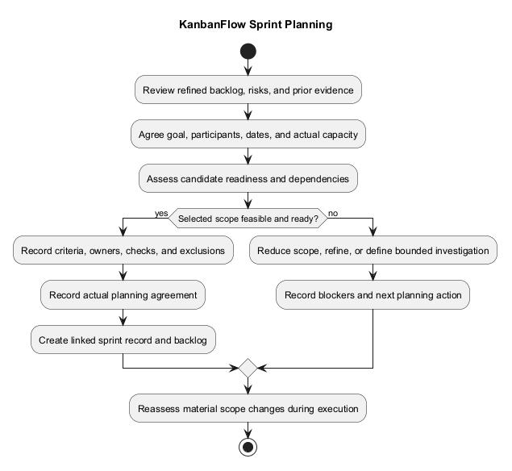
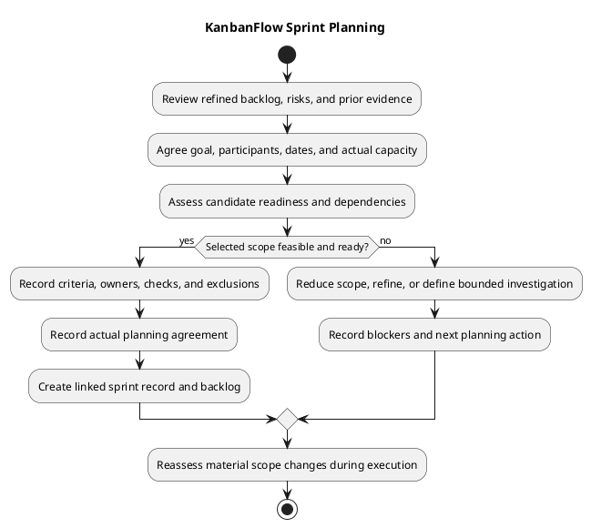

# KanbanFlow Sprint Planning

Sprint planning agrees a coherent goal and a feasible set of work for actual participants and dates. It connects refined needs to observable acceptance criteria, dependencies, ownership, and verification. A planning record describes agreed intentions; it does not demonstrate implementation or completion.

This guide does not impose a fixed sprint duration or assert a scheduled sprint, team size, velocity, or capacity baseline. Use the [sprint index](README.md) to create records only when a sprint is agreed.

## Inputs

| Input | What to review |
| --- | --- |
| [Product backlog](../Project-Management/product-backlog.md) | Candidate outcomes and current priorities |
| [Backlog refinement](../Project-Management/backlog-refinement.md) | Scope, acceptance criteria, and unresolved questions |
| [Roadmap](../Project-Management/roadmap.md) | Direction and dependencies, without assuming promised dates |
| [Decision register](../Project-Management/decision-register.md) | Relevant policy and compatibility decisions |
| [Quality and risk plan](../Project-Management/quality-and-risk-plan.md) | Required evidence and material risks |
| Actual availability | Agreed participants, other obligations, and environment access |
| Previous records, if available | Unfinished work, review feedback, and retrospective actions |

When no earlier sprint record exists, state that instead of inventing historical throughput or lessons. Historical milestones and release test counts provide context but do not establish sprint capacity.

## Agree the goal

Describe one coherent user or operational outcome. Make it specific enough for the [sprint review](sprint-review.md) to assess. Connect selected items to that outcome and identify what would remain incomplete if essential work is not delivered.

A goal should express the desired change rather than merely list activities. For example, a proposed goal might concern reliable recovery from a rejected task move, with explicit interaction and persistence criteria. This is an illustrative planning example, not a scheduled KanbanFlow sprint.

Avoid declaring a goal achieved from item counts alone. A completed supporting task cannot substitute for an unmet essential outcome.

## Participants, ownership, and capacity

Agree actual dates, participants, responsibility for scope decisions, and item ownership. A small project may assign several responsibilities to one person; do not invent formal roles or reviewers.

Assess actual availability, maintenance obligations, dependencies, and verification access before selecting scope. Use an agreed sizing approach only if it helps planning, and record assumptions. Do not convert commits or story points automatically into hours or infer availability from repository activity.

If capacity is uncertain, keep selection conservative and document that uncertainty. Ready work is still optional for selection; readiness does not establish a delivery commitment or date.

## Assess candidate readiness

Apply the [Definition of Ready](definition-of-ready.md). Each selected item needs:

- A user problem, intended outcome, bounded scope, and exclusions.
- Observable acceptance criteria, including relevant rejection/failure behavior.
- Assessed permission, data, and compatibility implications.
- Visible dependencies and agreed next actions.
- A feasible verification approach in an authorized environment.
- Actual agreed ownership, or an explicit ownership gap that prevents selection where necessary.

Clarify the manager membership policy before scheduling dependent enforcement implementation. DEC-003 and PB-001 track the unresolved remove/re-add role issue. A bounded investigation may be selected separately if its question, evidence output, and stopping point are clear; it does not automatically resolve policy or implement enforcement.

## Select and sequence work

1. Review candidates that support the agreed goal.
2. Identify essential items, supporting work, and explicit exclusions.
3. Check dependencies, including decisions and environment access.
4. Split oversized or mixed-outcome items through refinement.
5. Assess combined implementation and verification effort against actual capacity.
6. Record selected items, acceptance criteria, owners, and next actions in the [sprint backlog](sprint-backlog.md).

Do not fill unused capacity with unrelated work merely to increase item counts. If the essential scope is infeasible, reduce or revise the goal, resolve blockers, or leave planning pending. Record the actual agreement rather than assuming approval from elapsed time.

## Plan verification and completion

Agree how each acceptance criterion will be demonstrated. Use the [Definition of Done](definition-of-done.md) and [verification template](../Releases/verification-template.md) to identify expected checks and evidence, while keeping actual results pending until execution.

| Affected work | Planning question |
| --- | --- |
| Backend or permissions | Which roles, validation paths, and persisted outcomes need checking? |
| UI and interaction | Which browser, keyboard, responsive, and failure-feedback scenarios matter? |
| Ordering or locking | Which persistence and isolated database contention checks are needed? |
| Configuration or upgrade | Which environment assumptions and compatibility effects need verification? |
| Documentation | Which factual sources, relative links, and diagram assets need review? |

Build success does not demonstrate usability, and SQLite regressions do not demonstrate MySQL contention behavior. If required verification is unavailable, record the dependency and its effect on readiness rather than planning a false completion claim.

## Copyable planning record

Replace placeholders with actual agreements. This template is not an executed sprint or approval record.

```text
Sprint identifier:
Planning decision date:
Agreed sprint dates and participants:
Goal and observable goal criteria:
Baseline commit:
Capacity and sizing assumptions, if used:
Selected item references:
Essential work and dependency sequence:
Acceptance and completion criteria:
Verification environment and evidence plan:
Owners and scope-decision responsibility:
Exclusions and deferred candidates:
Risks, blockers, and unresolved decisions:
Actual planning agreement or pending decision:
Next action and review point:
```

For each selected item:

| Item | Contribution to goal | Readiness evidence | Owner | Dependency | Verification approach |
| --- | --- | --- | --- | --- | --- |
| Actual reference | Intended contribution | Assessment or pending | Agreed person | Condition or none identified | Planned checks, not claimed results |

Link the resulting [sprint record](sprint-record-template.md) and backlog. When copying templates into a sprint folder, repair relative links and diagram references for the new location.

## Planning outputs

The final record should establish the agreed goal, dates, participants, selected scope, dependencies, acceptance criteria, verification approach, and actual owners. Keep exclusions and unresolved questions visible. Mark planning pending when a required agreement is absent.

Create no completion claims, review attendance, test results, or user feedback during planning unless supported by actual prior evidence identified as such. Selected work remains planned work until observed progress is recorded.

## Adapt the plan visibly

Use [daily progress](daily-progress.md) for actual developments and blockers. Record material additions, removals, splits, and substitutions with their reason and impact on the goal and capacity. Obtain the relevant scope agreement and update the backlog; do not silently convert a new request into selected scope.

Reassess readiness when policy, dependencies, or criteria change. Unfinished work from an earlier sprint requires refinement and explicit selection; it is not automatically scheduled into this sprint.

## Review and delivery boundaries

At review, compare demonstrated outcomes with the goal and criteria. At the [retrospective](sprint-retrospective.md), identify process improvements with agreed owners and follow-up. Use [metrics](sprint-metrics.md) only when their definitions and observations are available.

Planning and sprint completion do not authorize release publication, deployment, or data operations. Link any separately agreed delivery decision and follow the [release checklist](../Releases/release-checklist.md). No production readiness or recovery guarantee follows from a sprint plan.

## Planning quality checklist

- Goal and essential outcome criteria are clear.
- Selected items are bounded and sufficiently ready.
- Capacity, ownership, and dates reflect actual agreements.
- Dependencies and unresolved policy remain visible.
- Verification is feasible and proportionate to risk.
- Exclusions and material scope decisions are recorded.
- Planned actions and historical evidence are distinguished.

Maintain this guide and its diagram together using the [diagram guide](../diagram-guide.md). See the [management sprint workflow](../Project-Management/sprint-workflow.md) for the wider planning and delivery process.

## Planning decision diagram



[PlantUML source](diagrams/sprint-planning.puml)


