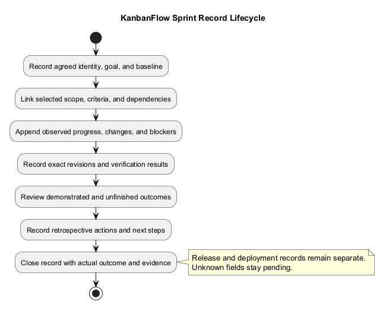
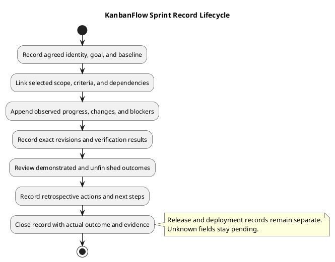

# KanbanFlow Sprint Record Template

Use this template as the summary record for an agreed sprint. It connects the goal, selected scope, observed execution, verification, and closure without duplicating every detailed backlog or progress entry.

This file is a reusable template, not an actual sprint or completion record. Placeholder values do not establish dates, ownership, review attendance, capacity, or outcomes. Create a dedicated record only after planning agreement, following the [sprint index](README.md).

## How to use the template

Copy the record below into the actual sprint folder, replace placeholders with agreed facts, and link its backlog, progress, review, and retrospective documents. Repair relative links after copying. Use full commit identifiers for source baselines and tested revisions.

Keep planned dates separate from actual dates, and planned checks separate from executed results. Leave unavailable values pending or unknown with a next action where useful. Record actual decision responsibility; do not invent sign-off or assign people without agreement.

## Copyable sprint record

The following Markdown can be copied and adapted. Tables contain placeholders, not completed work.

````markdown
# Sprint <agreed identifier>

## Identity and status

| Field | Value |
| --- | --- |
| Record status | Planning / Active / Closed, based on actual events |
| Planning decision date | Pending |
| Planned start/end dates | To be agreed |
| Actual start/end dates | Pending until observed |
| Timezone for time-sensitive records | To be recorded |
| Participants | Actual agreed participants |
| Record owner | Agreed person or unassigned |
| Scope-decision responsibility | Actual agreed person |
| Baseline commit | Full SHA |
| Closure candidate revision(s) | Pending |

## Goal and acceptance

Goal: <clear user or operational outcome>

| Goal criterion | Planned demonstration | Actual evidence | Outcome/gap |
| --- | --- | --- | --- |
| Observable criterion | Relevant check | Pending | Pending |

## Selected scope

Backlog record: <actual link>

| Item | Product reference | Contribution to goal | Criteria reference | Owner | Dependency |
| --- | --- | --- | --- | --- | --- |
| Actual ID | Actual link | Intended outcome | Actual criteria | Agreed person | Condition or none identified |

Exclusions and deferred candidates: <explicit boundaries>

Capacity/sizing assumptions, if used: <actual basis; otherwise not recorded>

## Dependencies, risks, and decisions

| Reference | Condition or risk | Impact | Agreed owner | Next action | State/evidence |
| --- | --- | --- | --- | --- | --- |
| Actual reference | Specific condition | Affected goal/item | Agreed person or unassigned | Concrete action | Actual state or pending |

Decision references: <links to actual decisions; unresolved questions remain explicit>

## Execution and scope changes

Progress record: <actual link>

| Observation date | Item/change | Observed result or reason | Effect on goal | Decision/evidence | Next action |
| --- | --- | --- | --- | --- | --- |
| Actual date | Actual reference | Actual observation | Explicit impact | Actual link or pending | Concrete action |

## Verification

Detailed verification record: <actual link>

| Criterion/check | Tested revision | Environment | Result state | Evidence | Remaining gap |
| --- | --- | --- | --- | --- | --- |
| Actual criterion | Full SHA; disclose relevant local differences | Actual environment | Pass / Fail / Blocked / Not run / justified Not applicable | Actual link or pending | Explicit limitation |

Review result and actual reviewer, where applicable: <actual record or pending>

Affected documentation: <updated files and review evidence>

## Review and goal outcome

Review record: <actual link>

Goal outcome: <demonstrated / partly demonstrated / unmet, with criterion evidence>

| Item | Final state | Demonstrated outcome | Unfinished work or defect | Next action |
| --- | --- | --- | --- | --- |
| Actual item | Actual backlog state | Evidence-backed result | Explicit gap or none identified | Agreed action |

Feedback: <actual observations; do not infer attendance or approval>

## Retrospective and follow-up

Retrospective record: <actual link>

| Action | Reason/evidence | Agreed owner | Follow-up point | State |
| --- | --- | --- | --- | --- |
| Concrete improvement | Actual observation | Agreed person or unassigned | Agreed date/event or pending | Actual state |

## Closure

Closure decision date and responsible person: <actual values>

Summary: <completed outcomes and remaining gaps>

Unfinished items: <refinement/next-action references; no automatic future scheduling>

Remaining risks and verification gaps: <explicit impact and tracking links>

Separately authorized release/deployment records: <actual links, or none recorded>

## Later corrections

| Correction date | Earlier claim | Corrected observation | Evidence | Effect/next action |
| --- | --- | --- | --- | --- |
| Actual date | Referenced statement | Actual correction | Actual link | Explicit effect |
````

## Execution and state rules

Use the [sprint backlog](sprint-backlog.md) item states and [daily progress](daily-progress.md) blocker records. Planning, Active, and Closed above describe the sprint record, not item completion. Closed can include an unmet goal and unfinished work; it does not mean every selected item is Done.

Preserve the selected baseline and record material scope additions, removals, splits, and substitutions with reasons and actual agreement. Link product references and decisions rather than silently changing requirements in the summary record.

The membership-policy issue tracked in DEC-003 and PB-001 remains relevant to dependent enforcement work. Link its actual state from the [decision register](../Project-Management/decision-register.md) and [product backlog](../Project-Management/product-backlog.md); a sprint record cannot resolve the policy by itself.

## Evidence and closure rules

Apply the [Definition of Done](definition-of-done.md). Required failed, blocked, or unexecuted criteria prevent claiming the affected item complete. Use the [verification template](../Releases/verification-template.md) for exact scenarios, revisions, environments, and limits.

Historical test totals are not fresh sprint evidence. Build success does not prove usability, and SQLite tests do not prove MySQL contention behavior. If a later source change invalidates evidence, reassess and rerun affected checks before relying on the earlier result.

At closure, reconcile the goal assessment, item states, review feedback, and unfinished work. Link follow-up actions without implying automatic scheduling into another sprint. Use the [metrics guide](sprint-metrics.md) only for measurements supported by actual records.

Sprint closure, merge, release publication, and deployment are separate events. Record actual links and authorization context when they occurred; do not infer production deployment or recovery readiness from a completed sprint. See the [release index](../Releases/README.md).

## Record quality and maintenance

- Planned and actual dates, checks, and outcomes are clearly distinguished.
- Scope and goal criteria link to the actual backlog and decisions.
- Evidence identifies revisions, environments, results, and gaps.
- Closure retains unfinished work and residual risks.
- Ownership, feedback, and decisions reflect actual agreements.
- Copied links and diagram references resolve from the new location.
- Later corrections preserve the earlier context and explain the change.
- Secrets and unnecessary personal data are excluded.

See [planning](sprint-planning.md), [review](sprint-review.md), [retrospective](sprint-retrospective.md), and the [management sprint workflow](../Project-Management/sprint-workflow.md). Maintain the diagram source and preview using the [diagram guide](../diagram-guide.md).

## Record lifecycle diagram



[PlantUML source](diagrams/sprint-record-template.puml)


