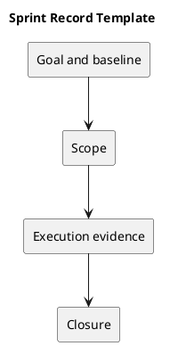

# Sprint Record Template

## Identity

- Sprint identifier: to be assigned.
- Dates and participants: to be agreed.
- Goal: a clear user or operational outcome.
- Baseline commit: record the full SHA.

## Scope

Link selected backlog items, dependencies, exclusions, and acceptance criteria. Identify known risks and any open policy decisions.

## Execution record

Record scope changes, blockers, decisions, and implementation references. Include the reason for changes and their effect on the goal.

## Closure

Record verified outcomes, unfinished items, review feedback, and retrospective actions. Link exact commits, checks, and any separately authorized release. This template is not evidence of an actual completed sprint.

## Related guidance

- [Sprint index](README.md)
- [Management sprint workflow](../Project-Management/sprint-workflow.md)

## PlantUML diagram

[Editable source](diagrams/sprint-record-template.puml)

