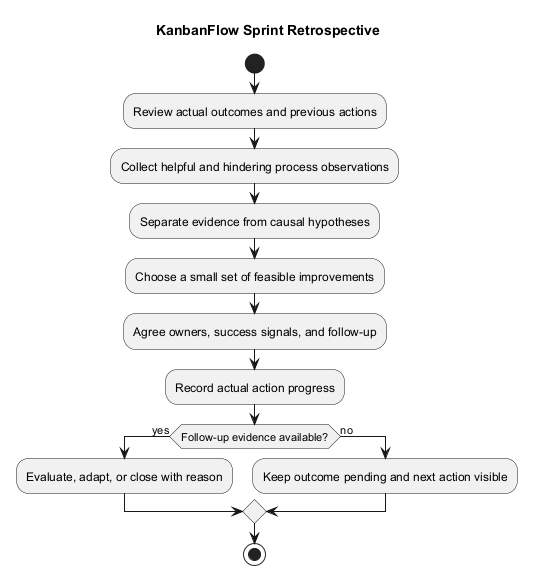
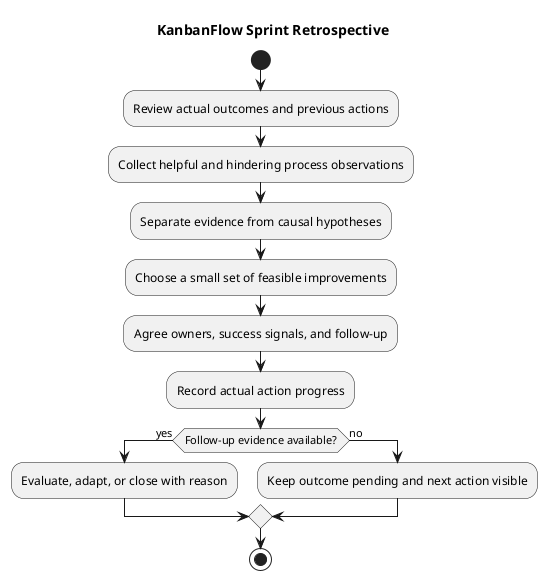

# KanbanFlow Sprint Retrospective Template

> **Policy amendment (2026-10-10):** Membership mutations are now owner-only; DEC-003/PB-001's bypass is fixed. Earlier open-policy text and diagrams below describe the preceding state. See [QA corrections](../SDLC/06-testing/qa-corrections-2026-10-10.md) for the selected rule and regression evidence.

Use a retrospective to examine how work was planned, coordinated, verified, and reviewed, then agree practical process improvements. Discuss what helped delivery, what hindered it, and what should change next. Separate process observations from unsupported assumptions about people.

This guide is a reusable template. It does not establish a meeting, attendance, satisfaction score, or completed improvement. A retrospective complements the [sprint review](sprint-review.md): the review assesses demonstrated product outcomes, while the retrospective examines the working process.

## Prepare from actual records

| Input | Useful questions |
| --- | --- |
| [Sprint record](sprint-record-template.md) | What was agreed, what changed, and what actually happened? |
| [Sprint backlog](sprint-backlog.md) | Which items finished, remained incomplete, or changed scope? |
| [Daily progress](daily-progress.md) | Which dependencies or blockers repeatedly prevented progress? |
| [Verification evidence](../Releases/verification-template.md) | Which checks failed, were unavailable, or exposed unclear criteria? |
| [Metrics](sprint-metrics.md), if available | What do defined observations support, and what remains unknown? |
| Previous improvement actions | What was attempted, what evidence exists, and what needs follow-up? |

Use actual dates, participants, and observations. If no previous action or reliable measurement exists, state that. Do not infer sprint history or causal explanations from repository commits alone.

## Discussion sequence

1. Confirm the period, purpose, and available evidence.
2. Review earlier actions and their actual progress before proposing new ones.
3. Identify practices that helped and specific events that hindered the goal.
4. Separate facts, interpretations, and unanswered questions.
5. Choose a small number of feasible improvements based on likely impact and available capacity.
6. Agree action owners, observable success signals, and a follow-up point.
7. Link material decisions and follow-up work to the appropriate records.

No mandatory meeting length, format, or cadence is imposed here. A small project can record an asynchronous or individual retrospective; identify the actual format rather than inventing a team ceremony.

## Prompts for useful observations

| Area | Discussion prompts |
| --- | --- |
| Planning | Were the goal, exclusions, and capacity assumptions clear? |
| Readiness | Which unresolved questions appeared only after implementation began? |
| Coordination | Were dependencies, ownership, and scope changes visible? |
| Verification | Were environments and checks available when needed? |
| Quality | Which defects or rework patterns suggest missing criteria or evidence? |
| Review | Was feedback understandable, timely, and linked to acceptance criteria? |
| Documentation | Did records help decisions, or create conflicting information? |
| Follow-up | Which previous improvements were actually tried and evaluated? |

For example, repeated verification delays could justify investigating environment preparation. That observation does not establish that a particular person caused the delay. Describe causal explanations as hypotheses unless evidence supports them.

The membership-policy dependency tracked in DEC-003 and PB-001 can be discussed as a planning or decision blocker. A retrospective does not itself decide the policy or close its enforcement work; link any actual decision through the [decision register](../Project-Management/decision-register.md).

## Copyable retrospective record

Replace the placeholders with actual observations and agreements. This is not a completed meeting record.

```text
Sprint identifier and record link:
Retrospective date and actual format:
Actual participants, if any:
Evidence reviewed and limitations:
Previous action progress:
What helped delivery:
What hindered delivery:
Supported observations:
Causal hypotheses or questions requiring investigation:
Selected improvements and rationale:
Agreed owners, success signals, and follow-up:
Decisions and backlog references:
Next review point:
```

Record observations before selecting actions:

| Observation | Evidence | Effect on goal/process | Interpretation or hypothesis | Next question |
| --- | --- | --- | --- | --- |
| Actual event or recurring pattern | Actual record link or unavailable | Observed effect | Clearly labeled explanation | Specific unanswered question or none identified |

## Action register

| Action ID | Observation/reference | Concrete improvement | Agreed owner | Success signal | Follow-up point | State | Outcome evidence |
| --- | --- | --- | --- | --- | --- | --- | --- |
| To be assigned | Actual observation | Bounded action | Agreed person or unassigned | Observable result | Agreed date/event or pending | Proposed | Pending |

Use Proposed, Agreed, In progress, Blocked, Completed, and Closed for improvement-action tracking. Completed means the action was performed; Closed means its outcome was assessed and the record explains the decision. An attempted improvement may be closed as ineffective or superseded without being described as successful.

An owner must agree to the responsibility. If ownership is missing, record it as unassigned and make agreeing ownership the next step. Blocked actions identify the condition, impact, and next action using the progress record.

## Choose feasible improvements

Prefer a small set of actions that can be evaluated. Specify what will change, where it applies, and how its effect will be observed. Avoid vague actions such as “communicate better” without a concrete practice or success signal.

An illustrative action might be to record the required verification environment before selecting an item and assess whether the next relevant item encounters the same setup blocker. This is an example, not an agreed KanbanFlow action or a promised improvement.

If an action requires implementation, add or link a bounded [product backlog](../Project-Management/product-backlog.md) item. If it changes a policy, record the actual decision and update the owning guidance. Retrospective selection alone does not authorize unrelated scope, release publication, deployment, or data operations.

## Follow up and evaluate

Revisit actions at the agreed planning or review point. Record whether the action was attempted, what changed, and whether its success signal was observed. Keep unavailable evidence pending rather than assuming success because time passed.

Compare observations only when definitions and context are sufficiently comparable. Small samples or changing scope limit conclusions. Do not invent satisfaction ratings, productivity measurements, velocity, or forecasts.

If the action did not help, record that outcome and decide whether to adapt, stop, or investigate further. Preserve the original action and explain the change. Carry forward only actions that are actually agreed for follow-up, with ownership and context intact.

## Privacy and record quality

Discuss working practices respectfully and keep unsupported personal judgments out of the record. Include only information necessary to understand the process issue; exclude credentials, private user data, and sensitive raw logs.

- Observations link to actual evidence or state its absence.
- Facts and causal hypotheses are distinguished.
- Helpful practices as well as problems are considered.
- Selected actions are concrete, feasible, and owned by agreement.
- Success signals and follow-up points are observable.
- Completion of an action is distinguished from demonstrated effectiveness.
- Unresolved decisions and blocked actions remain visible.

## Maintenance and related guidance

Preserve historical records and label later corrections with their reason and evidence. Link retrospective actions from the sprint record and future planning when actually selected.

See the [sprint index](README.md), [sprint planning](sprint-planning.md), [management sprint workflow](../Project-Management/sprint-workflow.md), and [quality and risk plan](../Project-Management/quality-and-risk-plan.md). Maintain the diagram source, embedded block, and preview using the [diagram guide](../diagram-guide.md).

## Retrospective workflow diagram



[PlantUML source](diagrams/sprint-retrospective.puml)


