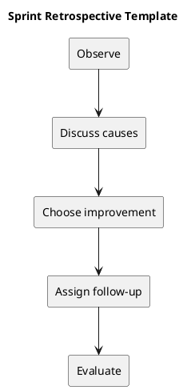

# Sprint Retrospective Template

Discuss what helped delivery, what hindered it, and what should change next. Separate process observations from unsupported assumptions about people.

## Action record

| Observation | Proposed improvement | Owner | Success signal | Follow-up |
| --- | --- | --- | --- | --- |
| Observed issue | Concrete action | Agreed owner | Observable result | Next review |

Prefer a small number of actionable improvements. Revisit them in the next planning or review cycle. Do not invent satisfaction scores or productivity measurements.

## Related guidance

- [Sprint index](README.md)
- [Management sprint workflow](../Project-Management/sprint-workflow.md)

## PlantUML diagram

[Editable source](diagrams/sprint-retrospective.puml)

