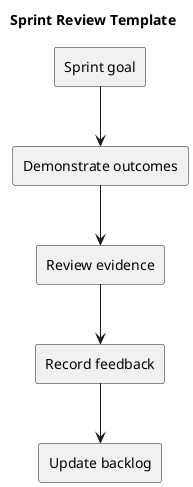

# Sprint Review Template

## Review agenda

1. Restate the agreed goal and selected items.
2. Demonstrate working behavior against acceptance criteria.
3. Present verification evidence and known limitations.
4. Record feedback, incomplete work, and follow-up backlog items.

## Outcome table

| Item | Demonstrated outcome | Commit or check | Result | Follow-up |
| --- | --- | --- | --- | --- |
| Actual item | Observed behavior | Evidence link | Verified or pending | Agreed action |

Do not mark defects closed based only on a demonstration that omits the relevant failing boundary. A review is not proof of deployment.

## Related guidance

- [Sprint index](README.md)
- [Management sprint workflow](../Project-Management/sprint-workflow.md)

## PlantUML diagram

[Editable source](diagrams/sprint-review.puml)

