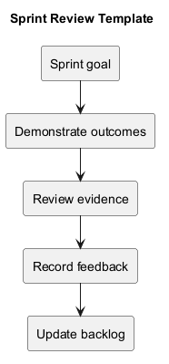
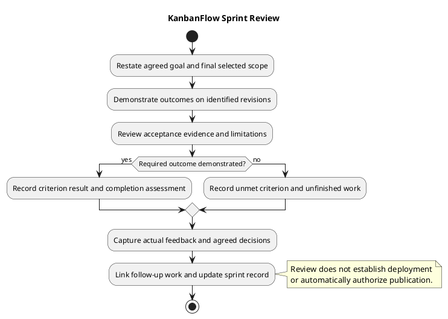

# KanbanFlow Sprint Review Template

> **Policy amendment (2026-10-10):** Membership mutations are now owner-only; DEC-003/PB-001's bypass is fixed. Earlier open-policy text and diagrams below describe the preceding state. See [QA corrections](../SDLC/06-testing/qa-corrections-2026-10-10.md) for the selected rule and regression evidence.

Use the sprint review to compare demonstrated outcomes with the agreed goal and acceptance criteria, discuss actual feedback, and identify next actions. Assess the final selected scope alongside material changes made during execution.

This is a reusable guide and template, not an actual review, sign-off, or deployment record. Do not infer attendance, customer feedback, acceptance, or completed work from commits alone. The [retrospective](sprint-retrospective.md) separately examines the working process.

## Prepare the review

| Input | What to establish |
| --- | --- |
| [Sprint record](sprint-record-template.md) | Goal, criteria, planned/actual context, and scope changes |
| [Sprint backlog](sprint-backlog.md) | Final selected items, current states, and unfinished work |
| [Daily progress](daily-progress.md) | Blockers, material observations, and linked decisions |
| [Verification record](../Releases/verification-template.md) | Exact revisions, environments, results, and limitations |
| [Definition of Done](definition-of-done.md) | Applicable completion requirements |
| Previous feedback | Actual follow-up references, if available |

Identify the revision and environment used for demonstrations. Record whether they differ from the tested candidate, and assess the effect on the evidence. Prepare isolated demonstration data where needed and keep credentials and private user details out of the review record.

Use actual review dates, participants, and format. An asynchronous or individual review is possible for a small project; describe what occurred rather than inventing a meeting or formal reviewer.

## Review agenda

1. Restate the agreed goal, essential criteria, final scope, and material scope changes.
2. Demonstrate relevant working behavior on the identified candidate.
3. Compare each outcome with its acceptance criteria and completion requirements.
4. Present automated and runtime evidence, failed checks, and unavailable verification.
5. Capture actual feedback, unresolved questions, and decisions.
6. Identify unfinished work and agreed follow-up actions.
7. Update the backlog and sprint record with the actual review outcome.

Focus demonstrations on the affected user behavior. A happy-path demonstration cannot close a defect whose failing boundary was omitted. Include relevant authorization, rejection, recovery, or persistence behavior when those are part of acceptance.

## Assess goal and item outcomes

| Assessment | Meaning |
| --- | --- |
| Demonstrated | Required goal criteria have supporting evidence within its stated scope. |
| Partly demonstrated | Some criteria are supported, while identified essential gaps remain. |
| Unmet | Required goal outcome is not established; record which criteria are absent or contradicted. |

Record criterion-level details so the overall assessment is understandable. Do not infer goal success from the percentage of tasks finished. An essential unresolved criterion can prevent the goal from being demonstrated even when supporting items are Done.

Item states follow the backlog and Definition of Done. Verified identifies demonstrated checks at a revision; Done also requires the agreed completion obligations. Required failed, blocked, or unexecuted checks prevent claiming the affected item complete.

## Evidence interpretation

Use Pass, Fail, Blocked, Not run, and justified Not applicable for individual checks. Record the actual observation and its limits using the verification record rather than treating every demo as comprehensive testing.

- Historical suite totals are not fresh sprint evidence.
- Build success does not demonstrate browser usability.
- SQLite tests do not demonstrate MySQL contention behavior.
- Passing scenarios support their checked revision and environment, not every workload or browser.
- Source changes after testing require reassessing affected evidence.

Choose checks through the [quality and risk plan](../Project-Management/quality-and-risk-plan.md). The membership-policy issue in DEC-003 and PB-001 remains tracked in the [decision register](../Project-Management/decision-register.md) and [product backlog](../Project-Management/product-backlog.md); review feedback alone does not resolve its policy or enforcement.

## Copyable review record

Replace placeholders with actual facts. This template is not completed acceptance or review evidence.

```text
Sprint identifier and record link:
Review date and actual format:
Actual participants and decision responsibility:
Agreed goal and essential criteria:
Final selected scope and material changes:
Demonstrated revision and environment:
Tested revision and differences from demonstration:
Goal assessment and supporting criterion evidence:
Item outcomes and unfinished work:
Verification gaps and remaining risks:
Actual feedback and unresolved questions:
Agreed decisions and follow-up references:
Separately authorized delivery record, if any:
```

### Outcome table

| Item/criterion | Demonstrated observation | Revision/environment | Check result and evidence | Item state | Remaining gap | Next action |
| --- | --- | --- | --- | --- | --- | --- |
| Actual reference | Observed behavior or not demonstrated | Exact candidate and context | Actual result or pending | Actual backlog state | Explicit limitation | Concrete agreed action |

### Feedback and decision table

| Observation date | Feedback or question | Source/context | Decision or pending question | Impact | Owner/next action |
| --- | --- | --- | --- | --- | --- |
| Actual date | Actual feedback | Actual source or unavailable | Actual agreement or pending | Affected scope/criterion | Agreed person and action, or unassigned |

Distinguish feedback from a decision. A suggestion is not automatically accepted scope, a policy change, or release authorization. Record actual agreement and link material decisions instead of silently changing criteria after a failed demonstration.

## Unfinished work and follow-up

Keep unfinished items in their actual states, with their remaining criteria, blockers, and next actions. Return them to [refinement](../Project-Management/backlog-refinement.md) or future selection without assuming automatic carryover or a delivery date.

New feedback that requires implementation should become a linked, bounded backlog candidate. Record its intended outcome and relevant dependencies; review discussion does not make it selected for a future sprint. Process observations can feed the retrospective rather than being confused with product requirements.

Do not mark a defect closed solely because another scenario passed. If later evidence invalidates a result, record a dated correction and reopen or create linked follow-up according to the scope.

## Release and deployment boundaries

Review, item completion, merge, version publication, and deployment are separate events. A successful review does not establish production deployment, recovery readiness, or a complete browser-support guarantee.

If a delivery decision is actually made, record its context and follow the [release checklist](../Releases/release-checklist.md), [release pipeline](../Project-Management/release-pipeline.md), and [upgrade and rollback guidance](../Releases/upgrade-and-rollback.md). Link actual release/deployment records; otherwise state that none is recorded.

## Review quality and maintenance

- Goal criteria and final selected scope are explicit.
- Demonstration and tested revisions are identified.
- Observations, evidence states, and limitations remain visible.
- Item completion follows agreed criteria rather than activity counts.
- Feedback and actual decisions are distinguished.
- Unfinished work has next actions without invented scheduling.
- Attendance, acceptance, and delivery claims reflect actual events.
- Sensitive data is excluded and copied links resolve.

Update the sprint record and backlog to reflect the review, preserving historical observations. Use [metrics](sprint-metrics.md) only when their definitions and sources support the interpretation. See the [sprint index](README.md) and [management sprint workflow](../Project-Management/sprint-workflow.md) for the wider process.

Maintain diagram source, embedded block, and preview together using the [diagram guide](../diagram-guide.md).

## Review decision diagram



[PlantUML source](diagrams/sprint-review.puml)


