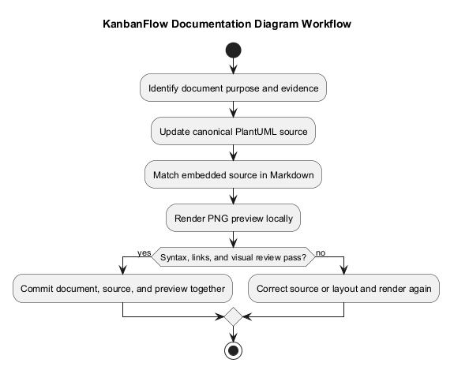
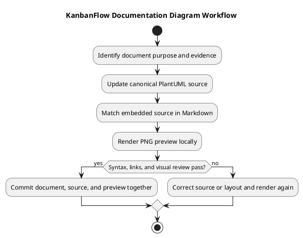

# KanbanFlow Diagram Guide

This guide defines how to author, render, and maintain diagrams alongside KanbanFlow documentation. Use PlantUML for the documentation categories already using `.puml` sources and committed PNG previews. GitHub displays the image preview; a fenced `plantuml` block provides readable source but does not itself provide a native GitHub diagram preview.

## Files and ownership

Keep each diagram close to the document it explains. The standalone `.puml` file is the canonical diagram source. If the document also includes a fenced PlantUML block, keep its contents identical to that source. Generate the PNG from the source and commit all three files together.

```text
docs/<category>/
  <document>.md
  diagrams/
    <document>.puml
    <document>.png
```

Most topic documents use the document basename for the diagram files. Existing SDLC guides use names such as `workflow.puml` and `lifecycle.puml`; preserve meaningful existing names and update all references when renaming. Milestone diagrams stay inside `Project-Management/Milestones/diagrams/`.

For a document in a category folder, use relative links:

```markdown

[PlantUML source](diagrams/example.puml)
```

Describe the diagram's main message in surrounding prose so the document remains useful without the image. Use descriptive alternative text. The document author maintains the explanation, source, and preview; the reviewer checks their agreement with the supporting evidence.

## Choose a diagram

| Diagram type | Use when | Check against |
| --- | --- | --- |
| Activity | Showing a workflow, decision, review gate, or recovery path | Actual process steps and decision conditions |
| Sequence | Showing browser, API, and database interactions | Request handlers, authorization, and transaction boundaries |
| Component or context | Showing responsibilities and external systems | Implemented services and explicitly stated boundaries |
| Entity relationship | Explaining data relationships | Database migrations, keys, and model relationships |
| State | Showing allowed lifecycle transitions | Validation rules and status handling |
| Use case | Explaining actors and authorized capabilities | Routes, policies, and membership rules |

Prefer one clear question per diagram. Split a diagram when it mixes product scope, detailed implementation, and release procedures. Mark proposed behavior and historical snapshots explicitly; a diagram is an explanation, not proof that a feature or verification step is complete.

## Content and style conventions

- Use KanbanFlow consistently, with workspace, project, board, column, and task terminology.
- Add a short title and distinguish actors from application components and stored data.
- Label arrows and decision branches when their meaning is not clear from context.
- Include relevant failure, rejection, or rollback paths when explaining behavior that can fail.
- Keep text readable at normal document width; avoid tiny labels and unnecessary crossing lines.
- Use neutral, high-contrast styling. Never rely on color alone to communicate status.
- Keep credentials, personal data, local machine details, and secret configuration values out of diagrams.
- Use self-contained sources where practical. Review includes and external resources before rendering; avoid undocumented remote dependencies.
- Separate a historical release's behavior from current behavior and future plans.

## Render locally

Use Java and a trusted PlantUML JAR obtained from the [official PlantUML download page](https://plantuml.com/download). Record the renderer version in verification evidence when reproducibility matters. Existing previews in this documentation series were generated with PlantUML 1.2026.8 using the Smetana layout engine.

Example PowerShell commands, run from the repository root after replacing the JAR path with your installed location:

```powershell
$plantumlJar = 'C:\tools\plantuml.jar'
java -jar $plantumlJar -version
java -jar $plantumlJar -Playout=smetana -tpng docs/diagrams/diagram-guide.puml
```

The PNG is written next to its `.puml` source. Smetana supports the diagrams used here without a separate Graphviz installation. If a chosen diagram needs a different layout engine, record that dependency and validate its output. Rendering success verifies syntax and generation, not the truth of the diagram's content.

Render only changed sources during a focused edit. A renderer upgrade may change image layout without changing meaning; review regenerated previews before including them in a commit. Do not regenerate unrelated images merely to make a small wording change.

## Review and verification

| Check | Expected evidence |
| --- | --- |
| Source validity | Renderer exits successfully and creates the expected image |
| Source consistency | Embedded PlantUML matches the standalone `.puml` file |
| Preview freshness | PNG was generated from the final reviewed source |
| Visual readability | Inspect the PNG for clipped text, unreadable labels, or ambiguous paths |
| Relative links | Image and source links resolve from the containing Markdown file |
| Technical accuracy | Behavior matches the referenced code, configuration, or documented decision |
| Scope accuracy | Proposed, historical, and implemented behavior are clearly distinguished |
| Change hygiene | Review the diff and commit only the intended document assets |

Open the resulting image before committing. After pushing, check the document on GitHub for its preview and source links. Record unavailable checks honestly; a successful local render does not demonstrate a live GitHub preview or application behavior.

## Troubleshooting

| Symptom | Action |
| --- | --- |
| Source appears as plain code on GitHub | Add the committed PNG preview with a relative image link |
| Preview is missing | Check path spelling, filename case, committed image, and branch |
| Image shows old wording | Render the final source again and stage the regenerated PNG |
| Renderer reports syntax errors | Fix the reported source location, then render again |
| Layout requires Graphviz | Try the documented Smetana command or record and install the required engine |
| Diagram is too wide | Shorten labels or split it into focused diagrams |
| Embedded block differs from source | Reconcile with the canonical `.puml` and regenerate the preview |

## Mermaid and migration

Mermaid can be used for small diagrams where native GitHub rendering is useful, but keep the PlantUML assets required by the existing documentation structure. Avoid maintaining two independent diagrams of the same behavior. When changing a diagram format, update the document, remove only superseded assets after checking references, and explain the change in the commit.

## Related documentation

- [Documentation index](README.md)
- [Documentation traceability](Project-Management/documentation-traceability.md)
- [Release verification template](Releases/verification-template.md)
- [Release checklist](Releases/release-checklist.md)

## Diagram maintenance workflow



[PlantUML source](diagrams/diagram-guide.puml)


