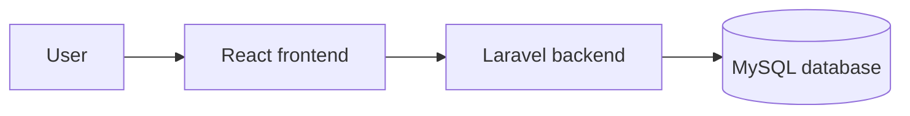

# KanbanFlow Diagram Guide

Use Mermaid diagrams in Markdown so diagrams can be reviewed and rendered on GitHub alongside the documentation.

## Choose a diagram

- Flowchart: user journeys, workflows, and decisions.
- Sequence diagram: interactions between the browser, backend, and database.
- Entity relationship diagram: data relationships, checked against the database migrations.
- State diagram: lifecycle states and allowed transitions.

## Example: application structure

## Conventions

- Give each diagram a short title and explain its purpose in the surrounding text.
- Use consistent KanbanFlow terminology: workspace, project, board, column, and task.
- Keep diagrams focused; split large diagrams by feature or workflow.
- Verify behavior against the implementation before documenting it.
- Never include passwords, tokens, or personal account details.
- Store each diagram with its relevant document in the appropriate documentation folder.
